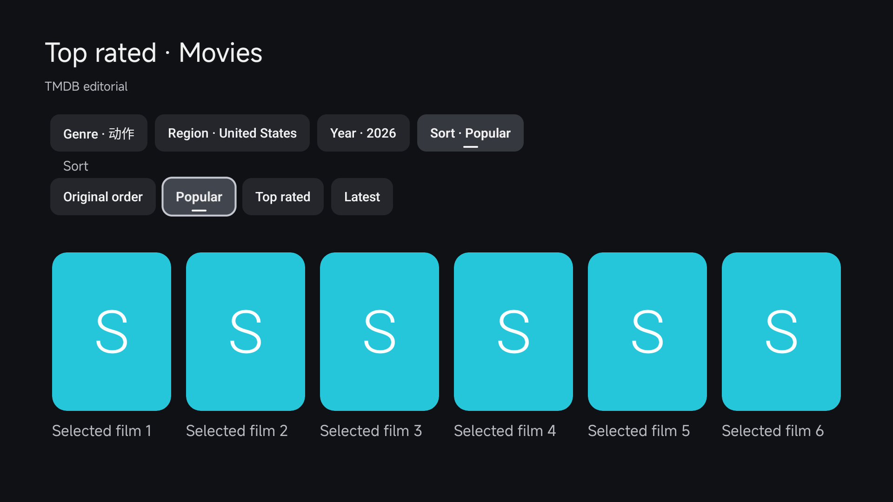
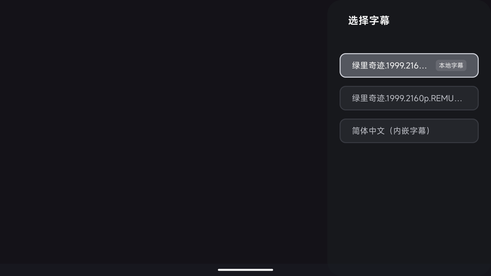
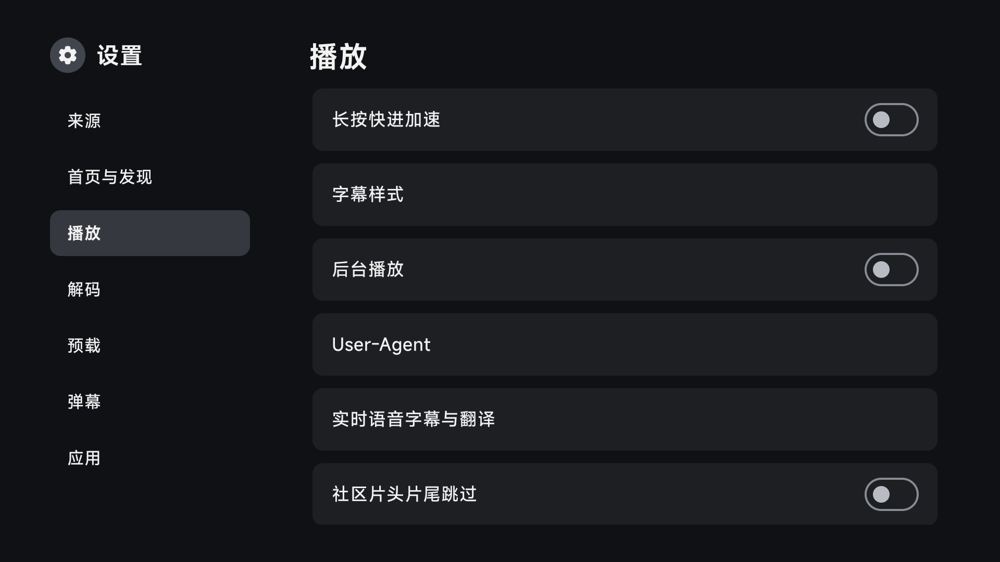
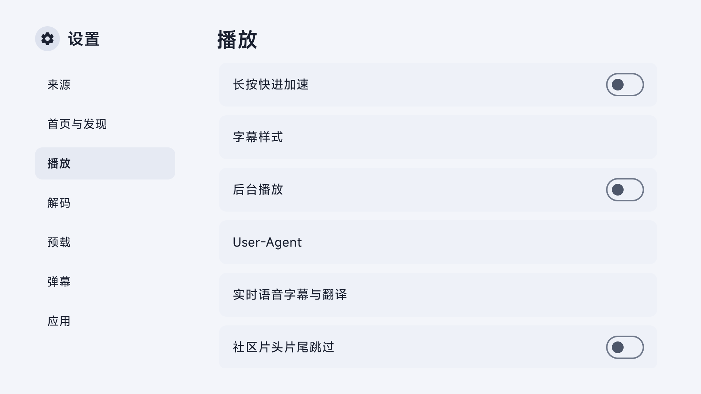

# TV · JetStream

**A media experience designed for the big screen and your remote.**

TV brings an Apple TV–inspired JetStream interface to Android TV, with a separate mobile interface for Android phones and tablets. Browse configured libraries, resume a series, discover titles, watch live channels, and manage playback and subtitles in one app.

[](https://customer-nkorbwmhxz04cbfd.cloudflarestream.com/b941aa27d5013806eb8fcab30cce4807/iframe)

[Download APKs](https://github.com/wobuhui666/TV/releases) · [Getting started](#getting-started) · [Playback core](docs/player-core-sync.md) · [Report an issue](https://github.com/wobuhui666/TV/issues) · [简体中文](README.md)

[Watch online](https://customer-nkorbwmhxz04cbfd.cloudflarestream.com/b941aa27d5013806eb8fcab30cce4807/iframe) · [download the MP4](https://customer-nkorbwmhxz04cbfd.cloudflarestream.com/b941aa27d5013806eb8fcab30cce4807/downloads/default.mp4) · 60 seconds · 1080p · H.264/AAC

The tour uses emulator recordings and a demonstration library. The displayed titles and sources are examples, not a supplied content service. See [media credits](docs/media/CREDITS.md) for footage, images, music, and fonts.

## At a glance

| Area | Current capabilities |
| --- | --- |
| TV interface | Remote and touch navigation, remembered focus, smooth transitions, large artwork, dark/light/system appearance, theme colors, and content-based backgrounds. |
| Home and discovery | Featured artwork, continued viewing, favorites, optional poster-wall home and personal shelf, TMDB/Douban recommendations, and configurable hero rotation. |
| Poster walls and filters | Source category and folder filters; media type, genre, year, region, and sorting where the page supplies them; consistent poster metadata and filter-panel state. |
| Search and source selection | Cross-source search, relevance levels, grouped results, optional Smart source selection, per-configuration preferred sources, and episode-aware fallback. |
| Playback | ExoPlayer/Media3 and MPV; hardware/software options, playback speed, seek acceleration, repeat, aspect ratio, track selection, chapters, and editions when provided. |
| Playback information | A TV specification capsule showing available input resolution, video/audio codec, dynamic range, bit depth, channel information, and explicit content ratings. |
| Subtitles | Native ASS styles and animation, independent primary/secondary subtitles, timing/style/font controls, subtitle search/import, local subtitle discovery, and VTT upload. |
| Live speech subtitles | Optional local speech recognition on the Exo PCM path; downloadable language packs and optional default, MTranServer, or OpenAI-compatible translation. |
| Intro and credit skipping | TheIntroDB, IntroDB, and TheOtherDB time ranges; preserve scenes before the intro and after the credits, with manual settings taking priority. |
| Next episode | Exo prepares eligible next episodes with up to 10 seconds of preloaded media; prepared same-episode cache can survive seeking. |
| Audio | Dialogue, night, music, and custom profiles; five EQ bands, center gain, loudness normalization, and limiting. |
| Danmaku | Configured or imported comments, search and automatic loading options, visibility, timing, density, speed, size, and appearance controls. |
| Live TV | Channel groups, favorites, XMLTV EPG, multiple lines, protected groups, catchup URLs, and provider-backed timeshift controls. |
| Local network | TV DLNA reception, mobile DLNA control, media push, local files, HTTP/STRM media pointers, and local playback/subtitle/danmaku APIs. |
| Additional media routes | Configured magnet/torrent/ed2k, YouTube, and selected TVBus, Force, or Jianpian extractor paths; these depend on the associated runtime libraries and source services. |
| Watch together | [Official Syncplay server compatibility](docs/syncplay.md), with play/pause/position synchronization and optional TLS. |
| Multi-device sync | [WebDAV favorites and viewing-progress sync](docs/webdav-sync.md), record-level merging, deletion propagation, and optional extra sync scopes. |
| Extensions and networking | Java JAR, QuickJS, and Python sources; compatible old/new APIs, source login forms, raw binary HTTP bodies, proxy rules, DoH, and ECH on supported shared-client paths. |
| Maintenance and updates | Cache categories, protected cleanup, diagnostic export, source health, cloud-share link checks, local backup/restore, and verified in-app OTA updates. |
| Mobile controls | A dedicated touch interface with gesture seeking, temporary speed, orientation/lock controls, a sleep timer, and picture-in-picture on supported Android devices. |

This list describes the current source branch, [`ui/apple-tv-redesign`](https://github.com/wobuhui666/TV/tree/ui/apple-tv-redesign). Source services, metadata, codecs, device capabilities, and the chosen playback engine determine which controls are available. See the feature sections below for the relevant requirements.

The development defaults match FongMi **5.8.5** (`versionCode=585`); production OTA builds append a UTC timestamp to `5.8.5` and use a shared timestamp-based version code for both ARM builds. The [release built from PR #92](https://github.com/wobuhui666/TV/releases/tag/build-41321238755-1) includes the recent features below. Check the release notes and source revision of any earlier APK you install.

## A closer look

<details>
<summary>Open the interface overview</summary>


Frames from the earlier 90-second cut of the tour, showing the interface as recorded. Interface details may differ slightly from the current app.

</details>

The home screen puts featured artwork and continued viewing within reach. Library and discovery pages lead into search results, title details, and episode selection. Playback controls and settings use the same remote-friendly interaction patterns.

Live TV brings channel groups and channel selection together. The personal page provides entry points for favorites, history, media push, casting reception, local files, and settings.

<details>
<summary>Open the recent poster-wall, subtitle, and playback-settings captures</summary>

| Poster-wall filters | Local subtitle labels |
| --- | --- |
|  |  |

| Dark playback settings | Light playback settings |
| --- | --- |
|  |  |

These are Android emulator captures of controlled interface fixtures. The retained [polish](docs/testing/reports/2026-11-01-tv-polish/README.md) and [community-skip](docs/testing/reports/2026-11-01-community-skip/README.md) reports describe the tested revisions and scope.

</details>

## Getting started

### 1. Choose an APK

Open this repository's [Releases](https://github.com/wobuhui666/TV/releases) and read the release notes before downloading.

| Choice | Intended device |
| --- | --- |
| `leanback` / TV | Android TV, a TV box, or another device operated with a remote. |
| `mobile` | The phone/tablet source flavor; it can be built locally. The current release workflow publishes TV APKs. |
| `arm64-v8a` | A device with a 64-bit ARM Android environment. |
| `armeabi-v7a` | A device that requires a 32-bit ARM APK. |

Android 7.0 / API 24 is the minimum supported version. Match the APK to your device's Android ABI; a 64-bit processor alone does not guarantee a 64-bit Android environment.

Every release ships two package names. Pick one depending on whether you want it installed alongside FongMi/TV:

| Edition | Files | Package | Notes |
| --- | --- | --- | --- |
| Standard | `leanback-arm64_v8a.apk`, `leanback-armeabi_v7a.apk` | `com.fongmi.android.tv` | Same package as FongMi/TV; upgrades earlier builds of this project in place. |
| Coexist | `leanback-arm64_v8a-coexist.apk`, `leanback-armeabi_v7a-coexist.apk` | `com.wobuhui666.android.tv` | Installs side by side with FongMi/TV or the standard edition; the launcher name stays the same. |

About the coexist edition:

- It is a separate app: configurations, favorites, history, and settings are not shared with the standard edition or FongMi/TV. Add your configuration again under **Settings → Sources**, or move favorites and progress with [WebDAV sync](docs/webdav-sync.md).
- In-app updates work: the coexist edition reads its own `leanback-coexist.json` and only downloads `-coexist` APKs.
- The standard and coexist editions cannot upgrade into each other.
- To build it locally, append `-PtvApplicationId=com.wobuhui666.android.tv` to the Gradle command.

### 2. Install and add your configuration

Install the selected APK on your device, then open **Settings → Sources** to add your own configuration URL or local file.

A configuration can define VOD sites, parsers, live channels, subtitles, danmaku, and network behavior. The app does not bundle a ready-to-watch media library or live TV subscription.

Start with [the configuration reference](docs/CONFIG.md). For live channels, see [supported live-source formats](docs/LIVE.md).

### 3. Open the controls you need

Choose a theme, open a source, and browse or search for a title. The TV settings are grouped by purpose; the mobile settings expose the corresponding player and source options in their own interface.

| Entry point | What it controls |
| --- | --- |
| TV Settings → Home and discovery | Home layout, Douban bridge URL/key, personal shelf, history-card actions, hero rotation, search relevance, and poster source selection/priority. |
| Settings → Playback | Engine, speed, scale, temporary seek acceleration, background playback, live speech subtitles, and community intro/credit skipping. |
| Player → Subtitle tracks → Advanced subtitles | Secondary subtitles, ASS styles, offsets, and font import. |
| Player → Audio tracks → Audio effects | Dialogue emphasis, EQ, loudness normalization, and limiting. |
| Settings → Preload | Current-stream cache and eligible Exo next-episode preloading. |
| Player → Options; My → Settings → App | Watch together on/off; separate Syncplay settings select the server and room. |
| My → Settings → Multi-device sync | WebDAV account, sync scope, manual sync, and optional automatic sync. |
| Settings → Cache management / Diagnostics and tools | Cache usage, diagnostic capture/export, source health, and cloud-share link checks. |
| My → Local files / Media push / Casting reception | Open local media, send a media URL from another device, or receive compatible DLNA playback requests. |

## Home, discovery, and source selection

The TV home, library, recommendations, title details, and settings share JetStream focus and touch behavior. Appearance can be dark, light, or follow Android's system setting. Theme presets, wallpaper-based accent colors, artwork backgrounds, title logos, and consistent poster year/episode rows keep those pages visually aligned.

The default compact TV home combines recommendations and continued viewing, with a **Filter titles** shortcut for browsing by type, region, year, and rating. Library stays separate for source categories, folders, filters, and login/cookie actions. Source previews show up to 20 titles while source actions remain independently accessible, including actions without poster artwork. Under **Settings → Home and discovery → Home layout**, you can switch to the legacy source home or legacy poster home without resetting sources, favorites, history, or other browsing settings. A continued-viewing card can expose a long-press/menu action for resuming, finding another source, or deleting just that record. Hero rotation can keep the original automatic timing, pause while focused, or switch only with left/right input.

Recommendation walls load TMDB and Douban data independently. Poster-wall filters expose the fields supported by that wall, while VOD category and folder pages use their source's filters. Filters and episode selection remain attached to the correct page or source when the view is recreated or the source changes.

Search can use original relevance, filter unrelated results, or require a strict normalized title match. Those settings are separate from source-selection modes: **Legacy**, **Group results only**, and optional **Smart** selection. Smart selection uses title/episode matching and source reliability when trying another line or, if enabled, another site; it does not treat list position as an episode number.

Poster-detail source selection is another optional entry point. It can use metadata aliases, years, seasons, and media types to rank candidates, and a per-configuration priority list can put your usual sources first. Results arrive progressively and retain the focused card. A match is a candidate for you to choose, not proof that the source is playable. See [the browsing guide](docs/native-discovery.md) for each setting, its default, and how to restore the original browsing experience.

### Douban cloud bridge

The Douban cloud bridge is an optional third-party recommendation service. It supplies title lists, artwork, and metadata for the TV home's popular Douban movie and series sections and their **View all** pages. Playback still uses your configured sources.

Configure it under **TV Settings → Home and discovery**:

| Option | What to enter |
| --- | --- |
| Douban bridge URL | Leave empty to use `https://douban-bridge.baran.wang`, or enter the root URL of another compatible service. Do not append API paths such as `/v1/catalog`. |
| Douban bridge key (sk_) | Obtain a key from the operator of your chosen bridge service. This is separate from your TMDB API key and source cookies/login credentials; they cannot replace one another. |

Save the settings and return home to browse recommendations. Without a key, the app skips the bridge and uses the public rexnow Douban feed. Authentication or request failures also trigger that fallback. The compact home and its **View all** pages additionally try the independent Douban API if the public feed fails or returns no titles. Douban and TMDB sections load independently, so bridge failures do not block TMDB recommendations.

The URL and key are stored in local app settings. Use a trusted bridge address, as the key is sent to that service with requests. Full app backups also include these settings, so do not publish backups containing your key. Changing **Home layout** preserves these settings; **Restore original browsing experience** clears the bridge URL and key.

## Playback and audio

Exo / Media3 and MPV use the same browsing and episode controls while retaining their own rendering and audio paths.

- **Common controls:** play/pause, forward/backward seeking, adjustable speed and aspect ratio, previous/next episode, repeat, manual intro/ending offsets, and audio/video/subtitle selection. Chapter and edition controls appear when the media provides them.
- **Input continuity:** remote key ownership and cancellation prevent a released key or queued seek from jumping newly selected media. Temporary long-press speed restores the speed that was active before the gesture; ordinary per-title speed can still be remembered.
- **Recovery:** switching engines, decode modes, or audio pipelines preserves relevant position, speed, pitch, and pause state. The available fallback still depends on the media and device.
- **Exo next-episode preparation:** eligible resolved HTTP(S) VOD can preload up to 10 seconds using a bounded media-cache budget. It yields to active buffering/seeking, owns the next item's headers, and can retain prepared same-episode cache across seeks. DRM, unresolved parser-dependent media, and non-HTTP sources are excluded.
- **MPV options:** native current-stream cache, custom MPV configuration, native subtitle controls, and exposed gpu-next/Vulkan, Anime4K, HDR, and Dolby options where the device and native path support them. An option or metadata label does not establish hardware HDR output.
- **Audio profiles:** off, dialogue, night, music, and custom modes, with five EQ bands, multichannel center gain, normalization, and a limiter. Audio effects process PCM and may require leaving encoded passthrough.

On TV VOD and live playback, the [specification capsule](docs/playback-specs-capsule.md) briefly presents facts from the selected input streams. It omits unknown information, uses the actual raster size, and shows content classification only when the source supplies an explicit rating. Its entry/exit animation respects the system animation setting and does not replay on every pause or seek.

The [playback core notes](docs/player-core-sync.md) describe engine, container, subtitle, audio, and preload boundaries; the [MPV HLS seeking notes](docs/mpv-hls-seeking.md) cover the specific repaired seek path.

## Subtitles, speech recognition, and danmaku

### Text, styled, bitmap, and local subtitles

Exo uses real libass for original ASS styles/animation, external ASS, and embedded Matroska fonts. Primary and secondary text streams are independent; disabling the primary can leave the secondary enabled. MPV retains its native subtitle rendering and secondary-track controls. Font import uses Android's document picker, and advanced controls cover style, position, size, and offsets.

The documented playback paths cover SRT, ASS/SSA, WebVTT, TTML, SUP/PGS, embedded VobSub, and DVB. Bitmap/container coverage is described in the playback notes rather than assumed for every format combination.

You can search for or import subtitles, upload VTT through the local interface, and discover matching subtitles beside local video files when the document/storage permissions allow sibling access. Local discovery accepts SRT, SSA, ASS, and VTT files. Local tracks carry a **Local subtitle** label and long filenames are shortened consistently. A selected-file permission alone may not permit scanning the surrounding directory.

### Live speech subtitles and optional translation

**Live speech subtitles & translation** is an optional feature, disabled by default. Local sherpa-onnx speech recognition consumes the Exo PCM audio path; it is not an MPV speech-recognition feature. Download the language pack before enabling it, and use a device that meets the pack's memory requirement.

The current choices are Mandarin, Cantonese, English, Japanese, German, French, and Spanish. Recognition can display the original text alone, or use the default translator, a configured MTranServer, or an OpenAI-compatible service for bilingual or translated-only subtitles. Remote translation has its own service URL, model, and credential requirements. The TV settings can receive the translation credential from a phone on the local network. Local recognition with translation off does not need a remote API key.

### Community intro and credit ranges

**Community intro/credit skipping** is enabled by default in TV and mobile player settings. It queries TheIntroDB, IntroDB, and TheOtherDB on a separate worker and uses absolute start/end positions rather than assuming the intro begins at zero. An intro at 80–170 seconds keeps the first 80 seconds; a credit range ending before the final scene leaves that scene playable.

Manual intro/ending choices, including an explicit manual reset, take priority per category. Each community range is skipped once per playback session so rewinding can replay it. Pause, scrubbing, source/episode changes, cancelled sessions, and stale results are guarded; community ranges are not copied into the user's length-based history fields.

Ordinary sources need reliable title/year/season/episode metadata and the build's existing TMDB configuration. Ambiguous or unsupported identities, no coverage, and service failures leave normal playback available. IntroDB has no release-duration field, so matching every edited release cannot be guaranteed. The retired AISkip audio-probe/Worker implementation is [archived](docs/archive/aiskip-20261101/README.md) and is no longer part of the app. See [the service and behavior guide](docs/community-skip.md).

### Danmaku

When the source or a configured API supplies danmaku, the player can search, import, load automatically, show/hide, and adjust the comments. Controls include timing, density, duration/speed, display area, font size, transparency, and styles. Availability depends on the selected source/API; danmaku is separate from subtitle tracks and speech-recognition overlays.

## Live TV and local-network playback

Live TV supports configured M3U, TXT, and JSON sources, channel groups, protected groups, favorites, multiple playback lines, channel logos, and XMLTV programme guides. Channel/EPG navigation is available in the TV interface; the mobile flavor has its own touch controls.

Catchup and timeshift depend on the provider's retained window and replay URL/metadata. Supported sources can expose seeking within that window and a return-to-live action, preserving the current playback/pause state when replay resolution fails. This is provider-backed replay, not universal local recording. [LIVE.md](docs/LIVE.md) documents the source formats and catchup fields; [CONFIG.md](docs/CONFIG.md) covers the app configuration.

The TV app can act as a DLNA renderer for compatible senders, with discovery, playback/status reporting, play/pause/stop, seeking, and media replacement. The mobile app can control compatible DLNA devices. Casting sessions and local playback ownership are kept separate so stale casting commands do not resume the wrong media. Sender, receiver, network, codec, and transport capabilities still determine interoperability.

Local files and media push share the existing playback flow. Local and HTTP STRM pointers can resolve a media URL, including the bounded no-filename-header HTTP path; failed or non-pointer responses keep the original source fallback. The local-network service also accepts media, subtitle, and danmaku input and exposes documented playback commands. See [LOCAL.md](docs/LOCAL.md).

The mobile player additionally offers gesture seeking and temporary speed, rotation/orientation locking, and Android picture-in-picture where the OS permits it.

## Watch together, backup, and sync

[Syncplay](docs/syncplay.md) connects to compatible official servers and rooms, optionally over TLS. Each participant opens the matching video on their own device; play, pause, and position are synchronized. The room is not a video-stream relay.

[WebDAV sync](docs/webdav-sync.md) merges favorites and viewing progress per record, propagates deletions, and protects concurrent edits. Subscriptions and selected danmaku preferences are optional scopes. Manual sync and optional scheduled/background sync are available; configure your own WebDAV account before use.

Local backup and restore remain available in App settings. The standard and coexist packages keep independent data, so use an appropriate backup/sync path when moving between installations.

## Diagnostics and maintenance

- **Cache management:** inspect image, playback, update-APK, and other cache categories; clear eligible items while active playback/writes/downloads/installations retain their protection. Configuration, favorites/history, fonts, and imported persistent data are not treated as disposable playback cache.
- **Diagnostics:** opt in to bounded logs, mark a recent problem, and share a diagnostic archive or download it by QR on the local network. Diagnostic capture starts disabled after an app restart; the download authorization is short-lived and revoked when capture stops. Common credentials are redacted in the unified archive. The separate legacy log exports have their own behavior.
- **Source health:** view recent search/detail outcomes and latency for the active configuration, clear them, or optionally use health in search scheduling. Cancellation, offline state, missing results, and source failures are distinguished.
- **Cloud-share checks:** inspect supported 115, Quark, and Aliyun share-link metadata, including extraction-code handling, without logging in, downloading the files, or blocking normal source playback. Rate limits and changing provider interfaces can make a result inconclusive.
- **Application updates:** manual OTA checks, optional important-version notices, mirror fallback, package/ABI/version/signing-certificate validation, and complete-file size/SHA-256 checks before installation. A bad validated download does not trigger redundant re-download loops.

See [the maintenance guide](docs/practical-improvements.md) and [OTA behavior](docs/ota-updates.md) for the controls and exact scope.

## Configuration and integrations

Bring your own sources and choose the extensions you need. Java JAR, QuickJS JavaScript, and Python integrations retain compatible legacy entry points while exposing newer network/storage/proxy helpers. Supported source-defined dialogs can request text/passwords, selection, or multiple selection, and return the user's choices to the requesting source. Waiting for user input and source cancellation are scoped to that request; background tasks cannot open surprise login forms.

Sources can also request supported image or QR-code prompts. Long forms retain remote scrolling and gentle overflow hints; their available fields and login flow come from the requesting source.

The shared source network interface supports explicit raw-byte HTTP bodies as well as text/JSON/form requests. Proxy rules, proxy authentication across redirects, custom headers, hosts, DoH, ECH, and configured Cloudflare/TMDB routing are available on their supported paths.

ECH is enabled by default for the integrated shared-client path, including conditional Cloudflare shared configuration when the documented DNS checks allow it. It does not cover every third-party source's independent network stack, WebView, or native MPV, and it is not a mandatory-ECH privacy mode. See [ECH behavior and evidence](docs/ech-validation.md).

| Guide | Use it for |
| --- | --- |
| [Documentation index](docs/README.md) | Current guides, implementation notes, reports, and historical archives. |
| [Configuration](docs/CONFIG.md) | VOD sites, parsers, live sources, network rules, subtitles, and danmaku settings. |
| [Browsing and source selection](docs/native-discovery.md) | Optional home features, relevance levels, poster source matching, source priority, and TMDB routing. |
| [Playback core](docs/player-core-sync.md) | Engine-specific subtitles, audio profiles, preloading, and native validation. |
| [Specification capsule](docs/playback-specs-capsule.md) | TV playback metadata and its display rules. |
| [Community skipping](docs/community-skip.md) | Provider interfaces, identity/release matching, manual priority, and AISkip retirement. |
| [Spider API](docs/SPIDER.md) · [Compatibility](docs/spider-api-compatibility.md) | Java, QuickJS, Python, source dialogs, storage, and binary request behavior. |
| [Local API](docs/LOCAL.md) | Media push, playback controls, and subtitle/danmaku injection on your local network. |
| [Live formats](docs/LIVE.md) | M3U, TXT, JSON, channel groups, EPG, and catchup configuration. |
| [Syncplay](docs/syncplay.md) | Server/room setup, TLS, matching, and playback synchronization. |
| [WebDAV sync](docs/webdav-sync.md) | Sync scopes, accounts, record merging, and conflicts. |
| [Maintenance](docs/practical-improvements.md) | Cache controls, diagnostics, source health, and cloud-share checks. |
| [OTA updates](docs/ota-updates.md) | Verified downloads, standard/coexist manifests, notices, and release behavior. |
| [Workspace maintenance](docs/workspace-maintenance.md) | Retained source/dependencies, published development evidence, and disposable local build/test outputs. |
| [ECH](docs/ech-validation.md) | The supported shared-client route and limits of the evidence. |

Forward Widget compatibility is limited to the supported adapter behavior. Scripts that depend on unavailable host APIs, unsupported encrypted formats, or their own browser/network runtime may need changes; they are not universally interchangeable with source spiders.

## Recent additions and fixes

These are already integrated changes, including the earlier interface work and the latest playback/source updates.

| Changes | Result |
| --- | --- |
| [#78](https://github.com/wobuhui666/TV/pull/78)–[#83](https://github.com/wobuhui666/TV/pull/83) | TV touch input; light and system-following appearance; home category order and toolbar touch; clipped history progress; category-card colors, fewer redundant refreshes, and visual logo/laurel/subtitle polish. |
| [#84](https://github.com/wobuhui666/TV/pull/84) | Stop redundant update downloads after APK validation rejects a candidate. |
| [#85](https://github.com/wobuhui666/TV/pull/85) | VOD category/folder filters, cover and episode selection fixes, and compatible binary HTTP request bodies. |
| [#86](https://github.com/wobuhui666/TV/pull/86) | Shared source login/input dialogs and provider-backed live timeshift controls. |
| [#87](https://github.com/wobuhui666/TV/pull/87) and [#89](https://github.com/wobuhui666/TV/pull/89) | DLNA renderer discovery, capability/status reporting, speed handling, and casting lifecycle fixes. |
| [#88](https://github.com/wobuhui666/TV/pull/88) | Animated TV playback specification capsule with input metadata and explicit content ratings. |
| [#90](https://github.com/wobuhui666/TV/pull/90) | Cancel stale seeks and requests; handle proxy-host edge cases, HTTP STRM and missing local files; isolate Python init/destroy failures; improve source-form scrolling; add VTT/local-subtitle discovery and retain eligible preload cache across seeks. |
| [#91](https://github.com/wobuhui666/TV/pull/91) | Fill poster-wall gaps, keep filters appropriate to each wall, align poster year/episode rows, add gentle long-form scroll hints, and label local subtitles with consistent filename shortening. |
| [#92](https://github.com/wobuhui666/TV/pull/92) | Replace AISkip with three community range providers, preserve cold opens/post-credit scenes and manual resets across sources, and remove the old app/Worker runtime into an archive. |

Earlier native subtitle/audio work, MPV HLS/JNI fixes, optional home features, Syncplay/WebDAV, diagnostics, and networking compatibility remain described in the feature sections and their linked reports. An upstream proposal or historical investigation in the research/archive directories is not an installed feature unless the current code implements it.

## Build and contribute

Begin with [LOCAL_BUILD_ENV.md](LOCAL_BUILD_ENV.md) for the supported toolchain, local properties, signing setup, and Media3 source configuration.

A public [TV Codespace template](https://github.com/zhhshss/tv-codespace-template) is also available as a development starting point. [Workspace maintenance](docs/workspace-maintenance.md) distinguishes source and Media3 dependencies from disposable caches, build outputs, and temporary test exports; published verification material belongs in the report directories.

```bash
# Build a debug TV APK for ARM64.
./gradlew :app:assembleLeanbackArm64_v8aDebug

# Build a debug mobile APK for ARM64.
./gradlew :app:assembleMobileArm64_v8aDebug

# Run the app and proxy unit-test variants.
./gradlew :app:testLeanbackArm64_v8aDebugUnitTest :catvod:testDebugUnitTest
```

Shared application code lives in `app/src/main/`; TV and mobile interfaces live in `app/src/leanback/` and `app/src/mobile/`. The `catvod`, `quickjs`, and `chaquo` modules provide the extension foundations.

For a bug report, include the APK version or source commit, Android version, device ABI, playback engine, reproduction steps, and relevant logs. Remove credentials and private source URLs before posting to [Issues](https://github.com/wobuhui666/TV/issues).

## Validation

Tests are recorded with their source revision, environment, and scope. See the retained [poster-wall/subtitle polish evidence](docs/testing/reports/2026-11-01-tv-polish/README.md) and [community-skip evidence](docs/testing/reports/2026-11-01-community-skip/README.md), including dark- and light-theme settings captures. The latest completed checks for the community-skip integration on **2026-11-01** include:

| Check | Recorded result |
| --- | --- |
| Production-source build and JUnit | [779 app tests passed](https://github.com/wobuhui666/TV/actions/runs/41319343911), including 57 identity/segment/history-policy tests; TV ARM64 debug and AndroidTest APKs built; mobile ARM64 Java compilation passed. |
| TV interface | [Dark/light, touch/remote, and interface checks passed](https://github.com/wobuhui666/TV/actions/runs/41317633980); [the retained polish report](docs/testing/reports/2026-11-01-tv-polish/README.md) and [community-skip report](docs/testing/reports/2026-11-01-community-skip/README.md) include selected screenshots. |
| Actual Exo seeking | [Nine regression tests passed](https://github.com/wobuhui666/TV/actions/runs/41319384536), including two production-controller tests for cold opens, intro/credit seeks, later scenes, pause, manual reset, cancellation, and changed episodes. Local PCM fixtures were used. |
| Real configuration | The same run loaded the specified configuration's **99 sources**, captured 579 navigation frames, and recorded no crash/ANR in that navigation probe. The probed sources returned no home/search content, so the run does not establish real-source playback. |
| Retired AISkip | Generated APK DEX was checked for the new runtime and the absence of the old AISkip runtime/API/audio-probe/settings classes. |

The Exo/configuration workflow passed on its second execution of the same source. Its first execution exited during an existing WebView parser test before the community-skip tests; the available exit information did not establish the cause. Public provider checks also recorded TheIntroDB returning HTTP 403 from a GHA runner while the two alternatives responded; local checks had verified all three interfaces. Service availability and a passed parser test do not guarantee coverage for every video release.

For older engine/native evidence, the [playback integration report](docs/player-core-sync.md) records the following checks completed on **2026-10-04**:

| Check | Recorded result |
| --- | --- |
| App / proxy JUnit | 267 app tests and 14 proxy tests passed in that revision. |
| x86_64 Android emulator | 12 controlled playback scenarios passed. |
| ARM64 Android environment | 15 controlled scenarios passed, including native Python, MPV, and dual subtitles. |
| Builds | TV ARM64/ARMv7 debug APKs built; mobile ARM64 Java/Kotlin compilation passed. |
| TV lint | 0 errors; 311 warnings at that revision. |

The ARM node reported `redroid`; it was not physical Samsung hardware. These dated fixture results do not establish HDMI/HDR hardware behavior, universal DRM support, every source's network speed, or end-to-end AI translation. The [report index](docs/testing/README.md) links later source, ASR, ECH, sync, browsing, and tool checks with their own limits. Development/preview emulator APKs are validation artifacts, not a substitute for the signed ARM release or its native-device validation.

## Credits and license

This fork builds on [FongMi/TV](https://github.com/FongMi/TV) and [CatVod](https://github.com/CatVodTVOfficial/CatVodTVJarLoader), with thanks to their authors and the wider open-source community.

The project is distributed under [GNU GPL v3.0](LICENSE.md). Third-party components retain their own licenses and notices; see the attribution and reproducible-source information in [third_party/libass](third_party/libass) and [third_party/mpv](third_party/mpv).

Promotional footage includes **Sintel © Blender Foundation, CC BY 3.0**, demonstration photos from Unsplash, and a synthesized soundtrack. See [the complete media credits](docs/media/CREDITS.md).

TV is a media application, not a content provider. It does not supply media catalogs, subscriptions, or rights to third-party content. Add and use external sources only when you have the necessary permission.
