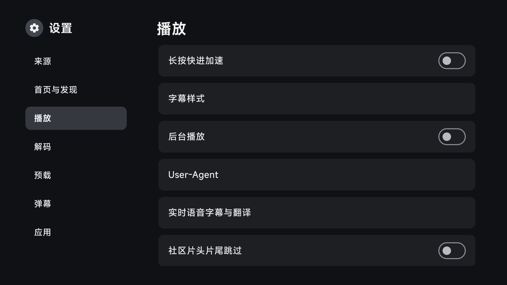

# TV · JetStream

**让大屏回归内容，让遥控器操作更顺手。**

面向 Android TV、电视盒子的影音应用，同时保留独立的 Android 手机版界面与构建变体。基于 [FongMi/TV](https://github.com/FongMi/TV) 与 [CatVod](https://github.com/CatVodTVOfficial/CatVodTVJarLoader)，围绕首页、片库、搜索、播放和设置，持续完善 JetStream 大屏界面与播放内核。

[](https://customer-nkorbwmhxz04cbfd.cloudflarestream.com/b941aa27d5013806eb8fcab30cce4807/iframe)

[下载安装](#下载安装) · [功能亮点](#功能亮点) · [功能详解](#功能详解) · [近期更新](#近期已合入功能) · [构建指南](LOCAL_BUILD_ENV.md) · [内核验证](docs/player-core-sync.md) · [反馈问题](https://github.com/wobuhui666/TV/issues) · [English](README.en.md)

[在线观看宣传片](https://customer-nkorbwmhxz04cbfd.cloudflarestream.com/b941aa27d5013806eb8fcab30cce4807/iframe) / [下载 MP4](https://customer-nkorbwmhxz04cbfd.cloudflarestream.com/b941aa27d5013806eb8fcab30cce4807/downloads/default.mp4) · 60 秒 · 1080p · 中文字幕与配乐

宣传片由模拟器实录制作，使用演示片库展示界面，不提供影片资源或订阅服务。演示片段为 Sintel © Blender Foundation（CC BY 3.0）；完整[素材来源与署名](docs/media/CREDITS.md)。

## 功能亮点

以下按当前源码整理。TV 专属体验、共用业务和需要片源／设备支持的能力分别注明；下载包以 [Releases](https://github.com/wobuhui666/TV/releases) 中的实际构建为准。

| 功能 | 当前能力与适用范围 |
| --- | --- |
| TV 大屏与操作 | JetStream 原生／Compose 界面、MiSans 字体、遥控焦点、触摸轻点与长按；海报、Tab、侧栏及设置过渡动画。 |
| 主题与氛围 | 深色、浅色、跟随系统外观，多种主题色与跟随海报的内容氛围；TV 各页面统一取色。 |
| 首页与推荐 | 来源首页、可选原生海报首页、豆瓣／TMDB 推荐、分类海报棚、继续观看、收藏片单和主视觉轮播控制。 |
| 海报墙与筛选 | 首页栏目、片库和推荐结果页使用各自的分类／筛选维度；支持根目录筛选、分页、重试、目录导航和筛选状态恢复。 |
| 搜索与选源 | 跨站搜索、无关结果过滤、严格片名匹配、结果分组、海报详情侧栏选源、智能匹配及按配置保存的来源优先级。 |
| 双播放内核 | Exo / Media3 与 MPV；音视频／字幕轨道、清晰度、倍速、缩放、软硬解、章节、标题、选集与续播。 |
| 播放规格胶囊 | TV 点播／直播开播时显示分辨率、编码、动态范围、声道和明确的年龄分级，配合短时展开／收起动效。 |
| 片头片尾 | 原有手动设置与新的社区区间跳过；TheIntroDB、IntroDB、TheOtherDB 互补，保留片头前剧情和片尾后彩蛋。 |
| 字幕与本地文件 | 主副双字幕、libass 样式／动画、字体导入；ASSRT 在线字幕搜索与 ZIP／RAR 文件选择，SRT / ASS / SSA / VTT 上传，本地同名字幕发现、STRM 指针与“本地字幕”标记。 |
| AI 字幕 | Exo PCM 音频的本地实时语音识别，七种语言模型；可选默认翻译、MTranServer 或 OpenAI 兼容翻译，双语／仅译文显示。 |
| 弹幕 | 来源弹幕、配置／自定义 API、自动匹配与手动加载；可调字号、透明度、速度、偏移、密度、滚动区域及显示类型。 |
| 音频与画面 | 对白、夜间、音乐、自定义音效，五段 EQ、中置增强、响度归一化和限幅；MPV 另提供 GPU Next、Vulkan、HDR、Anime4K 等选项。 |
| 缓存与预加载 | 当前片预缓存、符合条件的 Exo 下一集预加载；后台工作在缓冲、快进和切换媒体时让出资源。 |
| 直播与时移 | 频道分组、节目表 EPG、频道线路、节目回看；源提供时移协议时显示时间轴和“返回直播”，TV／手机共用。 |
| 来源扩展与登录 | Java JAR、QuickJS、Python 扩展，保留新旧源 API；Java／JS 来源可运行 WASM 模块，来源可展示输入、密码、列表、图片／二维码等登录交互。 |
| 扩展播放协议 | STRM、磁力／种子／ed2k、YouTube 和部分 TVBus／Force／荐片适配，按对应来源配置、第三方运行库与服务可用性处理。 |
| DLNA 与局域网 | TV 接收兼容 DLNA 控制端投放，手机版控制兼容渲染设备；局域网推送播放、字幕、弹幕及播放控制。 |
| 一起看 | 兼容官方 [Syncplay](docs/syncplay.md) 服务端，同步各设备本地影片的播放、暂停与进度，支持 TLS。 |
| 收藏与数据同步 | 本地收藏、历史、备份／恢复和无痕模式；[WebDAV](docs/webdav-sync.md) 同步收藏、观看进度、删除标记及可选订阅／少量弹幕偏好。 |
| 网络与工具 | 按规则代理、DoH、ECH、Cloudflare 优选、TMDB 网络兼容；缓存分类清理、诊断包、来源健康和网盘分享链接检查。 |
| 应用更新 | 按包名／ABI 校验 OTA，镜像下载与 SHA-256 校验；标准版、独立共存版和可取消的重要版本提醒。 |

当前默认分支为 [`ui/apple-tv-redesign`](https://github.com/wobuhui666/TV/tree/ui/apple-tv-redesign)。开发默认版本以 FongMi **5.8.7** 为版本基线，按本项目架构适配上游更新；正式发布版本附加 UTC 构建时间，例如 `5.8.7+YYYYMMDD.HHMMSS`。本轮的适配与保留项目见 [上游同步说明](docs/upstream-5.8.7-review.md)。

来源需要 WASM 时可直接使用内置解释器，无需额外安装组件。支持数值函数、同步函数导入、线性内存及超时取消；[WASM 接口与示例](docs/spider-wasm.md) 说明具体范围和旧来源兼容方式。

<details>
<summary>展开界面预览：从首页到播放与设置</summary>


分镜图取自上一版 90 秒宣传片，展示录制时的界面版本；界面细节以当前应用为准。

2026-11-01 播放设置中的社区跳过开关：



[查看浅色设置](docs/testing/reports/2026-11-01-community-skip/settings-light.png) · [海报墙、筛选、字幕与表单截图](docs/testing/reports/2026-11-01-tv-polish/README.md)

</details>

## 功能详解

### 首页、海报墙与找片

- **精简首页与旧版布局**：默认把首页和推荐合并，片库独立保留来源分类、目录及 CK／登录操作；“筛选找片”进入条件筛选页。在“设置 → 首页与发现 → 首页布局”可切回旧版来源首页或旧版海报首页。继续观看与我的片单沿用现有历史和收藏，首页片单最多展示 20 项，并提供“查看全部”。
- **各页独立筛选**：来源片库使用来源返回的筛选字段，推荐海报墙使用相应元数据服务的分类、地区、年份、类型等可用维度；根目录和文件夹筛选会随页面恢复。过滤或换分类时重新定位分页，空结果可调整筛选或重试。
- **主视觉轮播**：原有轮播、聚焦时暂停、仅手动切换；左右键继续可用。首页栏目保留月桂等视觉装饰，海报年份和更新信息使用统一间距。
- **继续观看菜单**：开启后，TV 卡片长按／菜单键可继续播放、查找其他来源或删除这一条；操作针对当前配置中的那条记录。
- **搜索与选源分开配置**：普通搜索可选原有匹配、过滤无关结果、严格片名匹配；海报详情内可独立开启侧栏选源、原名／年份／季数智能匹配和来源优先级。推荐只是选片信息，实际播放仍使用自己的来源。
- **播放来源模式**：保留原有模式，也可分组展示结果或启用智能选源／跨站换源；来源优先级按配置保存。查询并发受限，退出或发起新查询会取消待处理工作，迟到结果不会刷新新页面。

各开关、默认值与恢复方式见 [原生海报墙与选源](docs/native-discovery.md)；海报墙筛选、表单滚动提示和字幕列表的最新验证与截图见 [界面完善验证](docs/testing/reports/2026-11-01-tv-polish/README.md)。

### 豆瓣云桥

豆瓣云桥是可选的第三方豆瓣推荐服务，为 TV 首页的“豆瓣 · 热门电影”“豆瓣 · 热门剧集”及其“查看全部”页面提供片单、海报和影片信息。它不提供播放资源；选好影片后，实际播放仍使用自己配置的来源。

在 TV **设置 → 首页与发现** 中配置：

| 选项 | 填写说明 |
| --- | --- |
| 豆瓣云桥地址 | 留空使用默认服务 `https://douban-bridge.baran.wang`；使用其他兼容服务时，填写服务根地址，无需追加 `/v1/catalog` 等接口路径。 |
| 豆瓣云桥密钥（sk_） | 向所使用的云桥服务运营方获取密钥后填写。它与 TMDB API Key、播放来源的 CK／登录凭据分别配置，不能相互替代。 |

保存后返回首页查看推荐。不填密钥时会跳过云桥，使用 rexnow 公开豆瓣 feed；密钥鉴权失败或请求失败时也会自动回退。精简首页及其“查看全部”页面还会在公开 feed 失败或为空时尝试独立豆瓣接口。豆瓣与 TMDB 栏目独立加载，云桥失败不会阻塞 TMDB 推荐。

地址和密钥保存在本机设置中，请使用可信的云桥地址，因为密钥会随请求发送给该服务。应用的完整备份也会包含这些设置，请勿公开带密钥的备份。切换“首页布局”会保留云桥配置；执行 **恢复原有浏览体验** 会清除云桥地址和密钥。

### 播放、字幕与音效

两种内核共用选集、续播和播放控制。普通倍速可按影片记忆；长按临时加速结束后恢复按下前的速度，触摸取消、松键、切源和离开页面均会结束旧的快进／回退或加速操作。软硬解、音轨和内核重建保留相应播放状态，避免恢复后意外继续播放。

| 能力 | 使用说明 |
| --- | --- |
| 播放规格 | TV 点播和直播开播时短时显示规格胶囊。根据实际输入轨道显示分辨率、编码、HDR／位深和声道信息；只有来源提供明确年龄分级才展示，未知值省略。 |
| 主副字幕 | 独立选择主字幕和第二字幕；可调整字幕偏移、字号、位置与 ASS 样式，使用 Android 文件选择器导入字体。Exo 接入 libass，MPV 使用其原生字幕渲染。 |
| 复杂字幕 | 内核涵盖 SUP / PGS、MKV 内嵌 VobSub、DVB、WebVTT / TTML，以及 ASS 重叠、卡拉 OK、裁剪和矢量绘图；具体容器、外部字幕配对和设备限制见内核文档。 |
| 本地字幕 | USB／本地可访问视频目录中的同名 SRT / SSA / ASS / VTT，以及 `片名.语言.srt` 等变体，会在后台做有界发现；轨道列表标明“本地字幕”，长文件名省略显示。局域网上传入口也接受 VTT。 |
| STRM | 支持本地和 HTTP(S) STRM 指针，处理 BOM、空白及缺少文件名响应头的情况；非指针响应继续按原地址处理。 |
| 音频效果 | 对白、夜间、音乐、自定义预设，五段 EQ、中置增强、响度归一化和限幅。Exo 处理 PCM；MPV 使用其滤镜链。开启音效可能需要退出编码直通。 |
| 弹幕控制 | 可选来源弹幕优先、自定义弹幕／Logvar API 和自动匹配；支持字号、透明度、描边／阴影、速度、时间偏移、密度、显示区域和弹幕类型设置。加载能力取决于来源或所配服务。 |
| 画面与解码 | Exo 提供 MediaCodec／扩展解码和适用的失败恢复；MPV 可设置 GPU Next、Vulkan、HDR、Anime4K 和原生配置。HDR、杜比视界、AV3A、隧道播放及直通取决于内核、媒体和硬件支持。 |
| 预缓存与下一集 | Exo 提前准备符合条件的已解析 HTTP(S) 下一集，最多预载约 10 秒并在切集时复用；同集寻址保留符合条件的已准备缓存。DRM、仍需解析和非 HTTP 来源排除，MPV 使用自己的当前流缓存。 |

参考 [播放内核说明](docs/player-core-sync.md)、[播放规格胶囊](docs/playback-specs-capsule.md) 与 [MPV HLS 精确寻址](docs/mpv-hls-seeking.md)。

### 社区片头片尾与 AI 字幕

**社区片头片尾跳过**在 TV 和手机的播放设置中默认开启，使用 TheIntroDB、IntroDB、TheOtherDB 的只读元数据，按缺失类别补齐时间段。识别可靠的电影或剧集后，采用当前视频的绝对起止时间：片头若在 **80–170 秒**，先保留前 80 秒剧情，进入区间后才跳到 170 秒；片尾跳到标记末尾，后面的彩蛋继续播放。

手动设置优先，包括手动清零；每个区间一次会话内只跳一次，回退后可以重看。暂停、拖动、换源／换集、退出和旧回调有保护。普通来源的身份匹配需要发布包已有的 TMDB 配置及可靠片名、年份和季集元数据；无记录、身份歧义或服务不可用时正常播放。旧 AISkip 的音频探针、上传、Worker 和设置已从 App 移除，保存在 [历史归档](docs/archive/aiskip-20261101/README.md)。接口和剪辑版本限制见 [社区跳过说明](docs/community-skip.md)。

**AI 字幕**是独立保留的功能，默认关闭。在“设置 → 播放 → 实时语音字幕与翻译”选择语言并下载对应本地模型，识别 Exo 输出的 PCM 音频。当前语言为普通话、粤语、英语、日语、德语、法语和西班牙语；可仅显示识别原文，或使用默认翻译、MTranServer、OpenAI 兼容服务，选择双语或仅译文。TV 可通过局域网手机推送服务凭据。

AI 字幕目前接入 **Exo** 音频链，需下载模型并占用设备算力与存储；翻译服务需按所选提供方配置。开启后使用 PCM 输出，不沿用编码直通。MPV 的普通／双字幕继续可用，不能视为已经接入同一实时识别链。

#### 在线字幕搜索（ASSRT）

TV 和手机版可在 **播放器 → 字幕轨道 → 搜索在线字幕** 中，按片名、季集或发行文件名搜索。选择字幕版本后，再按语言、格式和文件名选择下载项；直接字幕文件可以加载，ZIP／RAR 包含多个字幕时会继续列出文件供选择，分卷包暂不支持。

字幕数据与下载链接来自 [ASSRT](https://assrt.net)，页面保留来源链接。官方发布包通过构建配置内置服务凭据，使用者无需填写 API Key。自行构建时，设置 GitHub Actions Secret／环境变量 `ASSRT_API_TOKEN`，或在不提交的 `local.properties` 中设置 `assrtApiToken`；真实凭据不写进仓库。

ASSRT 服务的 API 请求限制为每分钟 20 次，字幕下载链接临时生成。遇到链接失效时，可返回结果页重新选择版本以取得新链接。关闭搜索或切换播放内容会取消当前请求，加载字幕保留原来的进度、倍速和暂停状态。

### 直播、来源扩展与登录

直播支持 M3U、TXT、JSON 来源、频道分组、线路切换与 EPG 节目表；节目回看沿用来源的 catchup 协议。来源提供时移信息时，TV 和手机显示最近一段可回看的时间窗口、时间轴和“返回直播”；没有时移协议的直播使用原有控制。请求失败会保留现有播放和暂停状态，切节目或移除媒体会取消旧查询。详见 [直播格式](docs/LIVE.md) 与 [直播时移协议](docs/live-timeshift.md)。

来源可通过 Java JAR、QuickJS、Python 扩展提供列表、搜索、详情、播放、代理和弹幕接口。新旧接口兼容入口共存，支持常见二进制请求体；Python 按需初始化，失败与销毁按来源隔离。来源主动请求登录时，TV／手机可显示文本／密码输入、选择列表、图片／二维码等交互，长表单支持遥控滚动和淡色滚动提示。离开页面或取消任务会关闭对应交互，后台任务不会擅自弹出登录界面。接口约定见 [SPIDER.md](docs/SPIDER.md)。

Forward Widget 仅支持 [配置说明](docs/CONFIG.md) 所列的适配范围，包括部分视频列表、搜索和播放模块；依赖未实现宿主 API、WebView 或特定加密格式的模块不能直接通用。

### DLNA、一起看与多设备同步

**大屏伴侣网页**随应用内置，手机或电脑打开推送页二维码中的局域网地址即可使用。网页采用 Material 3 Expressive 的配色和形状，支持浅色、深色与跟随系统，默认简体中文，也可切换繁体或英文；搜索、推送、播放控制、方向键遥控、弹幕、配置和文件管理沿用当前设备的接口。文件支持上传、下载、重命名和移动，搜索／推送记录保存在当前浏览器，配置内容不加入记录。使用说明及界面截图见 [大屏伴侣网页](docs/web-companion.md)。

| 能力 | 用途与前提 |
| --- | --- |
| DLNA 接收／控制 | TV 可被兼容 DLNA 控制端发现，接收媒体及播放、暂停、停止、寻址、音量等指令；手机版可选兼容渲染设备投放。接收端补齐状态查询、能力声明和换播生命周期；双方需局域网可达，媒体与设备解码能力相容。 |
| 局域网推送 | 用手机／浏览器推送影片链接、字幕或弹幕，控制播放；沿用来源、请求头和现有播放流程。详见 [LOCAL.md](docs/LOCAL.md)。 |
| Syncplay 一起看 | 各设备各自拥有并播放同一影片，通过兼容官方服务端同步播放、暂停和进度；支持要求 TLS 的连接、服务器与房间设置。它不转发影片数据，详细连接与同步规则见 [Syncplay](docs/syncplay.md)。 |
| WebDAV 同步 | 同步收藏、观看进度和删除标记，可选可移植订阅与少量弹幕偏好；记录按订阅地址／类型和来源 ID 匹配。自动同步默认关闭，HTTPS、ETag 和条件写入保护并发变更。配置、解码器和账号凭据不作为跨设备偏好整体复制。 |
| 本地数据 | 收藏、历史续播、配置备份／恢复和无痕模式继续保留；标准版与共存版拥有独立数据，可按 [WebDAV 文档](docs/webdav-sync.md) 迁移可同步内容。 |

手机界面另外保留旋转、手势、锁屏控制、定时和画中画等适用能力；画中画和后台播放由 Android 版本、系统设置与设备决定。

### 网络、诊断与应用更新

- **网络配置**：DoH、hosts／请求头、按规则代理、代理鉴权和跨域跳转处理。TMDB 可选默认反代、直连官方或自定义反代，直连同时使用官方 API 和图片域名。ECH 默认开启，按宿主共享网络客户端和服务端能力生效；Cloudflare 共享配置补全、优选 IP 与 TMDB 网络兼容保留原域名、Host／SNI 和证书验证。适用范围见 [ECH 验证](docs/ech-validation.md)。
- **缓存管理**：分别查看和清理图片、播放缓存、更新包等占用；正在使用或写入的资源有保护，配置、历史、字体等用户数据不混入深度清理。
- **诊断与工具**：默认关闭的统一诊断日志、问题时间窗口、脱敏诊断包、局域网扫码下载／分享；查看来源最近状态和耗时，按需开启健康排序；匿名检查 115／夸克／阿里云盘分享链接状态，结果供参考。完整范围见 [诊断与工具](docs/practical-improvements.md)。
- **OTA 更新**：手动检查后确认下载；镜像回退、大小／SHA-256 校验及包名／版本／签名／ABI 校验，通过后交给 Android 安装器。兼容性不符时停止重复下载；普通更新不在启动时强制弹窗，重要版本提醒也可取消。

## 近期已合入功能

这些是已进入默认分支的功能与改进，早期已有能力也包含在上面的功能目录中；上游候选评估不等于已经合入。

| 合入记录 | 用户可见变化 |
| --- | --- |
| [#78](https://github.com/wobuhui666/TV/pull/78)、[#81](https://github.com/wobuhui666/TV/pull/81) | TV 触摸与遥控连续操作、深浅色切换、跟随系统外观、详情页对比度。 |
| [#79](https://github.com/wobuhui666/TV/pull/79)、[#80](https://github.com/wobuhui666/TV/pull/80)、[#82](https://github.com/wobuhui666/TV/pull/82)、[#83](https://github.com/wobuhui666/TV/pull/83) | 首页栏目排序与组合卡片取色、历史进度边界、减少重复刷新、电影节月桂等小型视觉完善。 |
| [#84](https://github.com/wobuhui666/TV/pull/84)、[#85](https://github.com/wobuhui666/TV/pull/85) | 更新下载失败分类、根目录筛选恢复、封面与剧集定位、二进制网络请求兼容。 |
| [#86](https://github.com/wobuhui666/TV/pull/86) | Java／Python／QuickJS 来源共享登录对话框、取消与后台交互保护；TV／手机直播时移。 |
| [#87](https://github.com/wobuhui666/TV/pull/87)、[#89](https://github.com/wobuhui666/TV/pull/89) | DLNA 发现、能力与状态查询、倍速和投放生命周期修复。 |
| [#88](https://github.com/wobuhui666/TV/pull/88) | TV 点播／直播播放规格胶囊、Logo 动效与明确的年龄分级显示。 |
| [#90](https://github.com/wobuhui666/TV/pull/90) | 快进按键归属与旧会话取消、空 host／重定向／STRM 保护、Python 释放隔离、长来源表单滚动、VTT 上传、本地同名字幕发现及下集缓存改进。 |
| [#91](https://github.com/wobuhui666/TV/pull/91) | 海报墙分页间隙、推荐与筛选体验、海报年份／更新间距、来源表单滚动提示、本地字幕标签和长文件名显示。 |
| [#92](https://github.com/wobuhui666/TV/pull/92) | TheIntroDB／IntroDB／TheOtherDB 社区区间跳过，保留冷开场和彩蛋；手动设置与换集保护，旧 AISkip 完整归档。 |

## 下载安装

### 1. 选择适合设备的 APK

进入本仓库的 **[Releases](https://github.com/wobuhui666/TV/releases)**，阅读发布说明并下载对应安装包。

| 选择 | 适用设备 |
| --- | --- |
| `leanback` / TV 版 | Android TV、电视盒子，以及主要使用遥控器的设备；目前正式发布构建此版本。 |
| `mobile` / 手机版 | 手机／平板的独立触摸界面，源码可构建；是否有现成 APK 以发布页实际资产为准。 |
| `arm64-v8a` | 运行 64 位 ARM Android 系统的设备。 |
| `armeabi-v7a` | 需要 32 位 ARM 安装包的设备。 |

最低支持 **Android 7.0 / API 24**。请按 Android 系统 ABI 选包，处理器支持 64 位不等于系统支持 64 位。升级时使用相同签名的安装包，保留已有配置与记录。

TV 正式发布同时提供两种包名，按是否要与 FongMi/TV 同时安装来选：

| 版本 | 文件名 | 包名 | 说明 |
| --- | --- | --- | --- |
| 标准版 | `leanback-arm64_v8a.apk`、`leanback-armeabi_v7a.apk` | `com.fongmi.android.tv` | 与 FongMi/TV 同包名，可覆盖升级本项目旧版。 |
| 共存版 | `leanback-arm64_v8a-coexist.apk`、`leanback-armeabi_v7a-coexist.apk` | `com.wobuhui666.android.tv` | 可与 FongMi/TV 或标准版同时安装，桌面名称不变。 |

共存版须知：

- 是独立应用，配置、收藏、历史与设置不与标准版或 FongMi/TV 互通；可在 **设置 → 来源** 重新添加配置，或用 [WebDAV 同步](docs/webdav-sync.md) 迁移收藏与进度。
- 支持应用内更新：共存版读取独立的 `leanback-coexist.json` 并只下载 `-coexist` 安装包，不会误装标准版。
- 标准版与共存版不能互相覆盖升级；从标准版换到共存版需要单独安装。
- 本地构建共存版：在构建命令后加上 `-PtvApplicationId=com.wobuhui666.android.tv`。

### 2. 添加自己的配置

安装后，在 **设置 → 来源** 中添加配置 URL 或本地文件。点播、直播、解析和扩展能力取决于所添加的配置及其服务。

- 点播、解析、网络与弹幕字段：[配置说明](docs/CONFIG.md)。
- M3U、TXT、JSON 和频道分组：[直播来源格式](docs/LIVE.md)。

### 3. 开始播放，按需调节

选择来源，浏览片库或搜索片名，然后进入详情选集播放。常用新增入口：

| 入口 | 可以设置 |
| --- | --- |
| 设置 → 预加载 | 当前片预缓存、下一集预加载及缓存预算。 |
| 设置 → 播放 → 社区片头片尾跳过 | 开关社区时间段跳过；原有片头／片尾控制继续设置手动偏好。 |
| 设置 → 播放 → 实时语音字幕与翻译 | 语言模型、识别与翻译选项；当前使用 Exo PCM 音频链。 |
| 设置 → 首页与发现 | 首页布局、豆瓣云桥地址／密钥、搜索相关性、主视觉轮播、海报详情选源及来源优先级。 |
| 设置 → 弹幕；播放器 → 弹幕 | 加载／匹配 API、来源优先与显示样式、速度、密度等控制。 |
| 播放器 → 字幕轨道 → 高级字幕 | 第二字幕、ASS 样式和字体导入。 |
| 播放器 → 音轨 → 音效 | 对白增强、EQ、响度和限幅。 |
| 播放器 → 选项；我的 → 设置 → 应用 | “一起看”开关加入／退出 Syncplay，独立连接设置选择服务器与房间。 |
| 我的 → 设置 → 多设备同步 | WebDAV 账号、同步范围、立即同步及自动同步。 |
| 设置 → 缓存管理；设置 → 诊断与工具 | 分类清理、诊断日志、来源健康与网盘链接检查。 |
| 我的 → 设置 → 应用 | 主题、无痕、来源模式、备份／恢复、网络与检查更新等偏好。 |

下一集预加载面向 Exo 的已解析 HTTP(S) 点播，排除 DRM、仍需解析和非 HTTP 来源；MPV 使用自己的当前流缓存。音频效果处理 PCM，开启后可能需要退出编码直通。字幕格式、容器和设备差异见[播放内核说明](docs/player-core-sync.md)。

## 配置与集成

| 文档 | 内容 |
| --- | --- |
| [CONFIG.md](docs/CONFIG.md) | 点播、直播、解析、代理、DoH、弹幕与配置示例。 |
| [原生海报墙与选源](docs/native-discovery.md) | 可选首页、我的片单、继续观看菜单、轮播控制、搜索过滤、详情选源与 TMDB 网络兼容。 |
| [诊断与工具](docs/practical-improvements.md) | 缓存管理、诊断包、来源健康、网盘检查和播放体验改进。 |
| [社区片头片尾](docs/community-skip.md) | 三服务接口、区间跳过、手动优先、身份与剪辑版本限制，以及旧 AISkip 归档。 |
| [最近界面验证](docs/testing/reports/2026-11-01-tv-polish/README.md) · [社区跳过验证](docs/testing/reports/2026-11-01-community-skip/README.md) | 海报墙／筛选／本地字幕／表单提示与社区跳过的精选截图、GHA 结果和验证边界。 |
| [播放规格胶囊](docs/playback-specs-capsule.md) | 开播规格、年龄分级字段、动效与采样预算。 |
| [直播时移](docs/live-timeshift.md) | 源端时间窗口协议、控制与失败保护。 |
| [播放内核](docs/player-core-sync.md) | 双字幕、音效、Exo 预加载、格式与 ARM／模拟器验证边界。 |
| [Syncplay](docs/syncplay.md) · [WebDAV](docs/webdav-sync.md) | 一起看连接、同步数据范围与冲突规则。 |
| [OTA 更新](docs/ota-updates.md) | 手动更新、重要版本云控、镜像下载和发布流程。 |
| [SPIDER.md](docs/SPIDER.md) | Java、JavaScript、Python 爬虫接口与返回结构。 |
| [LOCAL.md](docs/LOCAL.md) | 局域网推送、播放控制、字幕和弹幕注入。 |
| [LIVE.md](docs/LIVE.md) | 直播来源、频道分组与格式。 |

## 开发与验证

完整步骤见 **[本地构建指南](LOCAL_BUILD_ENV.md)**。需要 JDK 21、Python 3.10、Android SDK 37，以及配套 Media3 fork；首次构建先完成指南中的 SDK 和 composite build 配置。

也可以从公开的 **[TV Codespace 模板](https://github.com/zhhshss/tv-codespace-template)** 开始，复用工具链和测试环境。

```bash
# 按构建指南准备环境；手动配置 SDK 37.0 时带上对应的 -I 参数。
./gradlew :app:assembleLeanbackArm64_v8aDebug
./gradlew :app:assembleMobileArm64_v8aDebug
./gradlew :app:testLeanbackArm64_v8aDebugUnitTest :catvod:testDebugUnitTest
```

共享业务位于 `app/src/main/`，TV 与手机界面分别位于 `app/src/leanback/`、`app/src/mobile/`；`catvod`、`quickjs`、`chaquo` 提供扩展基础，`mpv` 和 `subtitle-ass` 集成原生播放与字幕库。开发目录、验证资料和可重建产物的整理规则见 [工作区维护](docs/workspace-maintenance.md)。

### 最近验证与范围

2026-11-01 的检查对应社区跳过、近期界面与稳定性改动；结果可从 GHA 记录核对。下面的测试量是该提交的快照，后续版本请查看自己的构建结果。

| 验证项目 | 记录 |
| --- | --- |
| 应用单元测试与编译 | [779 项 JUnit 全部通过；TV APK／AndroidTest 和手机 ARM64 Java 编译通过](https://github.com/wobuhui666/TV/actions/runs/41319343911)。 |
| 实际 Exo 控制回归 | [9 项回归通过](https://github.com/wobuhui666/TV/actions/runs/41319384536)，其中 2 项使用生成的 PCM 媒体实际检查片头／片尾寻址、冷开场、彩蛋、暂停、手动清零和换集失效。 |
| TV 界面 | [深浅色、触摸／遥控、播放规格及设置截图回归通过](https://github.com/wobuhui666/TV/actions/runs/41317633980)；[海报墙／筛选／本地字幕完善检查](https://github.com/wobuhui666/TV/actions/runs/41273693165)另有记录。 |
| 真实配置加载与导航 | `aiwex.json` 加载 99 个来源，捕获 579 帧，导航未记录崩溃或 ANR；GHA 抽测的来源没有返回首页／搜索内容，因此这轮不证明真实片源播放。 |
| TV 正式发布 | [ARM64／ARMv7、标准／共存包构建与发布通过](https://github.com/wobuhui666/TV/actions/runs/41321238755)。 |

此前内核已有 12 项 x86_64 受控播放回归，以及 15 项 ARM64 Android 检查，包含 Python 原生扩展、MPV、双字幕、音效和缩略图；保留在 [内核验证报告](docs/player-core-sync.md) 和 [测试资料索引](docs/testing/README.md) 中。ARM64 节点的系统标识为 `redroid`，不代表三星实体设备验证。

模拟器截图、软件 GPU 的帧记录、生成素材的寻址和历史 ARM 检查各有自己的范围，不能合并为当前所有机型、真实片源、硬件 HDR／HDMI 或端到端 AI 识别的验证结论。

## 反馈与贡献

欢迎通过 [Issues](https://github.com/wobuhui666/TV/issues) 提交问题。请附上应用版本或提交号、Android 版本、设备 ABI、播放内核、复现步骤和相关日志；分享前去掉令牌、私人地址与配置凭据。

改动前可阅读 [仓库开发约定](AGENTS.md)。播放器、解析和数据行为的变更请附上对应回归验证。

## 致谢与许可证

感谢 [FongMi/TV](https://github.com/FongMi/TV)、[CatVod](https://github.com/CatVodTVOfficial/CatVodTVJarLoader) 以及相关开源项目的作者与贡献者。

项目采用 [GNU GPL v3.0](LICENSE.md)。第三方组件保留各自许可证，详见 [libass 说明](third_party/libass/NOTICE.md)、[MPV 来源与重编说明](third_party/mpv/README.md)、[libarchive 字幕解包说明](third_party/libarchive/NOTICE.md)、[Chicory WASM 说明](third_party/chicory/NOTICE.md) 和[宣传素材署名](docs/media/CREDITS.md)。

应用是播放与配置工具，不提供影视资源、订阅或第三方内容的使用权。请自行添加并合法使用有权访问的来源。
