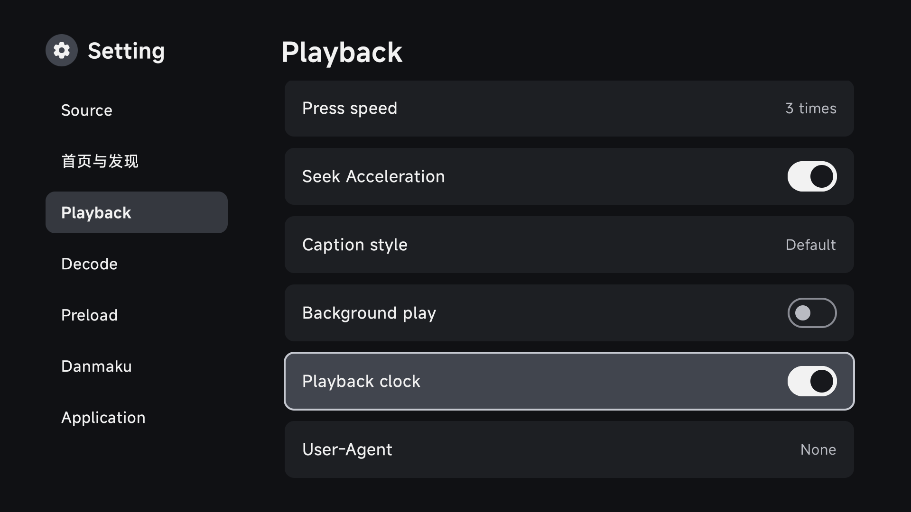
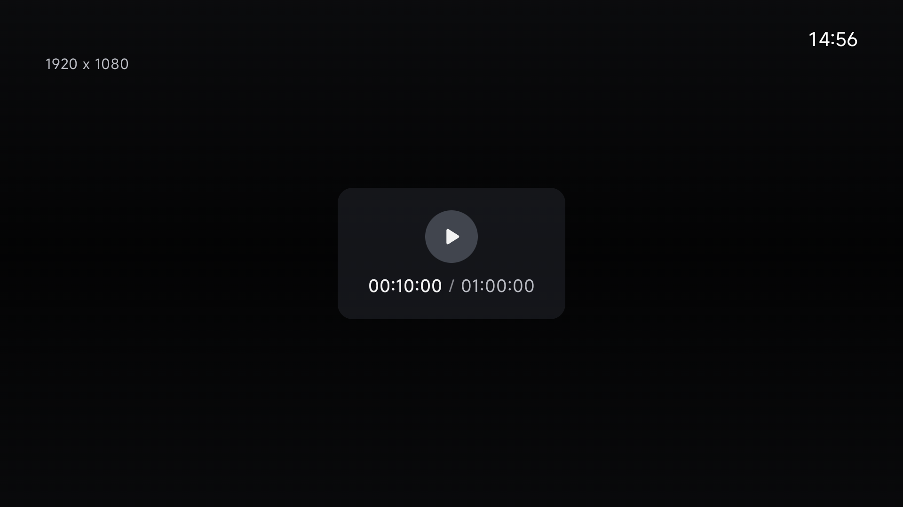

# 播放时钟

在 TV 版的「设置 → 播放设置 → 播放时钟」开启，点播、直播和投屏播放页面右上角会持续显示当前时间。默认关闭，选择会保存在本机；修改后返回播放页面即可生效。

时间采用 24 小时制 `HH:mm`，跟随设备的时间和时区。收起控制层、暂停或快进时仍可显示，文字带暗色阴影，时钟不占用遥控器焦点。

关联 [issue #113](https://github.com/wobuhui666/TV/issues/113)；保留 issue 以便收集体验反馈。

## 界面

设置开关：

暂停信息层显示时，右上角仍保留当前时间：

## 验证

2026-11-10 的 [构建验证](https://github.com/wobuhui666/TV/actions/runs/42834628962)通过 TV ARM64 和 Mobile ARM64 调试包构建、1,036 项 TV 单元测试及共享模块测试；完整 lint 与基线比较无新增错误。

[Android API 34 界面验证](https://github.com/wobuhui666/TV/actions/runs/42838193669)通过 3 项测试：三个实际 TV 播放活动默认隐藏时钟；遥控器滚动后启用设置，返回播放即生效；时钟随时区更新，控制层隐藏后仍可见且不占用焦点。截图使用空媒体请求的播放页面。
