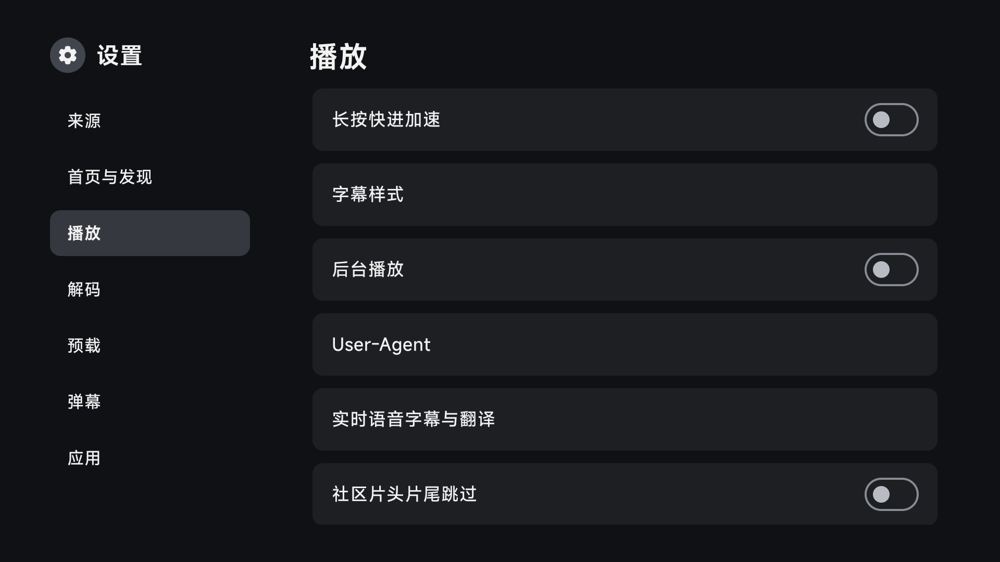
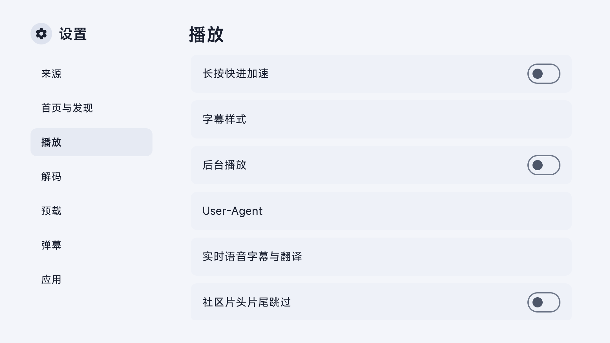

# 社区片头片尾、播放与界面验证（2026-11-01）

对应 [PR #92](https://github.com/wobuhui666/TV/pull/92)，合并提交 `5436ac1ba97748b556dc49ed482e99aabd548222`。验证提交为 `05bffa0ea7e24010f7abcaccef0edeb37a648d8d`；界面任务验证 `92708198d9eab69551b4c1ac8e39cf36f8beb12f`，其后只调整了测试 WAV 时长。

## 结果与证据

| 项目 | 结果 | 原始任务 |
| --- | --- | --- |
| 应用 JUnit | 779 项，零失败、错误、跳过；其中身份、时间段与历史策略相关 57 项 | [生产源码验证](https://github.com/wobuhui666/TV/actions/runs/41319343911) |
| 构建 | TV ARM64 debug、AndroidTest 和手机 Java 编译通过 | 同上 |
| 播放与生命周期 | 9 项真实 Android 回归通过，其中 2 项使用生产 VodPlaybackController / Exo 执行跳转 | [真实配置任务，第二次执行](https://github.com/wobuhui666/TV/actions/runs/41319384536/attempts/2) |
| 界面 | 深浅色、触摸、遥控、既有功能及播放规格胶囊回归通过 | [界面任务](https://github.com/wobuhui666/TV/actions/runs/41317633980) |
| 真实配置 | 成功加载 99 个源，捕获 579 帧；导航未记录 Java 崩溃、native fatal signal 或 ANR | [脱敏导航报告](navigation-report.json)、[健康计数](health.json) |
| 正式发布 | 标准版和共存版的 ARM64 / ARMv7 安装包已发布 | [Release 183](https://github.com/wobuhui666/TV/releases/tag/build-41321238755-1) |

测试用本地生成的 90 秒 PCM WAV，保留完整寻址检查和实际 Exo 跳转断言：片头 5–9 秒、片尾 73–87 秒，末尾仍有 3 秒剧情。覆盖冷开场不跳、进入区间后跳转、暂停不消耗区间、手动归零优先、停止及换集后失效；社区时间段不写入手动历史字段。晚于影片一半才开始的片头另有解析与策略单元测试。

首次执行该任务时，旧 WebView 解析测试发生进程退出，未收集到可定位的退出信息；同提交第二次执行通过，原因未确认。单次应用 UID 崩溃计数不能用于排除其他进程的故障。

## 服务可用性与范围

| 服务 | 本地公开接口查询 | GHA 查询 |
| --- | --- | --- |
| TheIntroDB | HTTP 200，格式通过 | HTTP 403，按不可用处理 |
| IntroDB | HTTP 200，格式通过 | HTTP 200，格式通过 |
| TheOtherDB | HTTP 200，格式通过 | HTTP 200，格式通过 |

[本地接口摘要](provider-smoke-local.json)与 [GHA 接口摘要](provider-smoke-gha.json)只保留 HTTP 状态和区间计数，不包含响应正文、配置或凭据。供应商失效时可补查其他服务，不能把单次可用性推广到所有网络。

GHA 预览任务抽测的配置源未返回首页或搜索内容，状态为 `no-content-from-probed-sources`。因此本轮确认配置加载与导航，**未确认真实片源播放**。Exo 跳转使用受控 PCM；本轮未执行 MPV 实机、视频解码、HDMI 或硬件 HDR 验证。此前纯 ARM 来源行为见 [2026-10-31 报告](../2026-10-31-responsiveness/README.md)，两种环境不能互相代替。

## 设置截图

截图来自隔离的模拟器界面，显示测试时的开关状态，不代表应用默认设置；社区跳过默认开启。

| 深色 | 浅色 |
| --- | --- |
|  |  |

使用与匹配规则见 [社区跳过说明](../../../community-skip.md)。[验证摘要](verification-summary.json)记录提交、用例和范围；[配置指纹](config-metadata.json)仅含 SHA-256、大小与源数量；[文件清单](FILES.json)记录本目录数据文件的大小和哈希。原始 APK、完整配置、播放 URL、凭据及原始设备日志未导入仓库。

[APK 符号检查](apk-audit.json)记录此前同一应用运行代码的 debug 产物：新社区 Runtime 符号存在，旧 AISkip 运行类符号不在 DEX 中。该项检查类符号和安装包哈希，不等同于媒体播放或真实设备解码验证。
