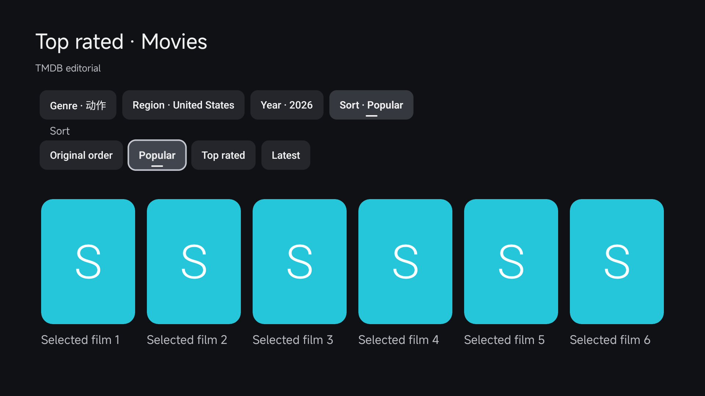
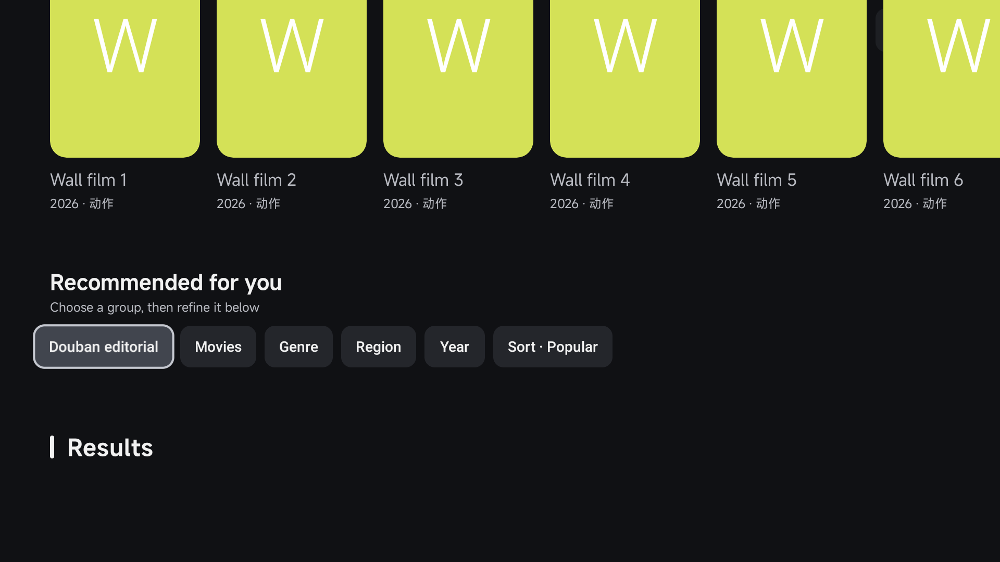
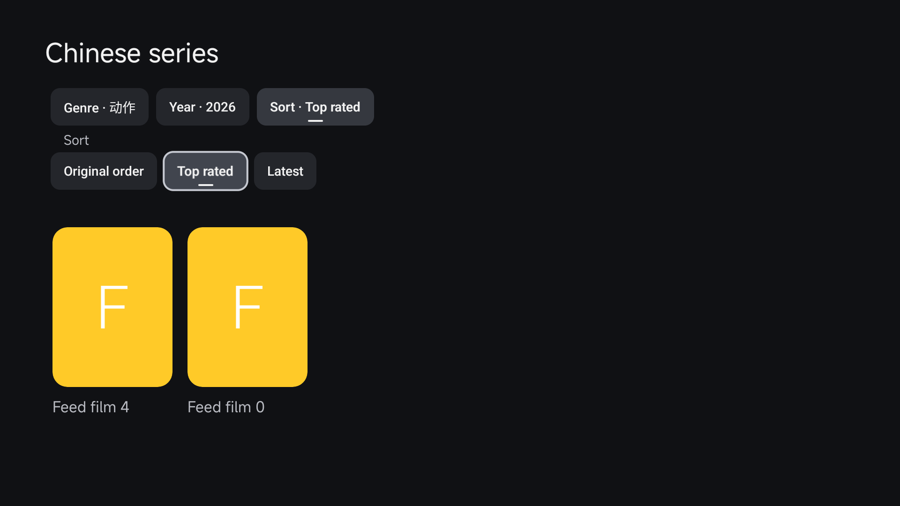
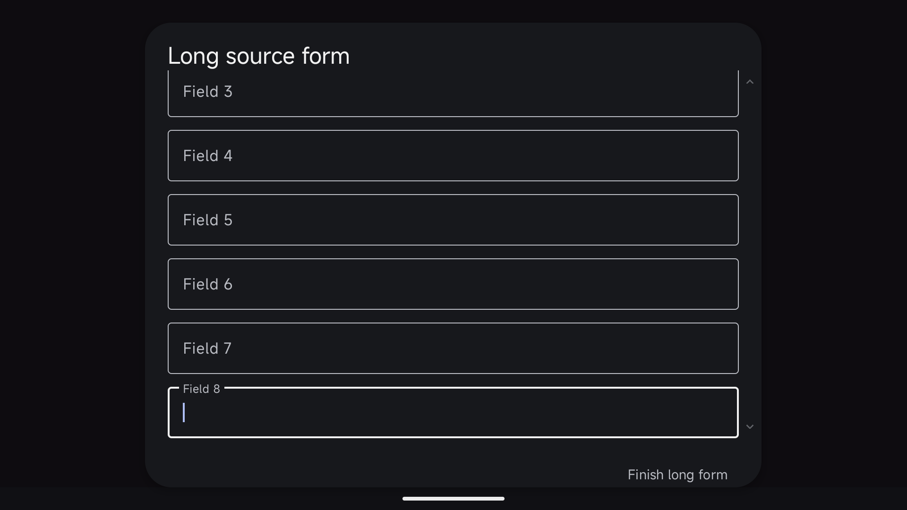
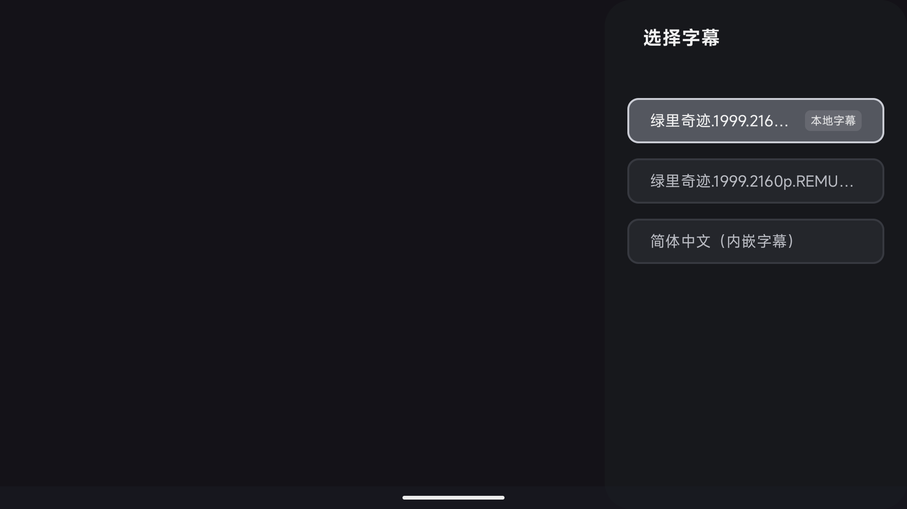
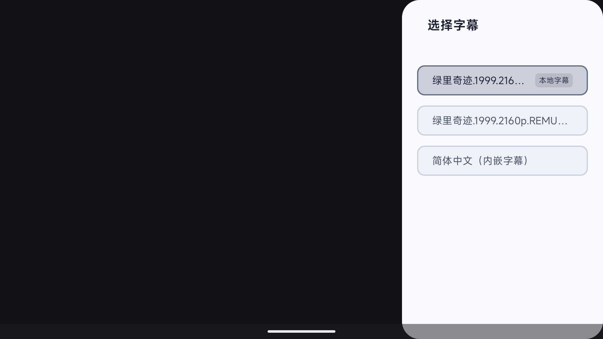

# 海报墙、推荐筛选、字幕与表单微调（2026-11-01）

对应 [PR #91](https://github.com/wobuhui666/TV/pull/91)，合并提交 `529d3fffc94dd83cbf5d9241db1b45d4a7e7e39f`。截图与摘要来自验证提交 `a52f476693bcdc95f2364dac13557363bd8d56fd` 的 [GHA 任务](https://github.com/wobuhui666/TV/actions/runs/41273693165)。本目录保存当时微调的证据，后续功能另见 [社区跳过验证](../2026-11-01-community-skip/README.md)。

## 已实现

- 首页栏目进入的海报墙调整卡片宽度、列间空隙及信息行间距，统一年份和集数信息。
- 推荐结果与各栏目按来源能力提供类型、地区、年份与排序选项，展开项便于遥控定位；部分栏目使用已加载内容的本地筛选，不代表对整个第三方片库做远程检索。
- 收藏片单的筛选保留页面状态，返回页面与刷新时校验仍有效的选项。
- 本地字幕显示「本地字幕」标签，字幕长文件名统一省略，区分内嵌与导入字幕。
- 长源表单增加淡色上下滚动提示，同时保持已有字段、焦点、主题和按钮行为。

## 验证

[UI 摘要](ui-summary.json)包含 7 项海报墙/筛选集成测试和 1 项字幕显示测试，共 8 项通过。[来源与输入摘要](source-input-summary.json)包含登录弹窗、本地字幕扫描、遥控按键归属共 15 项通过。

截图使用受控示例内容，验证布局与实际 Android 交互；没有提供影视资源。API 34 / x86_64 软件 GPU 模拟器结果不代表 ARM 电视性能，不用于宣称实机帧率。

## 精选截图

| 海报墙筛选 | 推荐页筛选 |
| --- | --- |
|  |  |

| 本地片单筛选 | 长源表单滚动 |
| --- | --- |
|  |  |

| 深色字幕列表 | 浅色字幕列表 |
| --- | --- |
|  |  |

使用入口见 [原生海报墙与选源](../../../native-discovery.md)。本目录只保存经检查的公开摘要与截图；完整 GHA 产物、安装包和原始日志不重复上传。[文件清单](FILES.json)记录保留文件的大小与 SHA-256。
