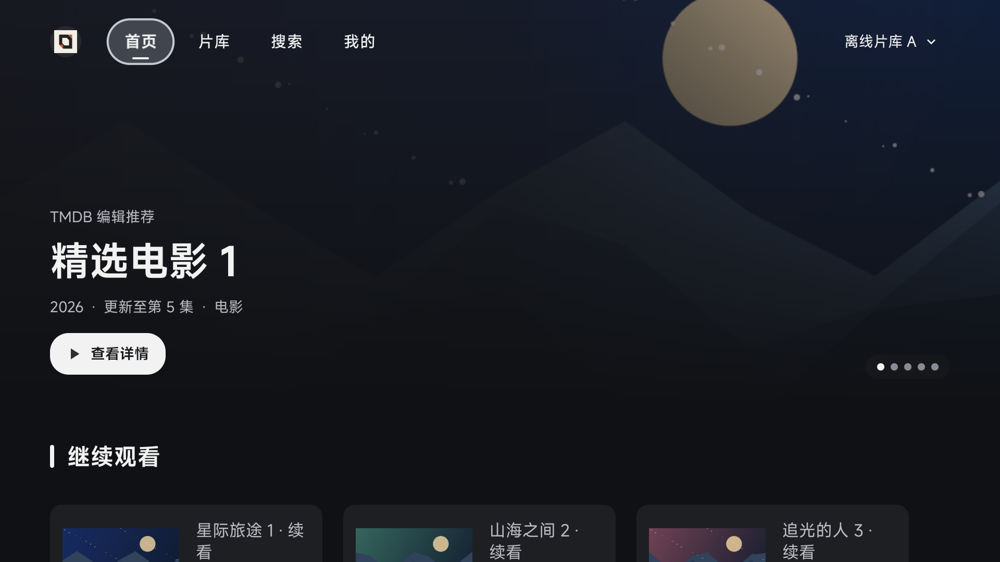
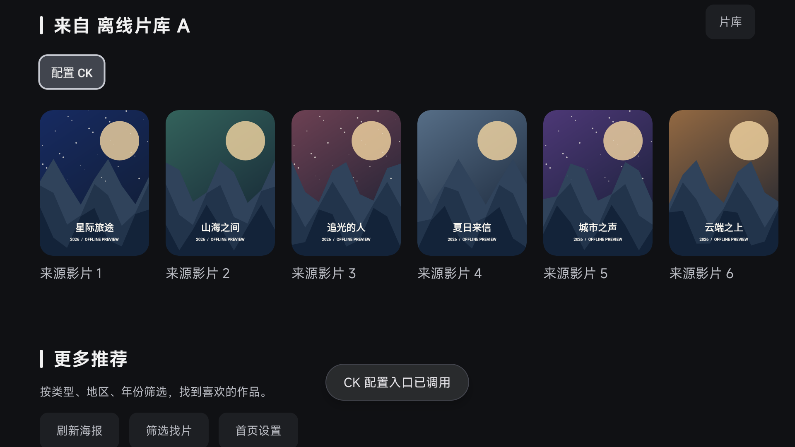
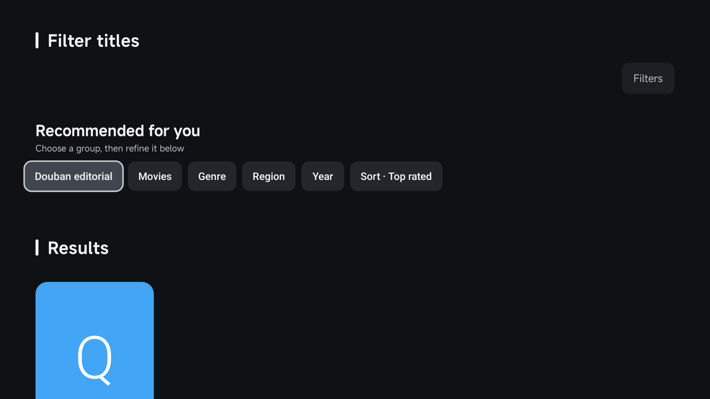

# 精简首页验证

对应 issue [#94](https://github.com/wobuhui666/TV/issues/94)，应用源码提交 `4b9d92a1c8c15817bb9528b68617432e7162b342`。

## 行为

默认把首页与推荐合并，片库保留独立入口和源分类、目录、筛选、登录／CK 操作。首页的“筛选找片”进入纯筛选结果页。设置提供旧版来源首页和旧版海报首页，切换布局不清除其他配置。当前源更新最多展示 20 部影片，源操作不受数量上限或海报缺失影响。

## Android 验证

[GHA 模拟器验证](https://github.com/wobuhui666/TV/actions/runs/42051806296)运行 Android API 34 x86_64 模拟器、隔离 preview 包和合成数据。全部 20 项通过：5 项首页、6 项筛选／回退、4 项目录、5 项来源登录测试。结果见 [首页与筛选](ui-summary.json) 和 [目录与登录](source-regression-summary.json)。

覆盖首页导航、栏目顺序、筛选入口、空栏目清除、无海报 CK 操作、刷新后卡片点击、旧版偏好保留、空结果与重试、TMDB 独立调度器取消、豆瓣回退及页面关闭后的旧回调保护。源操作截图已验证标题与导航不重叠。

| 精简首页 | 当前源与 CK 操作 | 筛选结果 |
| --- | --- | --- |
|  |  |  |

截图中的内容是合成验证数据，筛选页海报使用占位图。此验证涵盖原生 UI、请求和源操作链路，未测试实体电视解码或第三方源账号。

## 构建与 lint

[GHA 构建验证](https://github.com/wobuhui666/TV/actions/runs/42052538732)执行 TV、手机版 arm64 debug 构建、TV instrumentation APK 构建以及以下测试和 lint 命令：

```text
:catvod:testDebugUnitTest
:quickjs:testDebugUnitTest
:app:testLeanbackArm64_v8aDebugUnitTest
:app:assembleMobileArm64_v8aDebug
:app:assembleLeanbackArm64_v8aDebug
:app:assembleLeanbackArm64_v8aDebugAndroidTest
:app:lintLeanbackArm64_v8aDebug
```

构建使用仓库固定 Media3 源码与 SDK 37.0 init 脚本。JUnit 共 1,017 项（应用 788、catvod 213、quickjs 16）；Python 与 JavaScript 来源接口测试另行运行。

全量 lint 存在历史错误，因此工作流保留改动前提交 `8be56e629e71c9fd60740f714e079d60e975ec8a` 与当前提交的完整报告，以问题标识、消息、文件及出现次数比较，拒绝新增 Error／Fatal。未全局禁用 lint 检查；基准为 111 个错误，当前为 108 个。最终结果保存在 [lint 对比](lint-comparison.json)。
