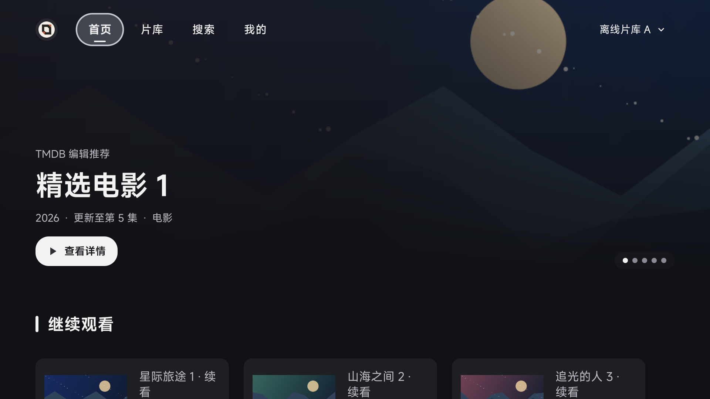

# 首页圆形 Logo

默认工具栏 Logo 的米白底由方形改成圆形，保留内部图形和原留白。自定义 Logo 继续沿用圆形裁剪。

[GHA 验证](https://github.com/wobuhui666/TV/actions/runs/42117321460)对应源码提交 `0a8cbad100c392f530d7c27c79164a2c9c91c411`。编译、单测及 21 项 Android 回归测试通过；实际截图已检查。

