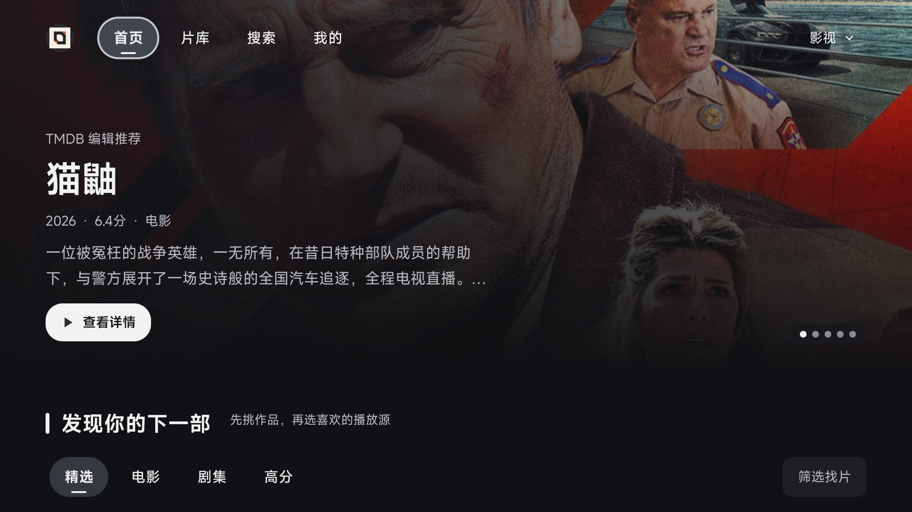
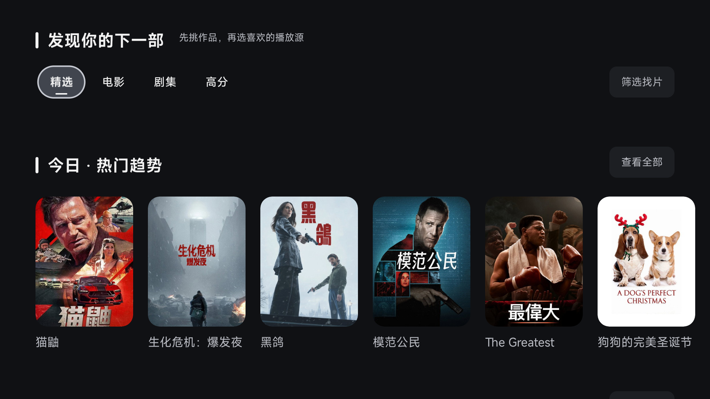
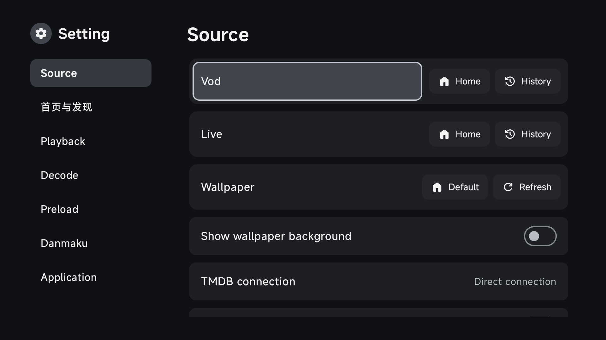

# TMDB 直连与真实首页

应用源码提交 `d9c92c29ee4869baa00a9807d35c8bd59293d5bc`，对应 [PR #95](https://github.com/wobuhui666/TV/pull/95)。

## 实际效果

[GHA 真实首页验证](https://github.com/wobuhui666/TV/actions/runs/42069927999)在 Android API 34 x86_64 模拟器运行生产首页、栏目加载器和 Glide 图片加载，使用 TMDB 官方接口实时返回的数据。没有替换栏目内容或海报。

官方 API 的 6 个栏目请求成功，图片请求成功 41 次；热门、热映电影、热门剧集各返回 20 项。主视觉、电影海报和剧集海报均确认解码成功。详细数据见 [真实请求报告](live-home.json) 与 [GHA 结果](live-summary.json)。

| 真实首页 | 分类与热门 |
| --- | --- |
|  |  |

| 热映电影 | 热门剧集 |
| --- | --- |
|  |  |

首次真实图片验证发现模拟器预览包缺少 x86_64 AVIF JNI。Glide 会在解码 JPEG 前探测 AVIF；验证脚本已加入与现有 Glide 依赖匹配、校验 SHA-256 的 x86_64 库。此补充仅用于隔离模拟器包，ARM 构建继续使用原有依赖。

## 连接方式

**设置 → 来源 → TMDB 连接方式** 提供默认反代、直连官方、自定义反代。直连分别使用 `api.themoviedb.org/3/` 和 `image.tmdb.org/t/p/`，不自动切至第三方反代。既有自定义地址在升级和切换模式时保留。返回首页后加载所选地址；手机版原地址编辑仍兼容。

[设置与回归验证](https://github.com/wobuhui666/TV/actions/runs/42070375051)通过 12 项首页／筛选／设置及 9 项目录／登录 Android 测试。[TV／手机构建与单测](https://github.com/wobuhui666/TV/actions/runs/42070554540)使用固定 Media3、SDK 37.0 和独立包，JUnit 共 1,020 项（应用 791、catvod 213、quickjs 16）。lint 与改动前版本比较，新增错误为 0，既有错误 111 → 108。

验证凭据通过临时 Actions secret 和运行时私有文件注入。源码、安装包和保留的报告不包含实际 key，临时 secret 与文件已在验证后清理。截图展示实时片目信息，不验证影片播放源或实体电视性能。
