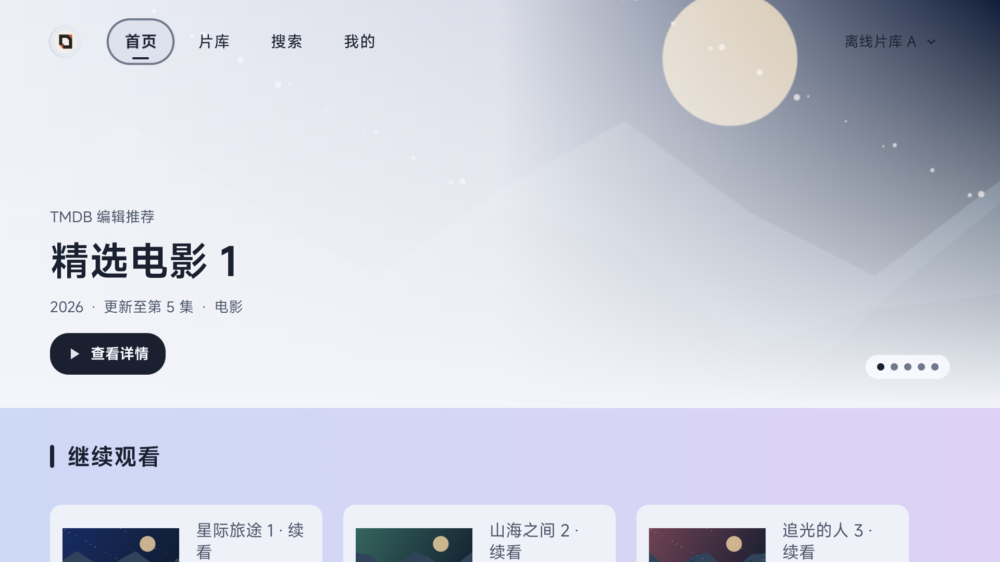
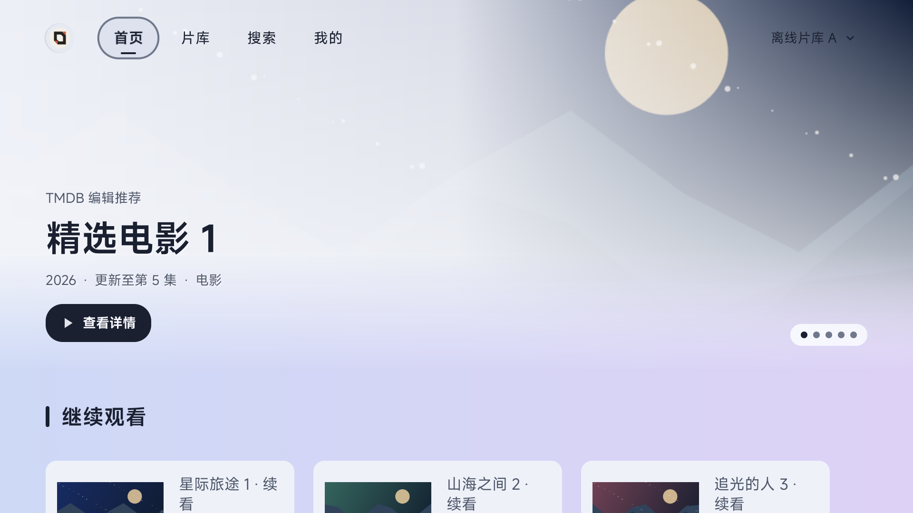
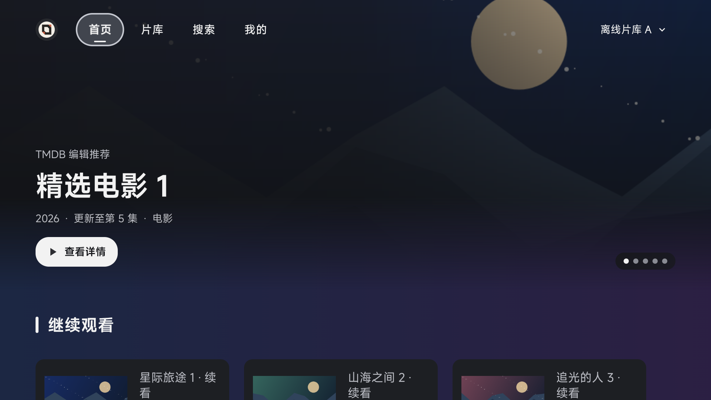
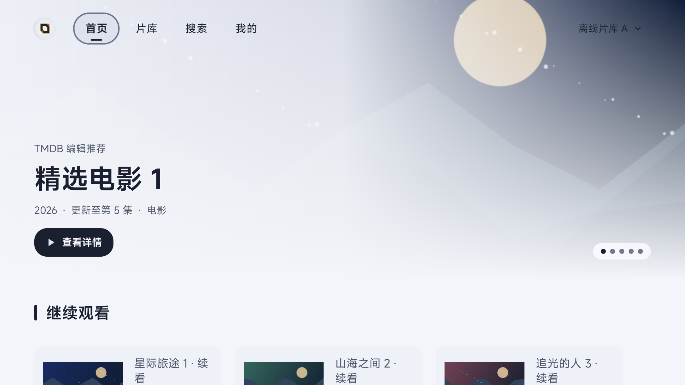
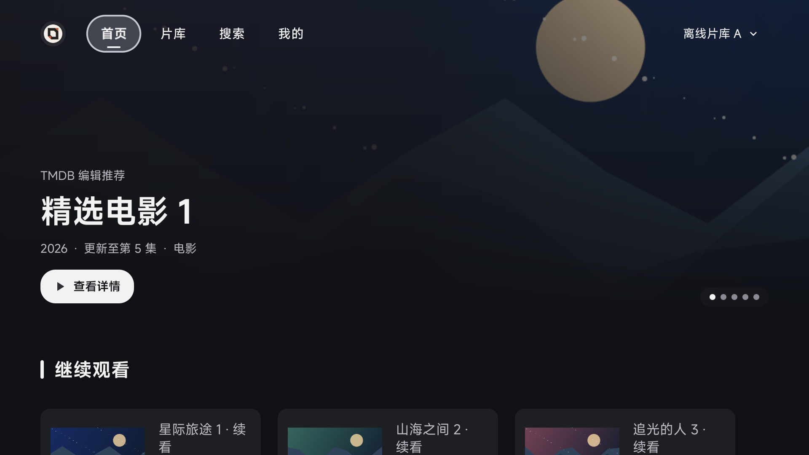

# 首页背景衔接验证

开启壁纸时，主视觉底部原来渐变到不透明主题色，列表区域却露出壁纸，产生横向硬边。现在主视觉图片与左右、底部遮罩放在同一容器，用 Android 原生底部渐隐逐渐露出页面背景。标题、按钮和轮播指示器在容器外保持清晰；关闭背景沿用原有显示。

以下为 API 34 模拟器上的真实 HomeActivity 截图。影片、历史与图片来自受控离线数据；使用内置蓝紫壁纸，以免壁纸本身的垂直明暗变化干扰边界测量。

| 浅色：修复前 | 浅色：修复后 |
| --- | --- |
|  |  |

| 深色开启背景 | 浅色关闭背景 | 深色关闭背景 |
| --- | --- | --- |
|  |  |  |

[专项 GHA 42464534319（第 2 次运行）](https://github.com/wobuhui666/TV/actions/runs/42464534319/attempts/2) 在提交 `9c11dfd8abdf21b87c0bbaaf4db947cbcd35c9a0` 全部通过：6 项两种主视觉布局的像素回归，以及 1 项真实首页回归（循环浅深色、背景开启／关闭）；1003 项应用单元测试无失败、错误或跳过。像素检查覆盖边界连续性、主图仍可见、按钮不淡出、运行时开关、重新附着和尺寸变化。

[原版对照 GHA 42461954833](https://github.com/wobuhui666/TV/actions/runs/42461954833) 在恢复原始主图绘制后正常完成，真实首页边缘产生最大 33 色阶跳变；修复后开启背景的最大跳变为 1，关闭背景为 0。具体场景记录见 [summary.json](summary.json)。

初版自定义整图离屏合成在模拟器触发退出，已移除并改用系统原生渐隐；最终测试正常绘制并结束。测试工作流保留设备断线后的有界诊断及日志，首页验证使用固定的官方 Emulator 36.3.10、普通 AOSP API 34 与正常 HWUI 渲染。此次未进行实体低端电视性能验证。
