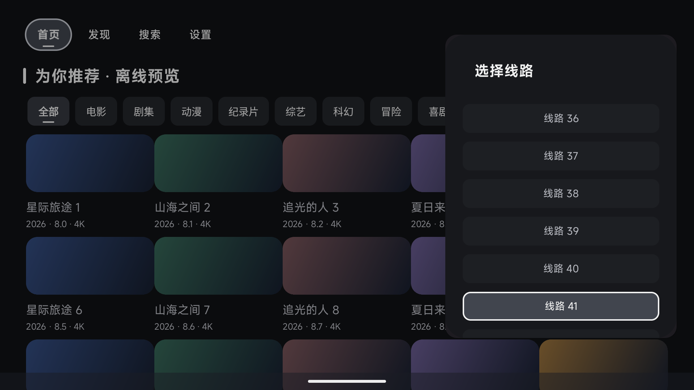
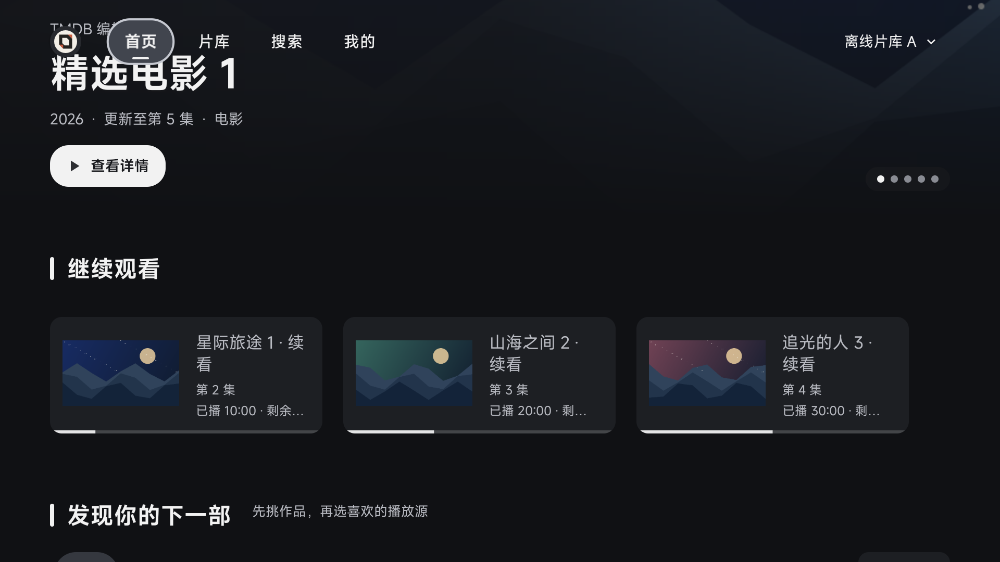
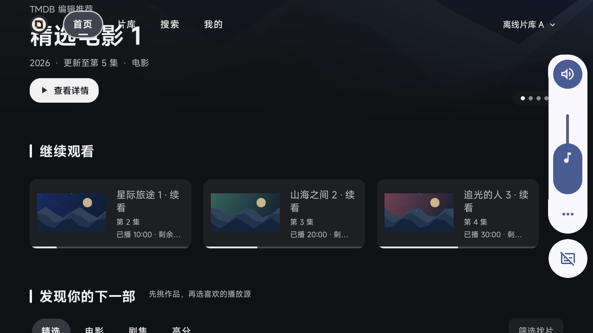
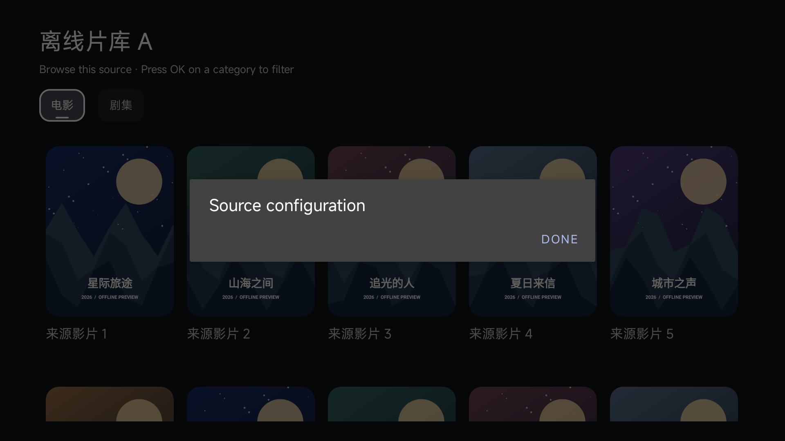
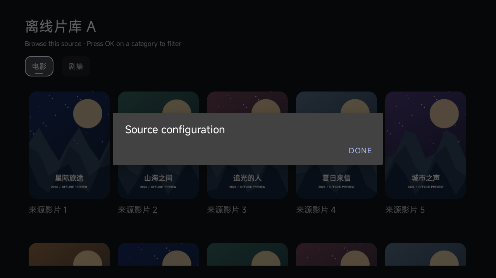
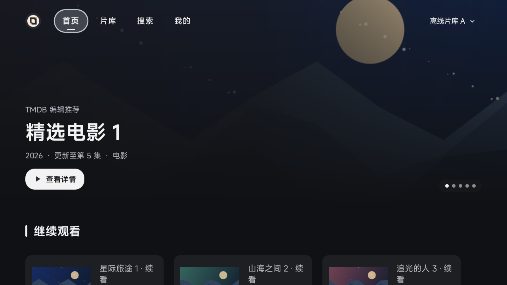
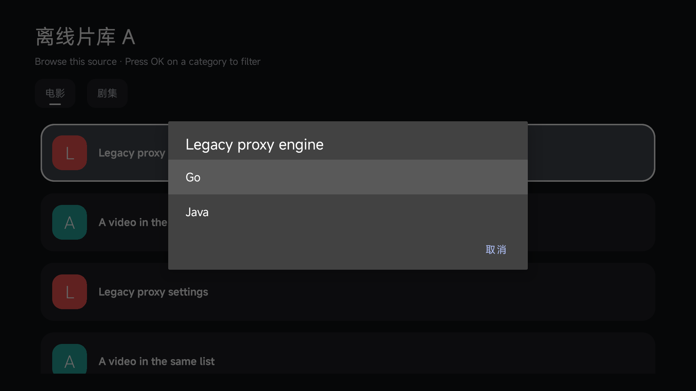
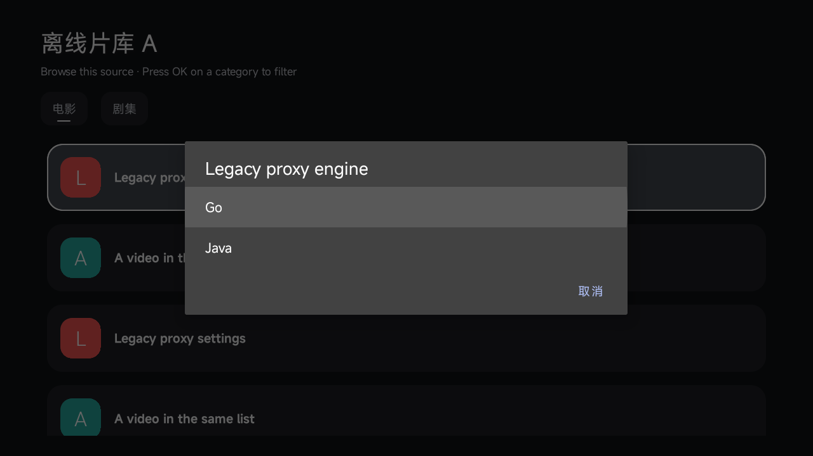
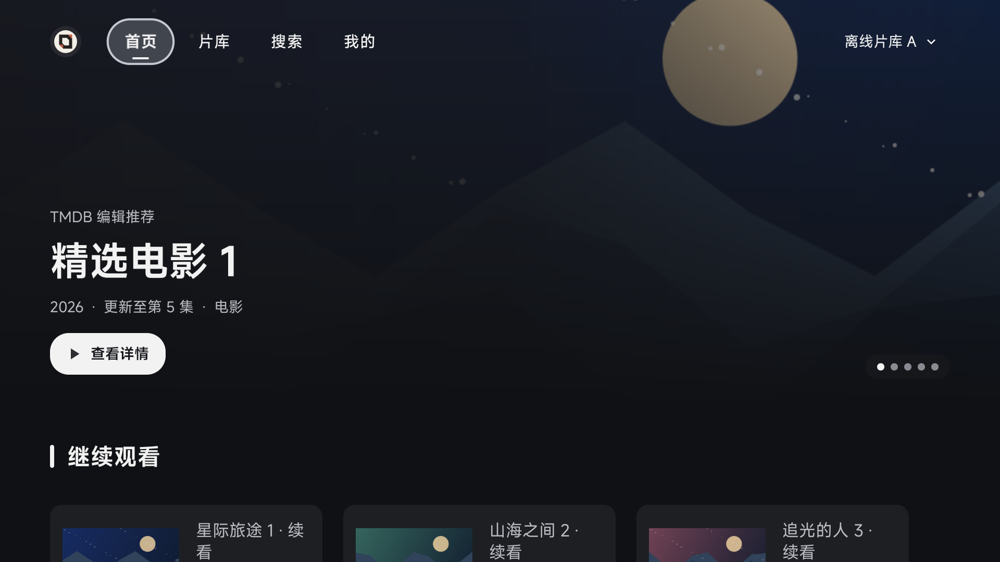

# Issue #119：直播选线、首页触摸滚动与配置弹窗

对应 [issue #119](https://github.com/wobuhui666/TV/issues/119) 第 4、5、7 项。验证代码提交为 `d0930b0e476d1d01bad1fe621aeba3c8d60fbd59`；之后的报告提交仅新增文档和证据。

## 环境与构建

- GHA：Ubuntu、JDK 21、Python 3.10、Android SDK 37.0；Media3 固定为 `342f6590e02ac390e0bd6b4488b8a1bff55747c1`。
- [TV／手机构建与回归检查](https://github.com/wobuhui666/TV/actions/runs/43732512790)：构建 TV ARM64 debug 应用与 AndroidTest APK、手机 ARM64 debug APK；使用独立的 `sourceprobe` 和 `preview` 包名。
- [UI 设备验证](https://github.com/wobuhui666/TV/actions/runs/43732510697)：Android 14／API 34、x86_64 模拟器；分别使用 `1920×1080 @320 dpi` 和 `1280×720 @240 dpi`。预览包补入 x86_64 QuickJS／AVIF 库，供界面和公共表单验证。

APK 位于构建任务的 artifacts 中，未提交到仓库。应用、测试 APK、固定媒体库与校验和见 [构建摘要](build-summary.json)。

## 结果

| 检查 | 结果 |
| --- | --- |
| 应用 JUnit | 1049 项通过，包含 13 项直播线路专项测试 |
| catvod／QuickJS／WASM JUnit | 240／28／19 项通过 |
| 两种尺寸的 UI 测试 | 每种 22 项，共 44 项通过 |
| Android lint | 当前与基线均有 108 个已有错误，新增错误为 0；基线为 `6d6a4a571ad8a6bd362cb05919bbfd8f0fd7a5ec` |

完整计数见 [UI 摘要](ui-summary.json)、[线路单测摘要](live-line-unit-summary.json) 和 [构建摘要](build-summary.json)。

执行的 Gradle 任务：

```text
:wasm:testDebugUnitTest :catvod:testDebugUnitTest :quickjs:testDebugUnitTest
:app:testLeanbackArm64_v8aDebugUnitTest
:app:assembleMobileArm64_v8aDebug
:app:assembleLeanbackArm64_v8aDebug :app:assembleLeanbackArm64_v8aDebugAndroidTest
:app:lintLeanbackArm64_v8aDebug
:app:assembleLeanbackArm64_v8aPreview :app:assembleLeanbackArm64_v8aPreviewAndroidTest
:app:testLeanbackArm64_v8aPreviewUnitTest
```

CI 同时传入 SDK 37.0 与隔离包的 init 脚本、`--no-daemon --build-cache --max-workers=2`；preview 任务使用 `-PtvPreview`。线路专项任务只选择 `LiveLineSelectionTest` 与 `LivePlaybackLineSelectionTest`，严格要求 13 项、无失败或跳过。

## UI 覆盖

| 测试类 | 每种尺寸的数量 | 验证内容 |
| --- | --- | --- |
| `HomeTouchScrollTest` | 3 | 真实 HomeActivity 初始化与触摸滑动；历史刷新、窗口恢复和排队焦点保持滚动位置；方向键、首页与返回导航恢复 |
| `LiveLineDialogTest` | 3 | 真实线路侧栏；60 条线路中后段当前项、精确点击、取消、重复打开保护、触摸后继续 D-pad 选线 |
| `SourceActionDialogTest` | 8 | 真实 Home／Vod 页面、刻意缓存错误 HomeActivity 的旧 Java 静态 API；窗口 token 归属、重复动作、延迟回调、离页清理、连续弹窗、公共弹窗去重、工作线程晚于页面结束；其他表单与过期后的后续调用可正常显示 |
| `SourceDetailDialogTest` | 3 | 通过真实片库列表点击和 SiteApi 调用旧 Java 源；详情协议的配置窗口留在片库、重复点击与延迟窗口清理；普通视频通过 Android Intent／Parcel 复用完整详情，保留线路、集数与请求头，显式刷新重新请求 |
| `SpiderDialogTest` | 5 | 原有 Java／QuickJS 表单、输入验证、二维码、选择器、焦点、连续请求、取消和超时暂停 |

旧窗口关闭验证同时检查 `Dialog.isShowing()` 和页面焦点，避免仅移除窗口视图而留下源内部的打开状态。Android 13 及以上的旧 Dialog 会忽略开启预测返回时的 BACK key event，因此清理使用正常的外部取消事件，并在页面暂停时关闭；保留原源的 dismiss listener。

旧源列表的 detailContent 可能直接打开配置窗口。该请求先绑定片库页面，没有视频线路时不进入播放页；有视频线路时复用本次响应进入原播放页，来源健康统计只记录实际请求。

离页后旧 Java 窗口只在一次操作的超时范围内跟踪已识别的构造位置，尚未返回的首窗使用相同预算。关闭配置动作不会永久禁止整个来源包的后续登录表单。公共 SDK 的请求仍按捕获的页面生命周期取消。

## 截图

以下是设备运行截图，内容为离线测试数据；线路侧栏挂在预览 Activity，未播放真实直播流。

| 场景 | 1080p | 720p |
| --- | --- | --- |
| 线路列表与当前项 |  |  |
| 滑动后历史刷新与窗口恢复 |  |  |
| 旧源配置窗口归属片库页面 |  |  |
| 返回首页后取消延迟窗口 |  |  |
| 旧详情协议的配置窗口 |  |  |
| 列表详情操作离页后的首页 |  |  |

## 受保护旧源补充烟测

另在 Android 12／API 31、x86_64 模拟器及 libndk_translation 上安装 `2cccf0d4b6e6fd412a0c412262bd14d7c81c7a26` 的 ARM64 debug 包，加载公开 aiwex 配置及 `Wexconfig`／`csp_PanConfigGuard`。配置中心能加载，确认其旧详情请求通过 Handler 构造原生 AlertDialog；本次未取得稳定的配置窗口及完整的重复点击、返回验证，未将该受保护 JAR 的真实弹窗烟测计为通过。

环境、安装包校验和及未确认项见 [补充烟测记录](real-source-smoke-summary.json)。源配置、应用数据、调试停顿和原始日志不作为公开截图或通过证据。

## 覆盖限制

本轮不计作实体手机或电视、真实直播解码、Exo 性能或 MPV 验证；手机版线路底部列表完成编译，未运行手机版设备测试。Android 10／API 29 以下不包含旧源窗口枚举与清理。

旧源自建窗口缺少调用身份，构造后另外延迟 `show()`、超出操作预算的独立回调，以及所有未知 JAR 的兼容性不在本轮设备用例范围内。新源应采用 [公共弹窗接口](../../../spider-dialogs.md)。
