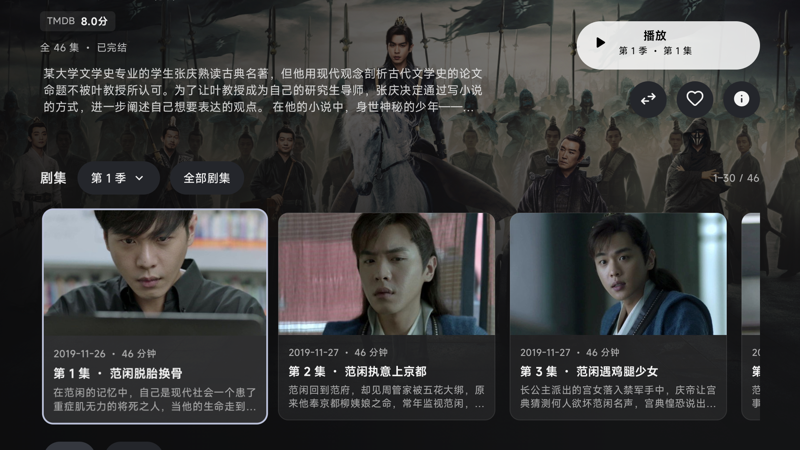
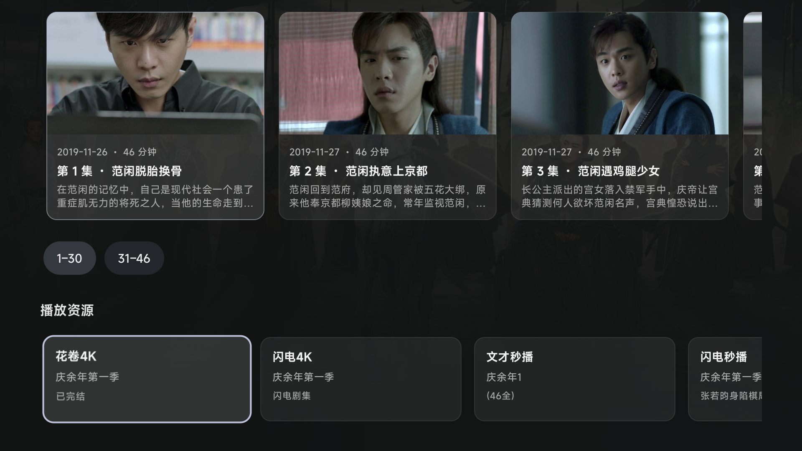

# Compose TV 媒体库详情重做验证

## 选集紧凑排版修订

选集参考图片改为 240dp 宽、16:9 缩略图；焦点细描边只包围图片，文字区没有卡片背景与左右内边距。下方按日期、集数／时长、加粗分集名、两行简介排列，缺值省略。保留原分集 key、进度、播放与区间选择。

当前主包 SHA-256 为 `93a35b788ea626d6323e0d2ffe693ae0419c782e6100d7052011605c981d4b59`，源码清单为 `842f8c33a639445c2f0f36977efa56e647bc1a30187cee87bb88240c26fdb82b`。Debug／Preview 构建通过（292 秒），4 项既有选集回归通过（64.8 秒），覆盖精确播放、方向键往返、35 集续播区间和无 TMDB 原始片源。真实《庆余年》分集图片、文字排列和默认选集焦点已目视核对。新主包已从外网完整下载校验，SHA-256 一致，HEAD 200 与 Range 206 通过。

本次仅验证选集排版及上述交互，未重新验收性能或原生稳定性；下面 7f 主包的慢帧与原生崩溃仍是保留的失败记录，不能认为已修复。

## 详情重做首轮验证（紧凑排版前）

详情重做首轮主包对应提交 `6d6a4a571ad8a6bd362cb05919bbfd8f0fd7a5ec` 加工作区修改，输入清单 SHA-256 为 `91cc77117bc9a4c6209eb1d5f4fc2f790f9975ffe8392f6a930ba12d3c5bc2fc`。使用完整 ARM64 APK，在 API 31 x86_64 与 ARM64 转译桥、1920×1080／320dpi 模拟器上验证。原始日志、工具与 APK 留在文档目录外，完整版本与结果摘要见 [verification.json](verification.json)。

## 页面与性能处理

详情改为 Compose TV 回收列表，采用 AndroidX TV 焦点组件、App 的 JetStream 主题与 MiSans 字体。左侧是片名／Logo、已有评分与简介，右侧是播放及快捷操作；分集、资源、演员、剧照和推荐保留实际资料与原有播放业务。没有时钟、顶部返回按钮或吸顶标题。

图片按显示尺寸解码，背景取色在后台完成并缓存；滚动只更新图层和缓存渐变，避免逐帧模糊及一次性创建所有海报。Logo 保留原图颜色并复用轮廓缓存，避免不透明图片被染成白块。资源画质筛选依据标题／备注的明确标识，实际流编码与轨道以播放器为准。

## 验证结果与范围

| 检查 | 结果与版本范围 |
| --- | --- |
| 构建 | 初版 Debug／Preview／测试包通过；文字颜色修正后三包通过；最终 Logo 修正仅重编 Debug，144 秒通过 |
| JVM | 46 项专项测试通过，零失败／错误／跳过；对应文字颜色修正前的解析与播放业务 |
| Android | 文字颜色修正前完整 48 项通过；c13 Preview 另复测 3 项既有方法通过，48.3 秒，不重复计为 51 项 |
| 最终真实界面 | aiwex《庆余年》、全局深浅主题、分集／资源／演职员／分类／预告／剧照／推荐导航通过 |
| 最终 APK | 签名、ZIP CRC、35 个原生库逐项哈希与 Python 资源保留通过 |
| 外网下载 | 完整下载 119,873,846 字节且 SHA-256 一致；HEAD 200、Range 206 |
| 性能与稳定性 | 最终主包两组共 159 帧均超 16.67 ms；第 3 轮内存采样因原生 SIGABRT 失效，验收未通过 |
| TV lint | 本次未重新运行；108 个错误仅为先前报告的基线 |

最终主包为 `TV-detail-redesign-20261115-arm64.apk`，SHA-256：`7f6446cf018a66afa02edeb0fef36afb39a81ed47ae41413510894436afb5043`。48 项完整回归使用较早 Preview `ed6374f0ab0abb59a8ce40d4ecf3274cbedeb59bea3d5cc0a92d54c36e67917c` 与测试包 `06622ce924e919285d583c7844e19659a6ee9e64b09b02dcfb75f10d85d867b9`；3 项复测使用保留的 c13 Preview `576e2fff256de62f670fde9010e03ab0b62a3ff261535efb4841bd0f93e09d46`。最终 Logo 修正未再重跑完整 48 项，其验收来自下面的主包实际画面。

完整类运行耗时 416.5 秒，覆盖初始焦点、浏览保持续播、35 集续播范围、切季移除旧卡、画质筛选可达、选源取消／替换及迟到响应、播放返回焦点、主题切换与关闭动画。首轮 SystemUI 启动 ANR 和背景装饰节点不可访问的失败保留；设备预检及真实 Bitmap 测试断言修正后通过，未忽略用例。

## 性能与原生退出

最终主包在同一真实作品、全局浅色主题下，以方向键采样。帧耗时使用 `IntendedVsync → FrameCompleted`，按 API 31 的 `FrameTimelineVsyncId` 列解析；Android 自报卡顿帧也分别为 118／118 和 41／41。

| 预热后导航 | 有效帧 | 中位数 | P95 | 超 16.67 ms |
| --- | --- | --- | --- | --- |
| 纵向栏目 | 118 | 424.551 ms | 568.282 ms | 100% |
| 横向资源 | 41 | 485.802 ms | 574.650 ms | 100% |

UI 绘制录制中位数为 3.945／2.115 ms，RenderThread 排队为 104.051／139.521 ms，交换到完成的等待为 163.795／175.316 ms；这些区间显示排队与后端等待，不能直接当作硬件 GPU 耗时，也不能据此排除 UI 开销。设备使用 SwiftShader／Skia OpenGL 与 ARM64 转译；GPU 直方图中的 4950 ms 是不可用哨兵。本轮不能验收流畅度，实体电视性能仍未测。

| 同一 PID 4328 的往返 | 详情 PSS（dumpsys KB） | 返回搜索 PSS（dumpsys KB） |
| --- | --- | --- |
| 第 1 轮 | 293,048 | 268,312 |
| 第 2 轮 | 312,189 | 293,317 |

第 3 轮发生原生退出，后续 155,980 KB 来自新 PID 7170 且前景为搜索页，不能并入原进程趋势。`exit-info` 确认 `APP CRASH(NATIVE)`（reason 5／status 6），20:54:31 UTC 的 `FinalizerDaemon` 收到 SIGABRT，Scudo 报 `corrupted chunk header`；这不是低内存退出或脚本主动重启。同 BuildId 的 ELF 将寄存器 r13 对应地址映射到 `libconscrypt_jni.so` 的 `OPENSSL_sk_pop_free_ex+0x50`；这是寄存器线索，尚不能确认具体释放对象或实际损坏来源。页面取消与图片池所有权的静态核查未发现直接双释放路径。脚本没有主动 GC，运行日志仍包含 Explicit GC，内存诊断本身可能触发终结；两轮短采样不能证明无泄漏或稳定通过。原始帧、退出记录和 tombstone 留在仓库外，摘要及证据哈希见验证 JSON。

独立关闭 ECH 的冷进程诊断完成同 PID 7600 的 3 轮往返，未再观察到原生退出（详情 PSS 269,185 → 276,063 → 257,299 KB，搜索 235,197 → 281,451 → 283,471 KB）。工作负载与原采样不同，仅支持 Native TLS／ECH 候选；不证明根因或默认配置稳定，原 159 帧与第 3 轮失败保留。诊断后移除临时 `ech_enabled` 项，恢复原本缺省开启状态；其他设置及文件权限不变，冷启动回到首页确认恢复；验证期间临时切换的外观也恢复为原深色，没有追加采样或更改主包。

## 最终主包实际画面

以下全部来自最终主包、真实 `aiwex.json` 与 TMDB／片源响应，未替换为离线夹具。Logo 与分集缩略图已加载，文字与默认播放焦点可读；浅色主题沿用全局设置。厂牌图恢复原始内容，深层栏目可用方向键进入。

## 覆盖边界

本轮最终主包验证 UI 与真实元数据，没有重新实播或提交 Cookie。实体电视硬件性能、账号登录及全部片源可播放未验证；模拟器帧与内存结果不能推广到 ARM 电视。日常操作见 [TV 媒体库体验](../../../../LIBRARY_EXPERIENCE.md)。
