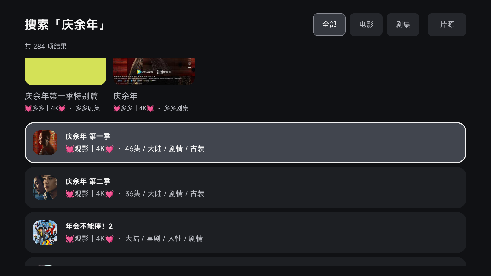
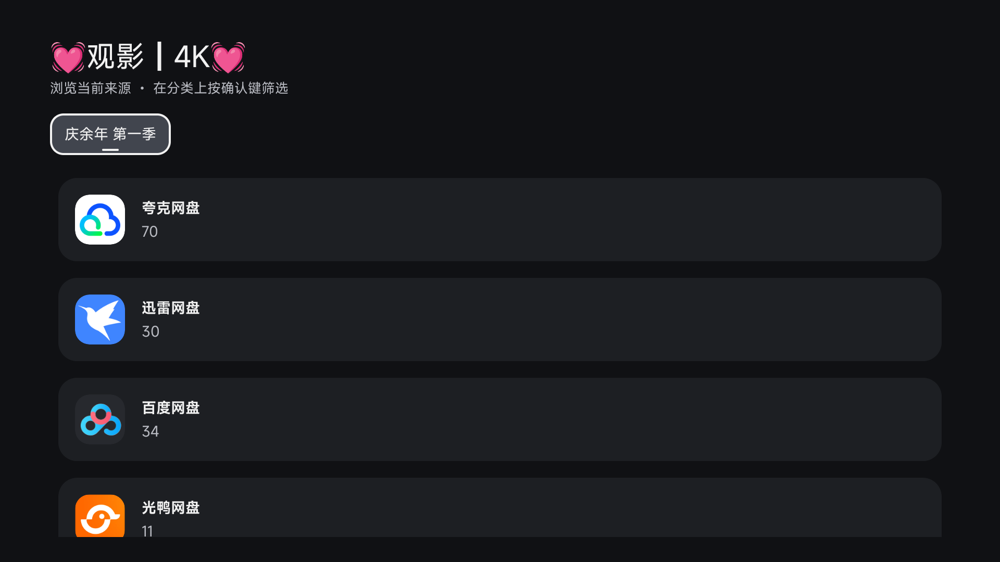
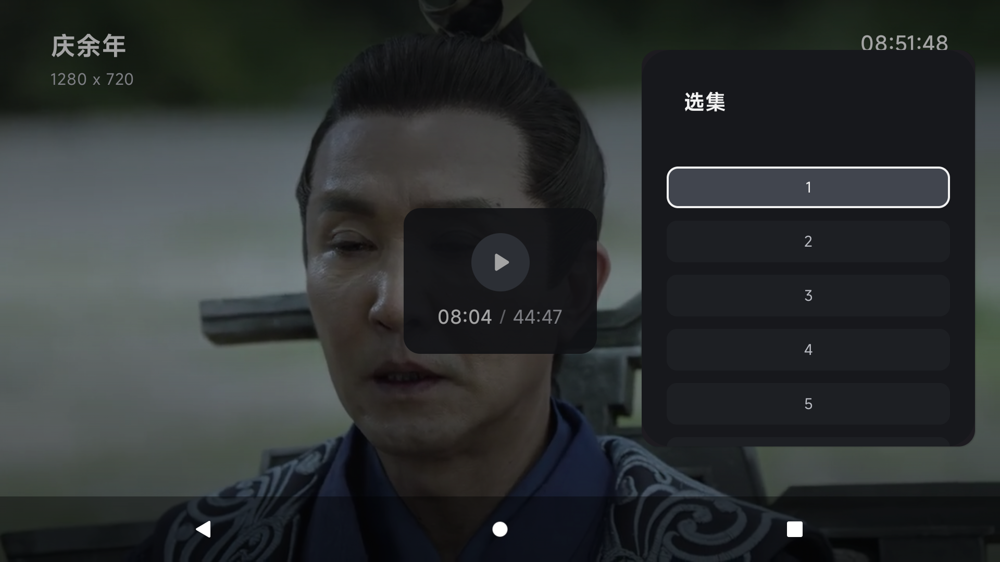

# 媒体库与全屏播放器实测

基于提交 `6d6a4a571ad8a6bd362cb05919bbfd8f0fd7a5ec` 加工作区修改。使用用户指定的 `https://9280.kstore.vip/aiwex.json`，真实请求 TMDB、片源插件与视频；在线过程没有替换响应或使用夹具。运行环境为既有 Codespace 的 Android 12 / API 31、KVM、`x86_64` 与 `libndk_translation` ARM64 桥，安装完整 ARM64 APK，保留原生库和 Python。该环境可以检查实际画面与遥控器操作，不能替代 ARM 电视硬件解码验证。

## 确认的问题与修改

| 实测或代码证据 | 修改 |
| --- | --- |
| 搜索《庆余年》得到 103 条资源，但海报缩成细线。Kotlin `LayoutParams.apply` 中的 `width` 指向 `MATCH_PARENT=-1`，未使用卡片宽度 | 明确使用卡片宽度计算 2:3 海报；继续使用 App 原生海报组件 |
| 全屏隐藏原来的选集区域，控制栏没有任意选集入口 | 增加直接选集按钮、定位当前集的回收列表；可用时提供线路与画质选择 |
| 聚焦其他集改写主播放目标；切季等待时旧季卡片仍可点击 | 浏览焦点与播放目标分开；切季立即移除旧卡并显示加载状态 |
| 正在选源时点击另一片源，只取消旧请求 | 一次点击取消旧请求并选择新片源；主按钮明确提供取消 |
| 多线路全集排在一条横排，加载状态消失时焦点无交接 | 原始剧集按线路与每 40 集范围分组，显示五列选集；加载完成交接焦点 |
| aiwex 同名同年、完整剧集的详情因分类只写“剧情,古装,国产”或缺失，被自动播放全部拒绝 | 同一线路至少两个不同的明确剧集编号可补足类型证据；生成序号、纯数字文件、预告、分段与冲突资料仍不据此自动播放 |
| 观影搜索《庆余年》返回 25 个 `folder` 目录，搜索索引却直接丢弃目录／动作 | 保留完整行目录结果与源操作，按原始 ID 进入源列表；不计作 TMDB 作品的可播放资源，返回恢复条目焦点 |
| 无 `vod_id` 的合法账号操作仍被过滤，多项空 ID 操作可能互相覆盖 | 为无 ID 操作使用独立稳定标识，保留不同操作并去重；只在明确点击时执行 |
| 实际滚动搜索结果时，屏幕外的海报越过列表边界覆盖顶部筛选栏 | 搜索根布局与列表均启用裁剪；已核对最终 APK 内的根布局属性 |
| 首页「片库」被导向 TMDB，索引源的账号目录也可能被当成片名搜索 | 片库恢复所选订阅源分类，TMDB 保留独立的「推荐」入口；账号目录保留原生路由 |
| 原始第 2 集返回详情后仍保留早先第 1 集的数字目标，主按钮续播错集 | 播放历史完整覆盖可空集坐标，继续最后明确选择的原始条目 |

详情把播放、换源与收藏放在标题下方，主按钮标明续播集数与时间。搜索筛选直接显示，分页不再使结果区反复跳动；卡片只显示作品信息与已确认资源数量。全屏信息显示作品名、当前集、片源与线路。搜索与详情移除额外重试按钮，使用简短状态文字。

参考了 [Jellyfin Android TV 搜索焦点分组](https://github.com/jellyfin/jellyfin-androidtv/blob/d2fd0372e8b284a88f7b5b60f8682f717b1d3e7f/app/src/main/java/org/jellyfin/androidtv/ui/search/SearchFragment.kt)、[Jellyfin 详情续播](https://github.com/jellyfin/jellyfin-androidtv/blob/master/app/src/main/java/org/jellyfin/androidtv/ui/itemdetail/FullDetailsFragment.java) 与 [Google JetStream 详情布局](https://github.com/android/tv-samples/blob/main/JetStreamCompose/jetstream/src/main/java/com/google/jetstream/presentation/screens/movies/MovieDetails.kt) 的交互方式，未复制其实现。

## 基线实播

旧包 SHA256：`d1bf9628289c87ae315bac9c42924f988162c448a6f664197ce5bdb79636260d`。配置加载与插件初始化成功，《庆余年》第一季详情显示 43 个资源；手动选“文才｜秒播”后播放第 1 集，实际看到连续视频画面，媒体为 1280×720、H.264 8bit / SDR、AAC 2.0、时长 44:47。暂停于 02:03，返回详情保留进度并恢复片源卡焦点。旧播放列表只有上集、下集、换源、重播、刷新，没有选集。

首次自动播放失败后回到资源区，稍后的截图确认了该状态，未连续测量完成时间。随后将真实详情中的标题、年份与分类送入原匹配器独立复现：花卷、蜡笔、闪电、文才与下饭样本均 `matches=true`、`score=100`，但 `kind=UNKNOWN`、`automatic=false`；同一文才样本改为明确“电视剧”分类则允许自动播放。完整列表已有明确剧集标签，修复据此补足类型，未放开所有未知分类。

另复核了旧播放器设置侧栏：等待展开动画完成后焦点正常进入侧栏，下键正常移动，未因中间帧截图的底栏描边改动该逻辑。重启后从观看记录打开详情再点主按钮，也能从文才源 02:03 继续播放。

## 新版验收

最终 ARM64 Debug 已构建并校验，位于 `/home/ubuntu/TV-concepts/library-polish-20261115/TV-library-polish-20261115-arm64.apk`，SHA-256 为 `12ca69a59f0168afcdec084c9bacf684a1322df344108001337b676aa7c9be24`；源码清单 SHA-256 为 `9c45de4c2ca2087cb481da8f07311996fc3df9ac3caeb8a7419aa0510ff7bb59`。安装包签名验证通过，35 个原生库与前版逐一校验一致，Python 保留，APK 二进制 XML 的搜索根布局 `clipChildren=true` 已确认。最终源码另运行 `EpisodeIdentityResolverTest`，36 项通过，零失败／错误／跳过。

最终 Debug 的在线滚动验收通过：重新导入真实 `aiwex.json` 后搜索《庆余年》，本次返回 284 项；结果数量是网络采样，不是固定值。片源跳转、深滚动、目录返回和回顶时，标题、计数与筛选均完整可见，海报裁剪在列表顶部（1920×1080、320dpi 下为 y=228）。遥控器打开观影第一季后看到夸克 70、迅雷 30、百度 34、光鸭 11 的分类；按返回恢复原目录焦点，继续按上键可回到首排及「全部」筛选。此次最终复核止于分类列表，未重测资源版本分支或播放。

以下两张截图来自最终 Debug：

以下 61 项 JVM、61 项 Android 回归及两张播放截图均属于根布局裁剪修订前，完整摘要见 [verification.json](verification.json)。前版 Debug SHA-256 为 `4b29b0137487dc47d7a4729bcd38ff649695e5423afa7e96baf16b0cc2e04143`；本轮设备为 API 31 x86_64 模拟器与 ARM64 转译桥。此次仅重建最终 Debug，下列 Preview 回归不包含该修订。

| 检查 | 修订前结果 |
| --- | --- |
| 专项 JVM 回归 | 61 项通过 |
| Android 回归 | 61 个独立用例通过：首页 8、媒体库 46、进度条 7；复测不重复计数 |
| TV ARM64 Debug、Preview 与 Preview AndroidTest | 构建通过 |
| TV lint | 108 个错误、379 个警告；任务因既有错误退出，比较确认无新增错误 |

首轮记录保留了 SystemUI ANR 遮挡、图片夹具缺失、旧栏目期望及选集面板重开后的焦点同步问题。处理后逐项复测通过，覆盖可见控件、目录往返、续播目标、全屏选集与进度交接。修复环境后的整类运行为首页 7/8、媒体库 44/46、进度条 7/7，随后失败项均复测通过；原始日志按类名与方法名去重，共 61 个独立通过用例。离线回归使用夹具，下面的在线操作使用上述 Debug 版本与真实 `aiwex.json` 响应。

前版在线搜索《庆余年》显示 77 条结果。观影条目以完整行目录显示，打开后见到夸克、百度、迅雷等网盘分类；实际进一步进入的是夸克资源版本分支。其他网盘仅确认出现在分类列表中。

从观看记录续播文才源第 1 集后，通过全屏「选集」切到第 3 集，看到连续真实视频画面。画面信息为 1080P、H.264 8bit、AAC 2.0；媒体会话采样为 `description=庆余年1,3`、`position=826662` 毫秒、`state=3`（播放中）。

以下两张播放截图来自根布局裁剪修订前的 Debug 版本，记录全屏选集和实际播放。

未验证实体电视硬件解码、网盘账号登录、真实 Cookie 提交或全部片源可播放。构建、原始网络日志与 APK 保存在文档目录外。
