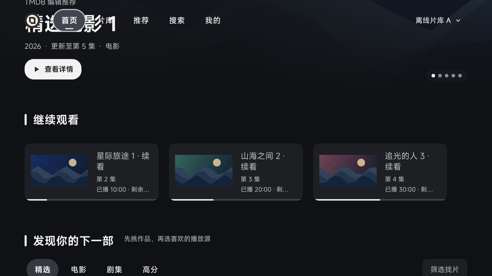
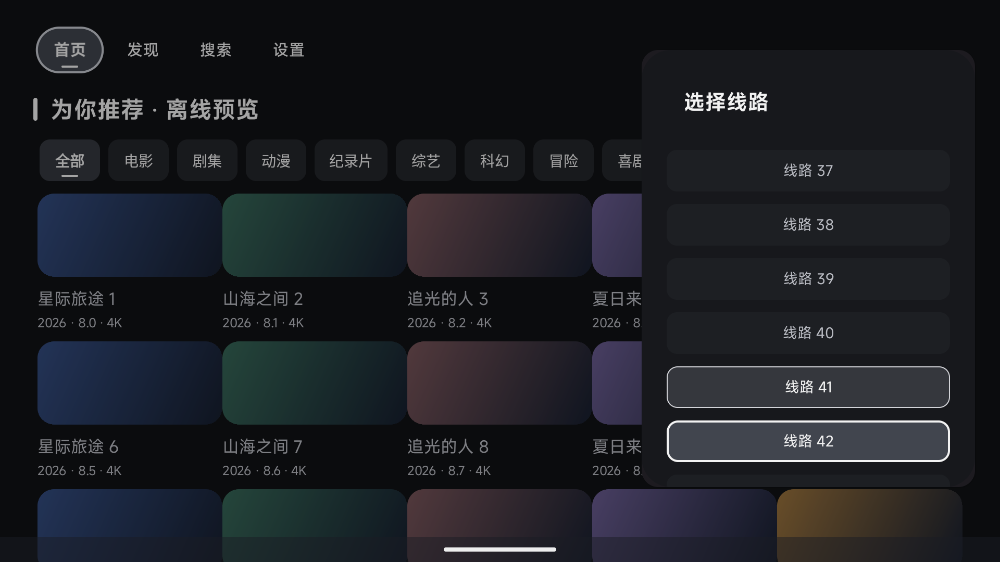

# 直播线路选择与首页触摸滚动

对应 [issue #119](https://github.com/wobuhui666/TV/issues/119) 的第 4、5 项。

## 测试版本与环境

- 最终构建快照：`eac9fca98ffa61275dc1df0245e5ce6d7aa85c59`；基于 `6d6a4a571ad8a6bd362cb05919bbfd8f0fd7a5ec`，包含当时工作区已有改动与本次修复。本报告不代表 Release 191 原始 APK 的结果。
- UI 验收提交：`d3d86b3d65167835043c634067727182a7982b3e`。最终构建仅移除使用前会被覆盖的默认字段初始化，UI 行为逻辑不变。
- 结果针对上述快照；构建完成后其他任务补充的片库目录导航改动不计入本报告。
- Media3：`342f6590e02ac390e0bd6b4488b8a1bff55747c1`，使用仓库固定补丁。
- GHA Ubuntu、Temurin 21、Python 3.10、Gradle 9.1.0、Android SDK 37.0 / build-tools 37.0.0、NDK 29。
- 本机约 2 GB 内存，无 adb 设备或 Android 模拟器；本地 Kotlin 编译因换页缓慢而中止，未形成测试结果。
- 按用户要求改用 GitHub Actions 的隔离构建与 Android API 34 x86_64 模拟器。

[TV／手机 APK、单测和 lint 构建](https://github.com/wobuhui666/TV/actions/runs/43685289320)；[专项单测与两尺寸 UI 回归](https://github.com/wobuhui666/TV/actions/runs/43683966987)。

## 行为与覆盖

直播线路按钮显示完整列表，TV 使用播放侧栏，手机版使用底部面板。显示来源中的线路名或本地化编号，用独立的 activated 状态标记当前项，移动遥控焦点保持原线路。指定索引直接切换；取消、当前项、无效或空线路不刷新。频道、配置或线路列表变化后，旧选择不能应用到新的频道。面板内部空白触摸不触发外部取消，遥控器左右切线及错误自动下一线路保留。

首页内容触摸开始时取消旧焦点请求，并保存原有策略、临时使用 `FOCUS_SCROLL_ITEM`，防止 Leanback 在 adapter 重布局时对齐第 0 行。滑动及惯性停止后继续保留视口，阻止历史、主视觉、来源结果和窗口恢复焦点强制回顶。遥控器、显式首页入口及返回键恢复原策略和导航；音量键不结束触摸浏览保护。返回键用实际可见行几何判断滚动位置。

新增 JUnit 类 `LiveLineSelectionTest`、`LivePlaybackLineSelectionTest`，共 13 项，覆盖名称与编号、空值、选中索引、精确切线、当前项不刷新、过期频道/列表和左右循环。

新增真实 preview UI 类 `HomeTouchScrollTest`、`LiveLineDialogTest`，各 3 项。首页覆盖实际滑动、迟到历史/来源结果、弹窗关闭、排队焦点及触摸转遥控；线路面板覆盖高亮定位、精确点击、取消、重复展示、60 项列表及触摸后遥控选择。

## 验证结果

| 检查 | 结果 |
| --- | --- |
| 13 项直播专项 JUnit | GHA 通过，6 + 7 项，零失败／错误／跳过 |
| 全量应用 JUnit | 1170 / 1170 通过，零失败／错误／跳过；其中包含 13 项线路专项 |
| TV / mobile ARM64 debug APK | GHA 构建与包名检查通过，TV APK 的 SHA-256 与构建元数据一致 |
| TV preview 应用与 AndroidTest 编译 | 通过，生产面板与首页 UI 实际在模拟器执行 |
| TV ARM64 debug lint | 基准与当前均为 108 个既有错误，新增错误 0；完整报告保留在 artifact |
| 新增 6 项 Android UI 用例 | 1920×1080 / 320 dpi、1280×720 / 240 dpi，各 3 + 3 项，总 12 / 12 通过 |

前两轮发现并修正了错误的 Leanback 滚动统计判定、面板内部触摸穿透、重布局自动对齐，以及焦点动画改写 selected 状态。原同一行位置、精确选线和取消不回调断言保留，新增真实共享控制器的线路／刷新次数断言。lint 另发现编号 `%s` 参数类型和无用字段初始化的受限常量引用，均在调用处修正。

日志确认：滑动后首行 top 为 −409，历史／来源刷新、实际弹窗关闭和音量键后仍为 −409；触摸策略为 ITEM。遥控操作恢复 ALIGNED，返回键恢复首行 top=0。

测试计数、运行链接、提交与 APK 校验值见 [验证摘要](verification.json)。[TV ARM64 验证包](https://github.com/wobuhui666/TV/actions/runs/43685289320/artifacts/14150895543)包含 app／test 两个 APK；[手机 ARM64 验证包](https://github.com/wobuhui666/TV/actions/runs/43685289320/artifacts/14149967281)为独立手机版界面。均使用隔离包名 `com.fongmi.android.tv.sourceprobe` 和 debug 签名，不覆盖标准版。





覆盖 Android 14 x86_64 模拟器上的离线生产 UI、共享控制器与两种屏幕尺寸，不代表实体手机／电视验收；未验证真实直播流、Activity 重建、MPV 黑屏或 Exo 性能。旧版来源首页主动刷新会删除旧推荐行，本次保留该加载策略；内容增删造成的布局位移不等于焦点强制回顶。原始日志、APK 与完整帧序列留在 GHA artifact，文档只保存摘要和必要截图。

## 运行方式

按根目录 [本地构建说明](../../../../LOCAL_BUILD_ENV.md) 设置 SDK、Python 与 `MEDIA3_SOURCE_DIR`，并加载 SDK 37.0 minor API init 脚本。

```bash
./gradlew -I "$TV_SDK_INIT" :app:testLeanbackArm64_v8aDebugUnitTest \
  --tests 'com.fongmi.android.tv.playback.live.LiveLineSelectionTest' \
  --tests 'com.fongmi.android.tv.playback.live.LivePlaybackLineSelectionTest' \
  --no-daemon --build-cache --max-workers=1
```

设备回归使用隔离 preview 包：

```bash
./gradlew -I "$TV_SDK_INIT" -PtvPreview \
  :app:assembleLeanbackArm64_v8aPreview \
  :app:assembleLeanbackArm64_v8aPreviewAndroidTest --max-workers=1
adb shell am instrument -w -r \
  -e class com.fongmi.android.tv.test.HomeTouchScrollTest,com.fongmi.android.tv.test.LiveLineDialogTest \
  com.fongmi.android.tv.preview.test/androidx.test.runner.AndroidJUnitRunner
```

安装 preview 应用与测试 APK 后再执行 instrumentation。现有 `HomeNavigationIntegrationTest` 可用于补充遥控焦点回归；UI 覆盖需要实际设备或模拟器。

GHA 可在 `TV appearance and touch verification` 工作流中选择 `live_lines_touch_scroll=true`，先核对 13 项单测，再运行两档尺寸各 6 项 UI 测试。
