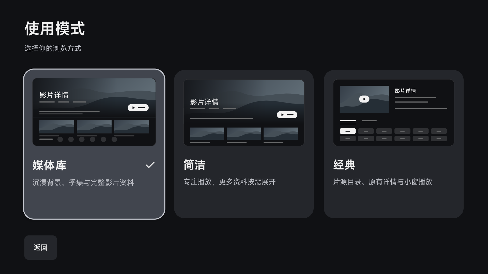
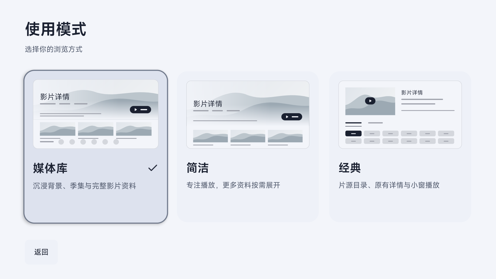
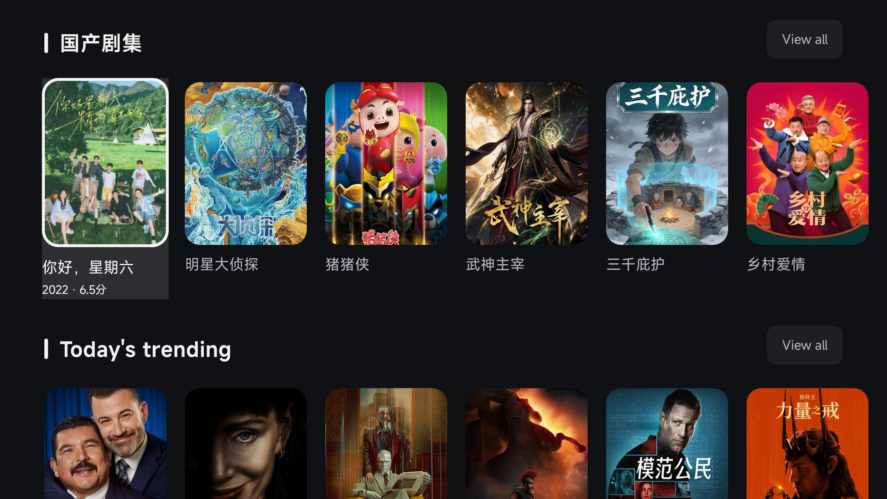

# 首页精选与模式选择验证

三种模式的简洁预览、首页国产精选及首页焦点修订已通过最终 Preview 的 **24 项 Android 回归**，失败与跳过均为 0。查询、首页内容策略及设置的 **39 项专项 JVM 测试**通过。最终 ARM64 主包构建、签名、原生资源及完整直链下载校验完成；真实网络首页显示国产精选，有限浏览及返回保持同一进程。主包版本、校验和及覆盖范围见 [verification.json](verification.json)。

## 版本与行为

基准提交为 `6d6a4a571ad8a6bd362cb05919bbfd8f0fd7a5ec`，包含未提交的工作区修订。1995 项输入清单 SHA-256 为 `92def23be27caad4ad20af8a2da8e45965f5807ad676f8830af3c05869244340`。最终 Preview APK 为 `2431ef05a2ed5a6b7621fad344c1708f5613cd2945c277fed15c7b49a52a748d`，测试 APK 为 `76fc07e23c9d295f4efe81cdffc029d1e313d950fdcfb4f4ee33222ccc38d30e`；签名核对通过，Preview 保留 35 个 ARM64 原生库及 20 项 Python 资源。

媒体库和简洁模式将推荐精选合入首页，保留独立片库、直播、搜索和我的入口。默认只展示国产电影、国产剧集与此刻热门，每行最多 12 部；电影、剧集及高分切换各自的少量栏目，每次至多请求三个栏目。国产筛选使用 TMDB `with_origin_country=CN`，高分另设至少 100 票门槛。片库继续打开当前源自己的分类、目录、筛选及登录／CK 操作，当前源影片预览最多 20 部，账号操作不受海报缺失或数量上限影响。

模式示意图使用统一中性色彩和静态微缩布局，复用绘制对象，不请求网络图片或创建位图缓存。首页预览和完整推荐共用缓存，但仅在展示时截取 12 部，避免首页先加载后在缓存有效期内缩短完整页内容。具体操作见 [原生首页说明](../../../native-discovery.md) 和 [TV 媒体库体验](../../../../LIBRARY_EXPERIENCE.md)。

## 最终测试结果

Android 测试运行于 API 31、1920×1080／320dpi 的 x86_64 模拟器，通过 `libndk_translation` 执行完整 ARM64 Preview APK；使用隔离包与离线 TMDB、片源和图片夹具。

| 检查 | 实际结果与范围 |
| --- | --- |
| JVM 专项 | 39 项，失败／错误为 0：`RexTmdbQueryTest` 16、`PosterHomeCatalogTest` 12、`RexHomeCatalogTest` 8、两类体验设置 3。覆盖国产查询、精选数量／顺序、身份去重与偏好；这些类未随后续焦点修订改变，本轮未重新运行全量 JVM |
| 首页 | `CompactHomeIntegrationTest` 10 项：两个媒体库模式的导航、国产精选、分类与筛选、请求和卡片上限、片源目录路由、CK、账号文件夹及刷新后点击 |
| 模式选择 | `ExperienceModePreviewTest` 3 项：深浅主题与三个当前模式、实际方向键／确认键切换、Back 返回及焦点恢复，其他偏好保留 |
| 推荐回退与缓存 | `CompactDiscoveryIntegrationTest` 7 项：独立调度取消、空结果／失败重试、豆瓣回退及共享缓存。传统豆瓣行为在显式经典模式下隔离验证；同一栏目 12 部预览→20 部完整页→12 部缓存命中仅请求一次 |
| 首页触摸与遥控器 | `HomeTouchScrollTest` 3 项：回调和窗口焦点变化后保留滚动、取消旧焦点请求、触摸后恢复遥控器与明确首页导航 |
| 模式兼容 | 原有 `LibraryExperienceAndroidTest#modeSelectionKeepsPlaybackAndSourcePreferences` 1 项：切模式保留播放偏好及片源 |

前四组共 23 项、179.8 秒；兼容用例另 1 项、9.5 秒，合计 24 项全部通过。临时焦点 probe 仅用于取证，已从最终测试源码移除，未计作功能通过。

构建和测试任务使用 `:app:testLeanbackArm64_v8aDebugUnitTest` 的上述五类筛选、`:app:assembleLeanbackArm64_v8aPreview` 及 `:app:assembleLeanbackArm64_v8aPreviewAndroidTest -PtvPreview`。最终 Android 结果来自安装后实际执行，不仅是测试包编译。

## 初期失败与焦点修订

早期测试出现分类不可见及筛选控件找不到。补充布局和焦点等待后仍失败，因此没有仅通过延长等待宣布修好。现场 JSON、截图和原生选择任务 probe 确认了两个生产问题：

- 原固定 50ms 回调没有等到目标行绑定和定位。目标分类行位于屏幕外，回调后分类 holder 已回收，焦点落到下一海报行的「查看全部」；请求代数保持一致，并非旧请求被取消。
- 选择任务本身的 holder、位置及行身份有效，但焦点查找忽略了标题容器的 `FOCUS_BLOCK_DESCENDANTS`，进入其不可获焦的 Compose 标题子树；`requestFocus()` 实际返回 false，进而错误回到顶部导航。列表本身的直接焦点请求返回 true，且已开启 `focusableInTouchMode`，排除了触摸模式限制这一解释。

最终交接先进入列表内容焦点域，使用 Leanback 的 holder 任务与目标行身份检查；若选中行已经拥有焦点就认可现状，递归查找尊重禁止后代获焦的容器，保留请求代数、配置及页面生命周期保护。Leanback 已有可用 holder 的快路径会同步执行任务，未准备好时才等待定位回调，不能宣称所有回调都晚于滚入。原真实 D-pad、可见性及路由断言保留，并在最终 24 项中通过。

早期经典推荐用例还因未隔离当前体验模式而失败，测试现显式设置经典模式并恢复原偏好，未放宽原断言。早期失败、临时 probe 与原始诊断保留在仓库外，由 [verification.json](verification.json) 记录阶段和范围，不复制私有配置或原始私有日志。

## 画面

模式图来自最终 Preview 的实际 Android 界面。首页国产精选图来自最终主包的真实网络内容；模拟器系统语言为英语，已有部分栏目为中文。图片来源及哈希记录在 [verification.json](verification.json)。

| 深色模式选择 | 浅色模式选择 | 首页国产精选 |
| --- | --- | --- |
|  |  |  |

## 主包与下载

最终主包 SHA-256：`b87c3668a8e23f01869fd4839d347d6b912d59d7223909f569174f2cfa46a705`，120287542 字节；保留 35 个 ARM64 原生库和 20 项 Python 资源，内容与上一轮稳定性包一致。签名与前版兼容，外网 HEAD、Range 及完整 GET 哈希核对通过。实际首页与国产内容浏览使用同一 PID 2988，并可返回首页。

当前 `aiwex` 源下载的 Go 扩展为 x86_64，与模拟器运行的 ARM64 进程不匹配；点击片库显示原生「没有可用分类」保护，未在主包中加载该源目录内容。源目录、账号文件夹与 CK 路由通过离线的真实生产调用路径验证；不将其计作在线源目录或账号验收。启动时的 SystemUI ANR 已按完整窗口归属确认并关闭，未将其归为 App ANR。主包检查中没有更改源配置或模式偏好。

## lint 与覆盖限制

TV lint 已执行，任务退出 1，报告仍有 121 个 Error。保存的较旧报告为 108 个；多出的 13 条全部来自上一轮详情取色文件 `LibraryDetailArtwork.kt` 的 Hct `RestrictedApi`，该文件哈希与上一轮主包源码一致。旧报告不是本轮精确的前置基准，不能据此宣称全量 lint 通过；本轮首页和模式修订没有新增 Error。静态模式预览另有程序构造器及 KTX 写法建议 Warning。

此次覆盖有限的首页、模式及导航工作负载，未验证实体电视帧率、全部第三方源、账号登录／Cookie 提交或完整播放资源。JVM 专项不覆盖原生焦点，后者由最终 Android 用例验证；模拟器结果不支持 60fps、全部 ARM 设备稳定或无泄漏的结论。既有 TLS 压力与详情稳定性结果仍以[上一份报告](../2026-11-16-library-alignment-stability/README.md)的版本和限制为准，本轮没有重新执行那组压力测试。
