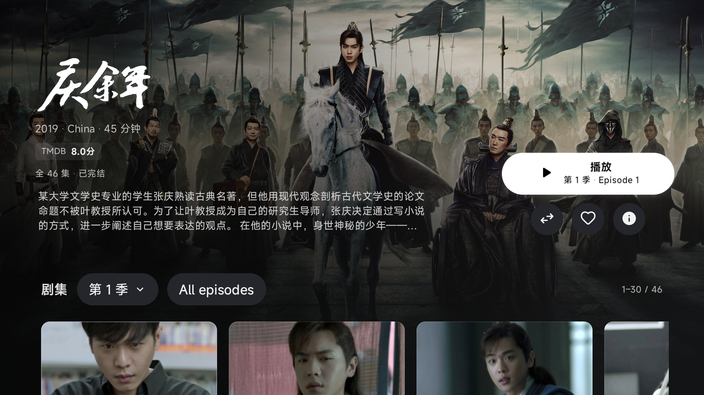
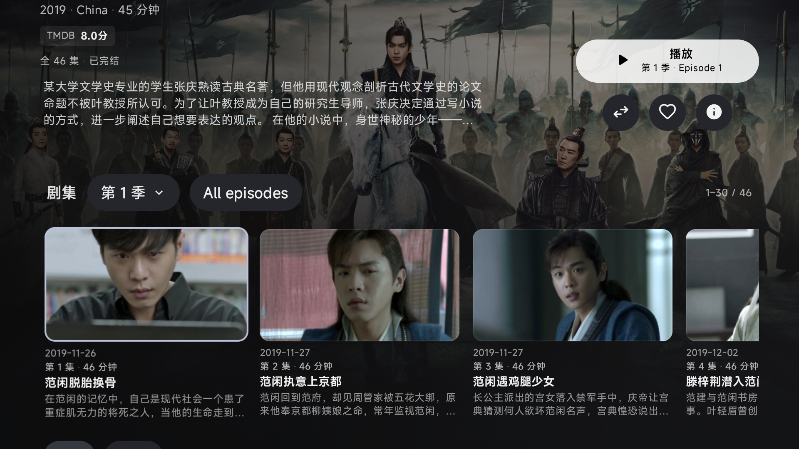
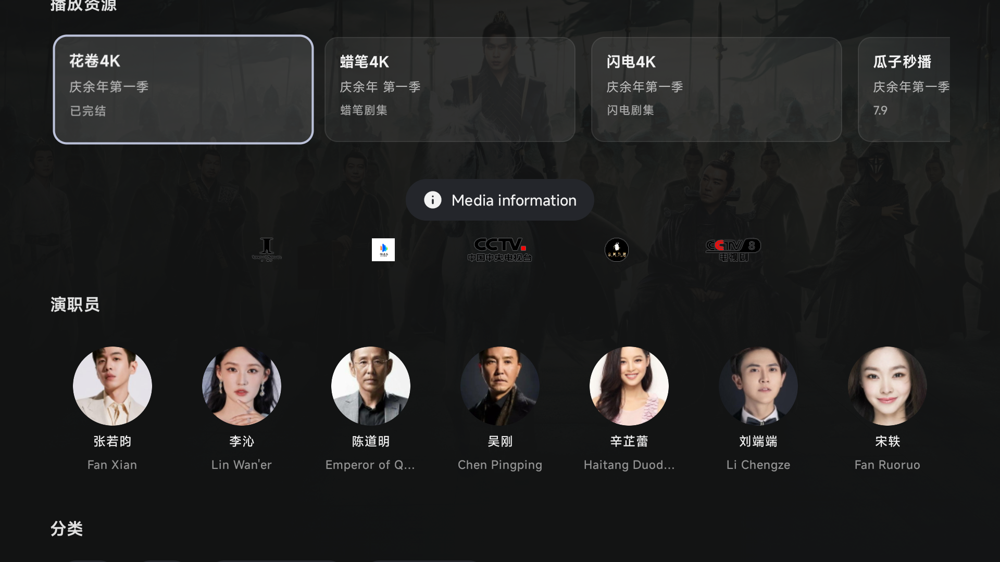

# 媒体库详情对齐与原生稳定性验证

本报告对应详情对齐与 TLS provider 阶段的 Debug／Preview 产物；后续首页精选、模式预览与统一发布使用新的源码和验证记录。

详情对齐与普通 TLS provider 修订已完成有限回归：当前 12 项单测、2 项离线、4 项 Preview 交互、十轮真实详情及两组独立证书压力通过，未再观察到本轮原生退出。最终 ARM64 主包三张实际画面和完整外网下载已核对。不同进程、Registry 回退及实体电视未覆盖的限制保留；先前失败不改写。

## 修订与版本

基准提交 `6d6a4a571ad8a6bd362cb05919bbfd8f0fd7a5ec` 加工作区修订，1990 项生产输入清单 SHA-256 为 `08313aaca7d5bd454e4f5786e6662189bb7e12187d9c947a83aedcf22ce35a9c`。签名主包为 `50205c94afdbe3c292e83f8c69cd85218dcfc3572a8de1fbe1927be16a8e7e82`，保留完整 35 个 ARM64 原生库及 20 项 Python 资源，与前一 `13f2fd98…` 逐项字节一致。各测试 APK、输入、计数与图片哈希见 [verification.json](verification.json)。

共享客户端的普通 TLS context 也显式选择 Conscrypt 2.9.0，保留原 TrustManager、SecureRandom、TLS 1.2／1.3 与 ECH 策略，不安装全局 provider、不关闭默认 ECH。新版包含上游 [#1551](https://github.com/google/conscrypt/pull/1551) 读取／关闭互斥及 [#1548](https://github.com/google/conscrypt/pull/1548) X509 分配登记／finalizer 回退。旧回溯定位到平台 libcrypto 的 X509 释放，新 provider 覆盖无 ECH 配置时的普通 TLS 路径；尚不证明堆损坏最初来源。接口边界见 [ECH 验证说明](../../../ech-validation.md)。

界面保持原播放与焦点逻辑，调整剧集标题与首卡左缘、季选择垂直位置、播放与快捷操作组居中。日常操作见 [TV 媒体库体验](../../../media-library.md)。

## 当前结果

| 检查 | 实际结果 |
| --- | --- |
| 专项单元测试 | 11 项 factory＋1 项 settings，36 秒；失败／错误／跳过均为 0 |
| 构建、签名与资产 | ARM64 Debug／Preview 65 秒，测试包 69／73 秒；原始证书压力测试包另重建 70 秒；签名与安装哈希通过 |
| 离线 provider／生命周期 | 2 项、0.373 秒；无 ECH 配置仍选新版 provider，原信任委托／TLS 1.2、1.3／无全局 provider；128 engines×128 轮×7 getters 读取／关闭通过 |
| 当前 Preview 交互 | 4 项、76.3 秒；明确选集、快速导航保留焦点与目标、35 集续播区间、切主题保留焦点与滚动 |
| 真实详情 | PID 4726 完成 10 轮、20 条详情／搜索记录；无原生退出，脚本未显式 GC；另 34 次加密连接实际最大并发 8，副本压力未完成的断言失败保留 |
| 严格证书压力 | PID 4639，48.938 秒；34 次实际 ECH／TLS 1.3、1536 个证书副本全部观察到回收，无新增 native／ANR 退出 |
| 共享并发证书压力 | PID 5031，26.876 秒；34 次实际 ECH／TLS 1.3、最大并发 8、1536 个副本全部观察到回收，无新增 native／ANR 退出 |
| 实际画面与下载 | 下方三张最终主包画面通过；外网完整 GET 117,297,462 字节、SHA-256 一致、HEAD 200／Range 206 |

严格与共享压力均从真实 SSLSocket session 取非空原始证书链，逐请求核对实际 Conscrypt socket 和同次公开 Cloudflare 响应 `sni=encrypted`。各组 4 批、12 次显式 GC／finalization、4 个 witness、15 秒同 PID 尾等待完成，设置与 DoH 恢复；测试仅恢复主动修改的 ECH 键及其存在状态，保留正常 App 写入。共享组仍使用源客户端既有 trustAll，不能用于证书安全结论。

详情十轮与两组证书压力为三个独立 PID；没有完成一次同 PID 的“十轮详情＋原生副本压力”验收。两压力组均为 0 Registry true／1536 false／0 不可用，实际使用 API 31 正常 finalizer 回退，Registry 回调未覆盖。弱引用和显式 GC 不证明自然回收、无泄漏或每个原生释放完成。

构建任务为 `:catvod:testDebugUnitTest`（仅 factory／settings）、`:app:assembleLeanbackArm64_v8aDebug`、`:app:assembleLeanbackArm64_v8aPreview`、对应 Debug／Preview AndroidTest；Preview 测试使用 `-PtvPreview`，主包测试使用仓库外的 Gradle source overlay。当前结果属于 Debug／Preview，未运行 Gradle Release 或本轮 TV lint。

## 最终 ARM 主包实际画面

全部来自 `50205c94…` 主包、真实《庆余年（2019）》、已加载的公开 aiwex 配置与实际 TMDB／来源响应，没有换成 Preview 夹具。系统为英文 locale，资料与部分业务文字沿用中文，未改系统语言。拍摄未提交 Cookie 或请求播放，最后返回首页。

发布文件为 `TV-detail-stability-20261116-arm64.apk`。2026-11-16 19:50:46 UTC 从外网完整下载并核对上述主包哈希，HEAD／Range 均通过；短期下载 URL 由交付消息提供，不把含访问票据的 URL 写入公开文档。

## 历史失败与测试边界

保留的原生失败与未完成诊断

前一输入 `5348b37b…`、主包 `13f2fd98…` 在 PID 5577 的真实来源搜索中复现 FinalizerDaemon SIGABRT／Scudo header corruption，ExitInfo reason 5、status 6；回溯为平台 libcrypto 的 ASN.1／X509 释放。仅升级依赖没有解决该次退出，此主包未交付。tombstone SHA-256 为 `53cb8bb7369a9e0d3eaa98f4e6ec4be1064b973b1b3ef0be6b18b752f906fa25`，原始证据保留在仓库外。

修订后 PID 4726 的原主控完成 2 轮后被宿主 SIGTERM，另主控在原 instrumentation／PID 内接续 8 轮，中断尝试不计数。最终十轮与34 次连接有效，但测试依赖共享 trustAll 的清理后 Handshake 链，副本数为 0，App 最终断言失败；原 CLI 完成输出不可用。随后修正外置测试从实际 TLS session 取链，并以上述两个独立 PID 补足证书压力，未改写该失败。

另有 UI 等待／存储权限／完成文件 owner 与 Android chcon 选项导致的驱动中断，以及来源 ARM 插件不可用的 x86 兼容对照。它们均保留为未完成试验；未将无 native 退出推断为转译桥根因，也未交付 x86 诊断包。

更早 `7f6446cf…` 主包原生退出与模拟器慢帧见 [上一份报告](../2026-11-15-library-detail-redesign/README.md#性能与原生退出)，失败保留。本轮 API 31 x86_64＋libndk_translation 的完整 ARM64 APK 回归是有限工作负载；未验证实体电视帧率、全部来源插件或全部资源播放、用户登录和 Cookie 提交。SwiftShader 数据不支持 60fps 或所有 ARM 设备稳定性的结论。来源返回真实资源卡不等于所有来源可播放；个别来源的本机 ABI 扩展仍有兼容限制。
