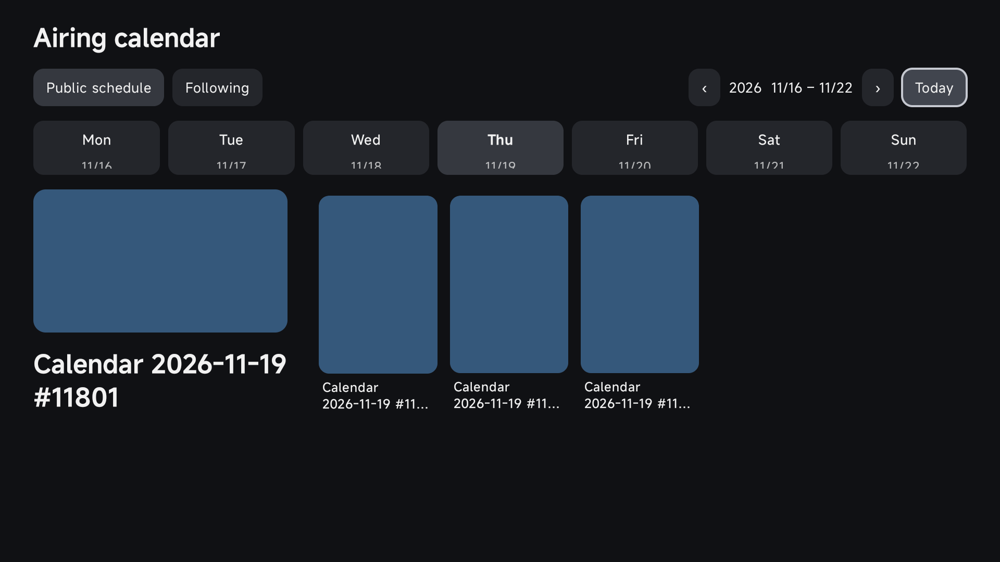
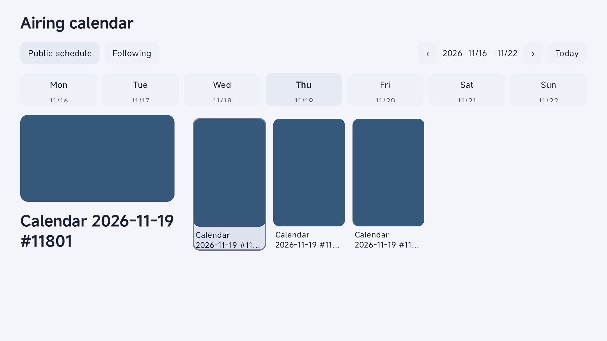
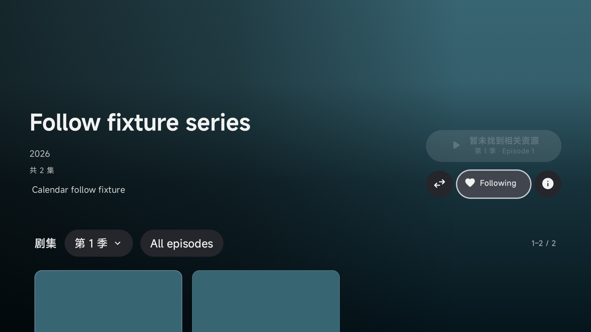
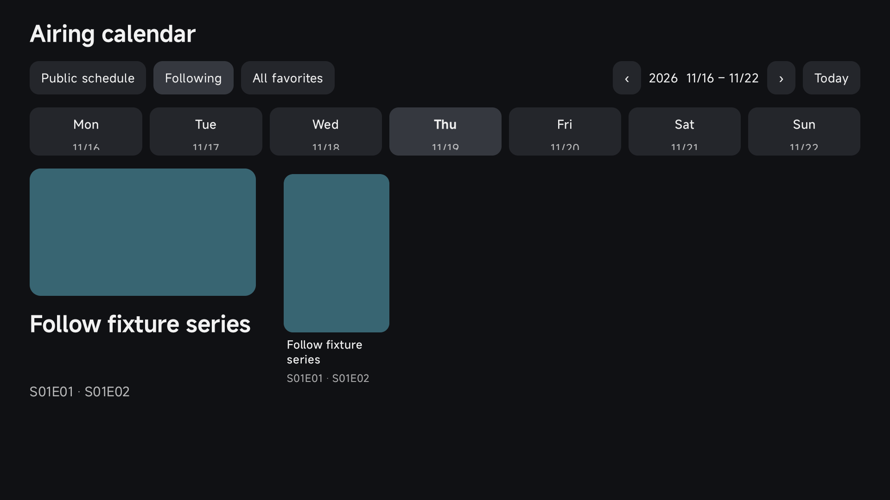

# 追更日历与媒体库追剧验证

> 本文记录初版功能和旧布局。当前界面与完整复测见 [2026-11-19 界面重排验证](../2026-11-19-calendar-redesign/README.md)。

[最终 GHA](https://github.com/wobuhui666/TV/actions/runs/44423306762) 已通过：32 项专项 JUnit，API 24／34 各 12 项 Android 交互与 9 张真实截图校验通过。完整 lint 仍有既有工作区问题，本轮改动范围未新增错误。

## 输入与环境

- 验证提交：`54b029d757612e7186d66cb4f3385c8ae63145c5`，独立分支 `verify/issue-118-airing-calendar-20261118`。基于 `6d6a4a571ad8a6bd362cb05919bbfd8f0fd7a5ec`，包含媒体库已有未提交依赖与本轮修订；本地工作分支未重写。相关输入 SHA-256 见 [source-inputs.json](source-inputs.json)。
- GHA Ubuntu、JDK 21、Python 3.10、SDK 37.0、Gradle 9.1.0；Kotlin in-process、3 GB heap、两名 worker。固定 Media3 `342f6590e02ac390e0bd6b4488b8a1bff55747c1` 及当前两份补丁。
- Android API 24／34、x86_64、原生 1080p TV 显示、320 dpi、Emulator 36.3.10。Preview 包补入固定的 QuickJS、AVIF、libarchive、Conscrypt x86_64 JNI。
- 离线 TMDB 排期和生成图片夹具，不注入线上 TMDB 或发布签名凭据。完整数据、APK SHA-256 和截图清单见 [verification.json](verification.json)。

## 最终结果

| 检查 | API 24 | API 34 |
| --- | --- | --- |
| 专项 JUnit | 32 通过，0 失败／错误／跳过 | 32 通过，0 失败／错误／跳过 |
| TV ARM64 Debug、Preview 与 Preview AndroidTest | 编译通过 | 编译通过 |
| 日历真实 Activity | 8 通过 | 8 通过 |
| 媒体库追剧真实 Activity | 4 通过 | 4 通过 |
| 原生截图 | 9／9，1920×1080、非空白 | 9／9，1920×1080、非空白 |
| lint 改动范围 | 新增错误 0 | 新增错误 0 |

JVM 包含日期查询与解析、收藏身份、全部显式季、同日多集、并发限制、取消、失败重试和缓存。Android 用例覆盖三种首页模式入口、遥控器日期／周切换、分页、错误与焦点恢复、真实 Logo 位图及切换清理、双主题文字像素对比，以及无播放源追剧、去重、日历显示和返回取消。

完整 lint 有 **121 个错误、387 个警告、6 个提示**，未宣称全量通过。历史基线 108 个错误；其余 13 项来自工作区既有 `LibraryDetailArtwork` 的 HCT RestrictedApi 调用。完整报告和任务范围比较均保存在 GHA artifacts。

## 保留的初期失败

- [首轮](https://github.com/wobuhui666/TV/actions/runs/44414493763)：单测和构建通过；API 34 的 `adb run-as` 清理被 scoped storage 阻止。API 24 交互 7 成功／5 失败，涉及截图返回空和追剧标签读取。改用应用上下文清理证据目录、真实截图回退与原生 TV 显示配置。
- [第二轮](https://github.com/wobuhui666/TV/actions/runs/44419962873)：截图尺寸和真实 Logo 检查恢复；API 34 日历 8 项通过，追剧 3 成功／1 失败；API 24 共 10 成功／2 失败。修正按钮语义合并及标签节点，焦点测试等待实际节点获得焦点。
- 实际截图发现黑字深底，修正日历主题文本颜色，并增加真实 PNG 的标题像素对比检查。最终完整复测通过，未删除或跳过失败用例。

## 实际截图与覆盖边界

以下为最终 API 34 的真实 Android 画面，排期与图片为夹具；不代表线上节目内容。

| 深色日历 | 浅色日历 |
| --- | --- |
|  |  |

| 无播放源仍可追剧 | 我的追更同日多集合并 |
| --- | --- |
|  |  |

未验证线上 TMDB 排期准确性、ARM 实机播放、手机端或 Release 签名。Preview x86_64 UI 结果不能替代 ARM 原生播放器回归。本地约 2 GB RAM 的初期构建未完成，最终结果以以上 GHA 提交与 artifacts 为准。
