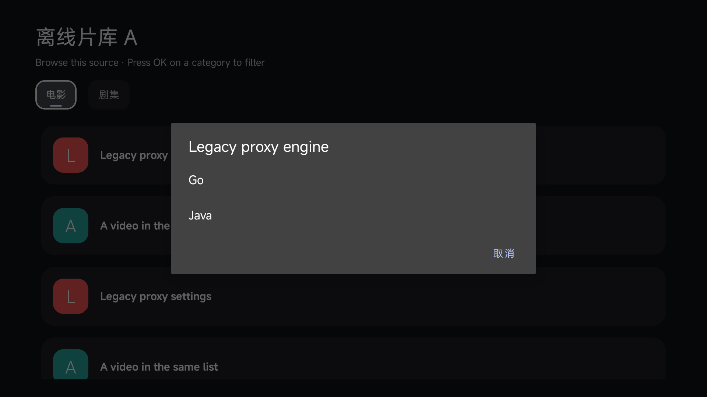
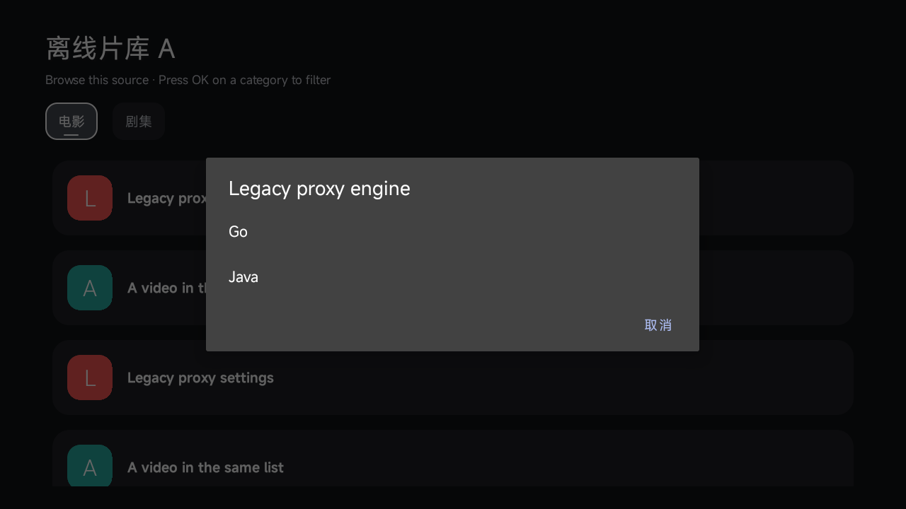

# aiwex 配置弹窗回归（2026-11-19）

`https://9280.kstore.vip/aiwex.json` 的「网页版配置中心」「网盘线路排序」已在最终代码提交 `61485f204ef710016a1358769686008ebf03c8cb` 构建的 ARM64 包上通过真机验证：弹窗取得焦点并连续显示至少 500 ms，返回键正常关闭，分类页保持有效。同一代码提交的两种尺寸共 52 项 Android 回归及 13 项集中 JVM 测试通过。机器可读结果见 [verification.json](verification.json)。

## 原因与修复

正式包 `com.fongmi.android.tv`，版本 `5.8.7+20261117.145653`、versionCode `218090613`，在 Android 10／API 29 ARM64 设备上点击两个入口均返回首页，未出现弹窗。来源 `Wexconfig` 的这些卡片通过 `detailContent` 打开配置窗口，没有播放线路。

首次修复解决了重复窗口捕获：Dialog 构造多次查询 `WINDOW_SERVICE` 时，后一次捕获会错误关闭前一次已经登记的窗口。现在先跳过本次操作已拥有的窗口。离线回归通过，但首个候选包仍未恢复真实 Guard 源，不能据此宣布修复完成。

诊断提交 `49fabcaed05a633d778115e99d21b56d9159d8fc` 记录到真实调用顺序：Guard 的独立主线程 Handler 先调用 `VodActivity.finish()`，没有继承来源页面作用域；页面的 `ON_PAUSE` 随即取消弹窗请求；随后创建的窗口因调用页面已经失效而被关闭。旧源把此页视为临时播放页，当前列表详情实际在既有片库页面执行。

`af2a394275` 仅在列表详情请求中启用页面保留。请求及发起页面仍有效、关闭调用来自已绑定源的主线程栈时，宿主阻止它关闭当前片库。用户返回、切换来源、普通 action、其他 Activity 与已经结束的请求仍按原流程处理。另保留重复捕获修复，避免同一个窗口被再次关闭。

## 真实源验证

构建运行 [44604113334](https://github.com/wobuhui666/TV/actions/runs/44604113334)，精确 artifact ID `14568498268`；测试代码提交为 `61485f204ef710016a1358769686008ebf03c8cb`。仅更新独立包 `com.fongmi.android.tv.sourceprobe.wexdialog` 与对应 `.test` 包，使用真实 `VodActivity` 和 `SiteViewModel.openListItem` 路径。最终 APK 已移除诊断日志；APK 对经一致 debug 证书重签，设备重建文件的完整 SHA-256 在安装前核对通过。测试将返回键关闭失败计为断言失败。

| 入口 | 持续显示且有焦点 | 分类页保持有效 | 返回键关闭 | 结果 |
| --- | --- | --- | --- | --- |
| 网页版配置中心 | 508 ms | 是 | 是 | 通过 |
| 网盘线路排序 | 506 ms | 是 | 是 | 通过 |

各入口独立保存结果，没有提交账号、Cookie 或表单值。摘要与 CI／实装 APK 散列见 [最终真实源报告](native-final.json)。较早含诊断的 `af2a394275` 候选也通过双入口验证，结果单独保留在 [候选报告](native-retention-candidate.json)。正式包没有被替换。

## Android 与 JVM 回归

| 检查 | 提交／运行 | 结果与范围 |
| --- | --- | --- |
| 最新 API 34 Android UI | `61485f204e`；[44604117531](https://github.com/wobuhui666/TV/actions/runs/44604117531)，artifact `14570910824` | 1920×1080／320 dpi 与 1280×720／240 dpi 各 26 项，共 52 项通过 |
| 最新集中直播线路 JVM | 同上 | 13 项通过，失败／错误／跳过均为 0；原始 JUnit XML 为 6 + 7 项 |
| 较早共享模块与 TV ARM64 debug JVM | `834dcb5c`；[44581420365](https://github.com/wobuhui666/TV/actions/runs/44581420365) | 199 个测试类、1481 项通过（app 1190、catvod 244、QuickJS 28、WASM 19）；仅覆盖首次重复捕获修复 |
| 较早 API 34 Android UI | `aab78be0`；[44582559040，第 2 次执行](https://github.com/wobuhui666/TV/actions/runs/44582559040/attempts/2) | 46 项通过；不含后续页面保留测试 |

最新 UI 每种尺寸包含首页触摸 3 项、直播选线 3 项、`SourceActionDialogTest` 10 项、`SourceDetailDialogTest` 5 项、`SpiderDialogTest` 5 项。新增测试复现无继承作用域的 Handler 先关闭页面再延迟弹窗，同时检查用户随后离页仍取消窗口、普通 action 仍可关闭页面。重复窗口查询、连续表单和普通视频复用详情响应后的播放跳转均通过。这里使用离线来源与 Java／QuickJS 表单，真实 Guard 验收单独记录。

以下截图来自页面保留回归的虚构来源，已查看确认没有账号、二维码或访问票据：

| 1080p | 720p |
| --- | --- |
|  |  |

首次重复查询回归的 [1080p 截图](source-config-repeated-window-lookup-1080.png) 与 [720p 截图](source-config-repeated-window-lookup-720.png) 保留为历史证据。

## 历史失败与覆盖限制

首个真实源候选 `318a0038b39941b2efac6c90bbd873520aff410e` 的 [构建 44587398285](https://github.com/wobuhui666/TV/actions/runs/44587398285) 通过，但补齐该独立包声明的存储权限后仍未出现弹窗，分类页提前结束。该失败保留在 [首个候选报告](native-first-candidate.json)，不计入当前通过数量；初次系统权限弹窗也未作为配置源成功计入。

较早 UI 运行 `44582559040` 第 1 次执行在 Media3 设置插件解析 Kotlin 2.2.0 依赖时失败，测试执行数为 0；相同提交第 2 次执行通过。首次修复的 lint 对比在统一缓存工作区路径后没有新增或减少检查项，基线仍有 108 个 Error、388 个 Warning、6 个 Hint；此结果属于 `834dcb5c`，未扩展为后续提交的全量 lint 结论。

真实源在一台 Android 10 ARM64 设备的独立 debug 包上检查弹出、持续焦点与返回键关闭；离页取消由两种尺寸的离线 Android 测试覆盖。没有提交配置表单、验证账号登录或播放，也没有更新正式包。APK、配置正文、真实源界面截图和原始私有日志均留在仓库外。
