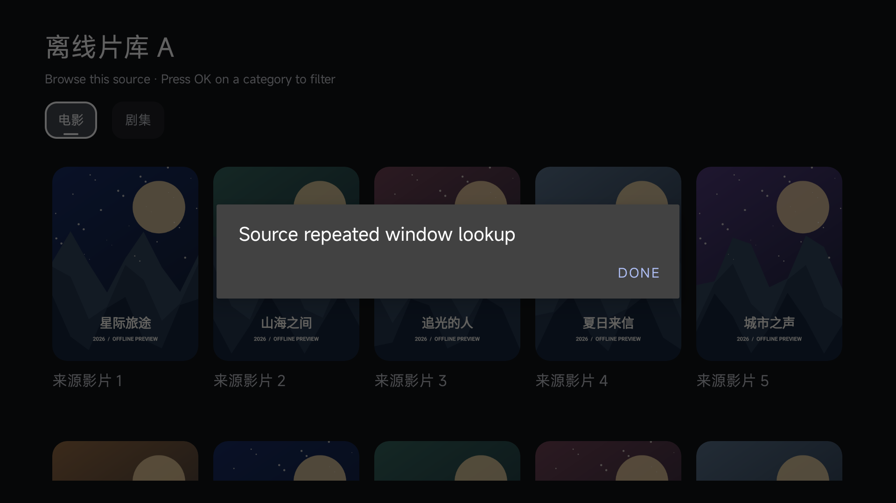
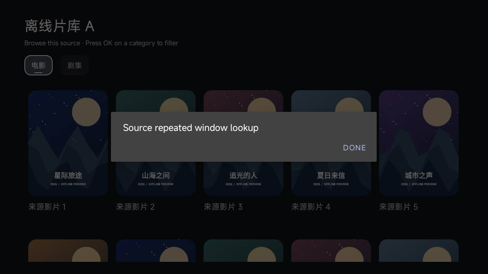

# aiwex 配置弹窗回归（2026-11-19）

已修复旧源窗口捕获中的重复处理错误，离线 Android 回归通过。`https://9280.kstore.vip/aiwex.json` 的 Guard 插件在首个候选包上的实测未通过，当前不能宣布真实源配置弹窗已恢复。机器可读结果见 [verification.json](verification.json)。

## 生产基线

在已有 Android 10／API 29、ARM64 设备上观察正式包 `com.fongmi.android.tv`，版本 `5.8.7+20261117.145653`，versionCode `218090613`。选中既有 `Wexconfig` 来源，在片库分别点击「网页版配置中心」「网盘线路排序」，两次均返回首页，没有配置弹窗。

「网页版配置中心」的 `detailContent` 请求记录为 `Wexconfig / web`，约 7 ms 返回带提示文字的单个条目，没有播放线路。这说明该条目通过详情接口触发配置操作；这次观察没有安装新 APK，也没有修改账号、Cookie 或偏好。正式包截图与原始日志留在仓库外。

## 修复与回归

`SourceActionUi` 在旧 Android Dialog 构造期间查询 `WINDOW_SERVICE` 时记录新增窗口。一次构造可能查询多次，产生相同的捕获前快照。第一个回调已经登记新窗口，后续回调却先按“已有窗口”规则把同一个窗口关闭，导致它无法稳定显示。

修复先跳过本次操作已经登记的窗口，再处理真正新增的窗口；离页取消和限制重复窗口的规则继续执行。新测试通过 `ContextWrapper` 在真实 Dialog 构造过程中查询两次窗口服务，验证窗口保持显示、使用发起页面的 token、确认回调只执行一次，并在关闭后恢复页面焦点。

主修复提交为 `834dcb5c2db7f82488d456a7fd80604be88656c9`。UI 验证提交 `aab78be004dd769c99b6944393c7f5bed8510804` 另将测试数量门禁从 8 更新为 9，两者的主修复与新增回归代码相同。

| 检查 | 提交／运行 | 结果与范围 |
| --- | --- | --- |
| 共享模块与 TV ARM64 debug JVM | `834dcb5c`；[44581420365](https://github.com/wobuhui666/TV/actions/runs/44581420365) | 199 个测试类、1481 项通过（app 1190、catvod 244、QuickJS 28、WASM 19），失败／错误／跳过均为 0；结果来自 JUnit XML |
| 集中直播线路 JVM | `aab78be0`；[44582559040，第 2 次执行](https://github.com/wobuhui666/TV/actions/runs/44582559040/attempts/2) | 13 项通过，失败／错误／跳过均为 0 |
| API 34 Android UI | 同上；隔离包 `com.fongmi.android.tv.preview` | 1920×1080／320 dpi 与 1280×720／240 dpi 各 23 项，共 46 项通过 |

UI 每种尺寸均包含 `SourceActionDialogTest` 9 项、`SourceDetailDialogTest` 3 项、`SpiderDialogTest` 5 项，以及首页触摸和直播选线各 3 项。新增重复查询测试在两种尺寸均通过；既有离页取消、延迟窗口、连续表单和普通列表详情导航测试继续通过。这些测试使用离线来源与 Java／QuickJS 表单，不执行真实 Guard 插件。

以下截图来自新测试的虚构来源，已查看确认不含账号、二维码或访问票据：

| 1080p 配置 | 720p 配置 |
| --- | --- |
|  |  |

Lint 与发布基线对比通过，既有 108 个 Error、388 个 Warning、6 个 Hint 均保留。统一基线缓存中的旧工作区路径后，502 个检查项没有增加或减少；这不代表全量 lint 无错误。

## 历史失败与未完成项

UI 运行 `44582559040` 第 1 次执行在 Media3 设置插件依赖解析阶段失败：Gradle Plugin Portal 未取得 Kotlin 2.2.0 的 stdlib、插件 API 与 BOM，测试执行数为 0。相同提交的第 2 次执行通过构建、集中单测和两种尺寸的 Android 回归；依赖失败没有作为应用测试失败计入通过数量。

首个候选包的真实源验证为 **失败**。最新隔离测试包目标为 `com.fongmi.android.tv.sourceprobe.wexdialog`，测试提交 `318a0038b39941b2efac6c90bbd873520aff410e`，构建运行 [44587398285](https://github.com/wobuhui666/TV/actions/runs/44587398285)。测试使用启用生产窗口钩子的 debug Activity，要求真实弹窗取得焦点并连续可见至少 500 ms。完整 ARM64 APK 对已构建，签名、ZIP、元数据 SHA-256 及 35 个 ARM64 库检查通过；补齐本独立包声明的存储权限后，配置加载和卡片查找成功，但分类页面仍提前结束，返回宿主有效，弹窗没有显示。安全结果见 [首个候选包报告](native-first-candidate.json)；原始日志留在仓库外。未提交表单值，也未修改其他包。

正在准备仅记录窗口决策和页面结束来源的 DEBUG 跟踪包，继续查明实际 Guard 窗口关闭原因。后续需要在 ARM 设备上完成「网页版配置中心」「网盘线路排序」显示、关闭和离页清理检查，再更新本报告。离线夹具、APK 构建和较早提交的验证不能替代这项验收。
