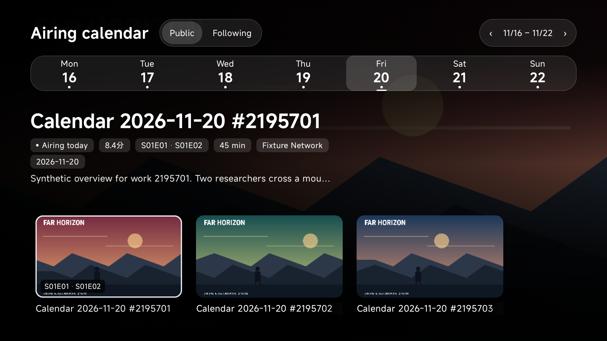
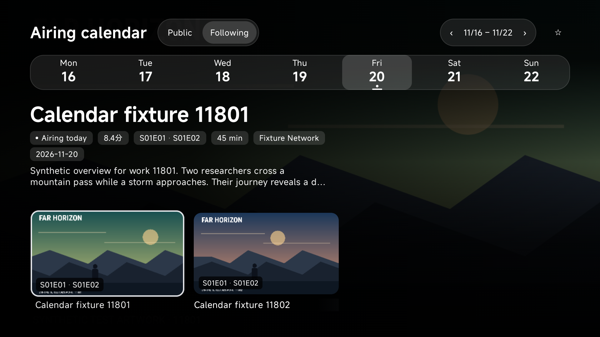
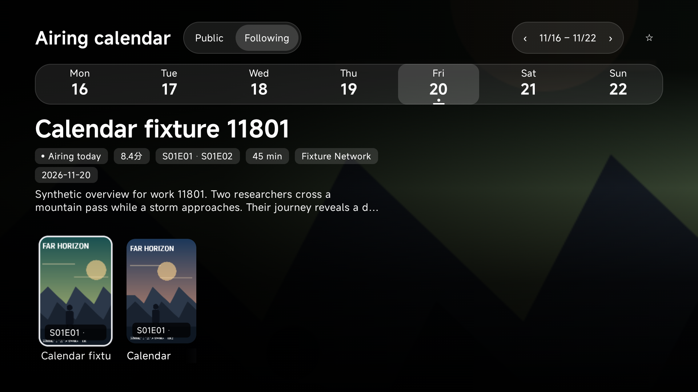
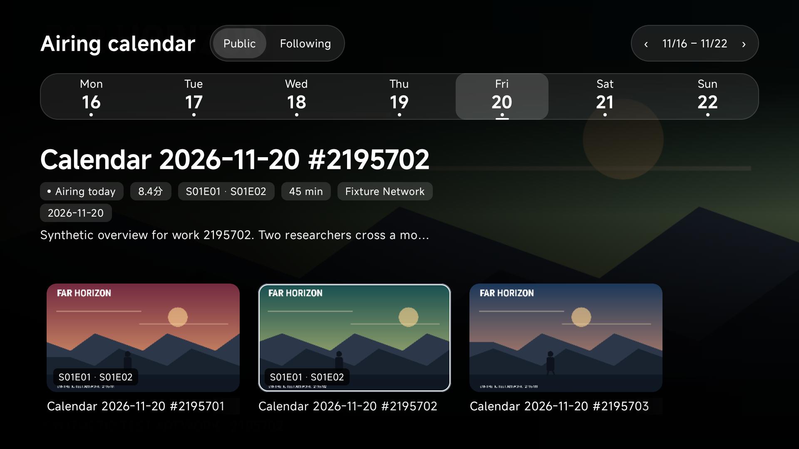
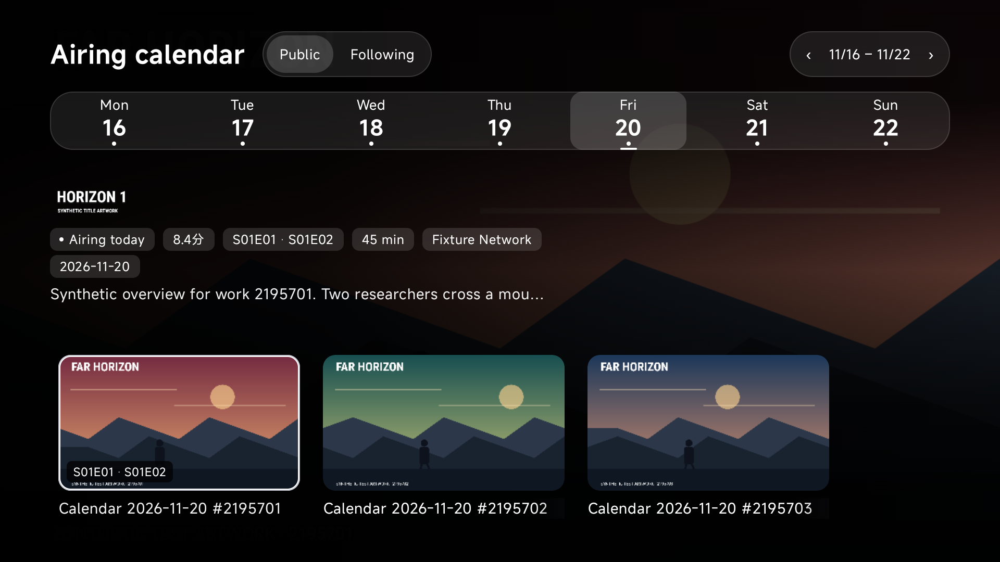
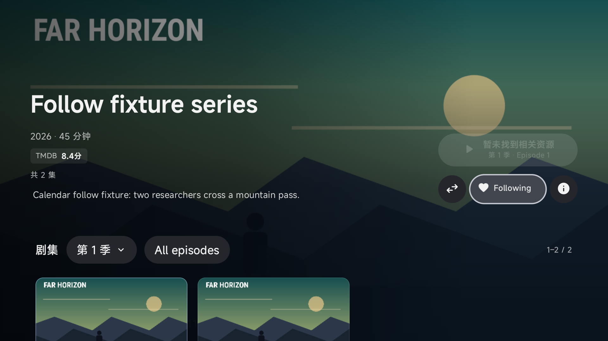

# 追更日历界面重排验证

> 本文记录首次整页重排。当前悬浮日期栏及复测结果见 [2026-11-20 验证](../2026-11-20-calendar-floating-dates/README.md)。

[GHA 最终复测](https://github.com/wobuhui666/TV/actions/runs/44602158639)：43 项专项 JVM 测试通过；API 24／34 各 16 项 Android 用例与 18 张必需截图通过，测试无失败或跳过。本轮改动范围未新增 lint 错误；完整 lint 仍有既有错误。

## 页面行为

日历使用应用现有字体、主题和白色焦点样式。顶部为模式／周切换与连续七日轨两层控件；星期和日号完整显示，不重复月份。“今天”仅在查看其他日期时出现。内容加载后焦点落在当天第一部作品，上键依次进入日期与顶栏。

介绍区随焦点展示片名、已知季集、评分、时长、TMDB 提供的播出网络、简介和播出日期；较长片名缩小或滚动查看。背景解码后以 350 ms 淡入，遮罩保护文字对比。该日期首批有效图片决定整轨横卡或竖卡，之后移动焦点不重排。焦点图片放大 1.06 倍并显示白边；关闭系统动画时保持 1.0 倍。沿用现有收藏的媒体库“追剧／已追剧”操作也完成回归。

## 提交与环境

- 验证源码：`a8545ac3f6ceaf4e9b9b5e8bd0c60e56865f5732`，分支 `verify/issue-118-airing-calendar-20261118`；基于 `6d6a4a571ad8a6bd362cb05919bbfd8f0fd7a5ec`，保留工作区已有媒体库及其他构建依赖。本地工作分支未重写。35 个相关输入的 SHA-256 见 [source-inputs.json](source-inputs.json)。
- GHA Ubuntu、JDK 21、Python 3.10、SDK 37、Gradle 9.1.0，两名 worker；固定 Media3 `342f6590e02ac390e0bd6b4488b8a1bff55747c1` 与现有补丁。
- Android API 24／34、x86_64、tv_1080p、1920×1080、320 dpi、Emulator 36.3.10。Preview 使用固定版本和 SHA 的 x86_64 JNI；不改生产 ABI 依赖。
- 排期、艺术标题和图片为离线测试夹具；截图来自真实 Android Activity，无网页渲染或后期拼图。完整结果、包校验值及截图清单见 [verification.json](verification.json)。

## 验证结果

| 检查 | API 24 | API 34 |
| --- | --- | --- |
| 专项 JVM | 43／43 | 43／43 |
| TV ARM64 Debug、Preview、Preview AndroidTest | 编译通过 | 编译通过 |
| 日历实际界面 | 12／12 | 12／12 |
| 媒体库追剧实际界面 | 4／4 | 4／4 |
| 必需原生 PNG | 18／18 | 18／18 |
| 本轮范围新增 lint 错误 | 0 | 0 |

JVM 覆盖具体集日期、周边界与跨周、特别篇、全部显式季、同日多集、收藏身份、缓存信息保留、并发上限、取消及失败重试。Android 覆盖三种首页模式入口、日期／周切换、分页、空日期、初始焦点、详情返回和追剧取消。

布局检查读取实际可见节点与未合并图片边界；确认两层顶栏、日号无裁切、夹具长标题完整、统一比例、邻居位置不动和安全边距。焦点截图在同一焦点与真实边界跨帧稳定后获取；PNG 白色笔画跨度相对静止时 2dp 描边中心线基准，确认 1.06／1.0 比例。背景检查使用九点像素与实际图片对应及切换差异；夹具 PNG 中标题、简介和六个元数据标签的采样文字像素在深／浅主题下均验证对比 ≥ 7:1。

完整 lint 为 **121 个错误、389 个警告、6 个提示**，未宣称全量通过。其中基线以外的 13 个错误仍来自既有 `LibraryDetailArtwork` 的 HCT RestrictedApi 调用，日历范围新增错误为 0；完整报告保存在 GHA artifacts。

## 保留的重排期间失败

| 运行 | 失败与修订 |
| --- | --- |
| [44555036750](https://github.com/wobuhui666/TV/actions/runs/44555036750) | 实际长标题裁切及语义／背景等待问题；修正标题自然高度与适配。 |
| [44557566753](https://github.com/wobuhui666/TV/actions/runs/44557566753) | Maven 短暂 404、背景加载竞争；固定 SHA 的缓存和有界镜像回退，等实际单集图加载后取证。 |
| [44561419345](https://github.com/wobuhui666/TV/actions/runs/44561419345) | 直接引用 Compose 内部类导致 AndroidTest API 签名编译错误；改为查找实际 View，使用公共语义读取。 |
| [44563714172](https://github.com/wobuhui666/TV/actions/runs/44563714172) | 父容器边界未反映内部焦点缩放；改测未合并图片边界。API 24 旧节点异常改为有界重新读取。 |
| [44570690746](https://github.com/wobuhui666/TV/actions/runs/44570690746) | 同一构建上下文中的来源测试遗漏 Callback 构造调用；最小修正后复测。 |
| [44573831854](https://github.com/wobuhui666/TV/actions/runs/44573831854) | 焦点白边像素失败；产品改为共用实际焦点交互状态，白边在图像后绘制。 |
| [44578521816](https://github.com/wobuhui666/TV/actions/runs/44578521816) | 焦点白边像素仍未通过；补足同焦点及边界跨帧稳定等待和有界重拍，排除截图提前，原白色／比例／扫描线门槛不变。 |
| [44592297566](https://github.com/wobuhui666/TV/actions/runs/44592297566) | 稳定截图显示节点边界已放大，但海报可见范围仍是原尺寸，白边只露四角；海报轨改用 Compose 缓存位图，背景与 Logo 保持原加载方式。 |
| [44595953405](https://github.com/wobuhui666/TV/actions/runs/44595953405) | 图像特征位置证明内容已放大，却被原尺寸外层裁切，原白边检查继续失败；将缩放与阴影放到同一外层，内部裁切层保持原尺寸，按原门槛复测。 |
| [44598898737](https://github.com/wobuhui666/TV/actions/runs/44598898737) | 实际放大及完整白边恢复；测试误将内缩白笔画跨度视作全图宽度。基准改为未缩放图片宽度减 2dp 的描边中心线跨度，比较白像素位置距离；RGB≥235、比例容差±0.025、至少两条扫描线均保持，未缩放或缺失白边仍会失败。 |

未删除、跳过或降低这些用例的验证要求。旧功能初次验收见 [2026-11-18 报告](../2026-11-18-airing-calendar/README.md)。

## 实际 Android 画面

以下为最终 API 34 截图，**媒体内容为测试夹具**；线上剧照、片名和排期由实际数据源提供。

| 横卡焦点 | 无剧照时的统一竖卡焦点 |
| --- | --- |
|  |  |

| 深色主题背景 | 浅色主题背景 |
| --- | --- |
|  |  |

| 艺术标题 | 媒体库追剧 |
| --- | --- |
|  |  |

本轮未验证线上 TMDB 排期准确性、低端 ARM 电视实机性能、播放器、手机端或 Release 签名。未知播出小时不推断，“今日播出”也不表示播放源已更新。x86_64 模拟器的界面与关闭动画测试不能替代实机性能评估。
