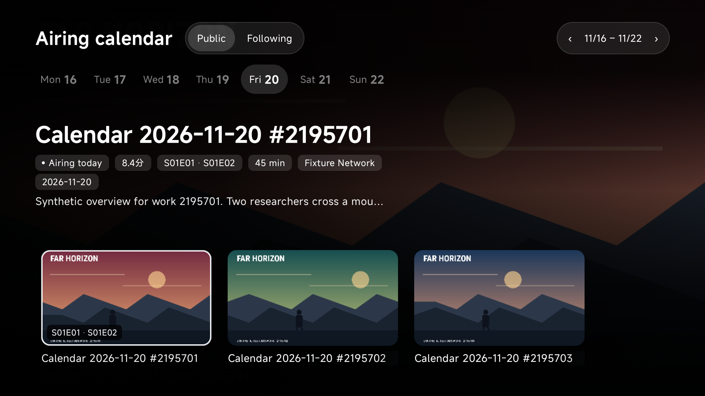
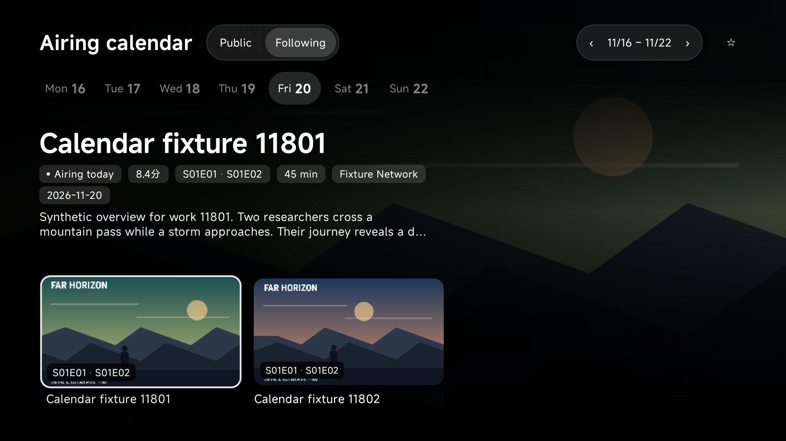
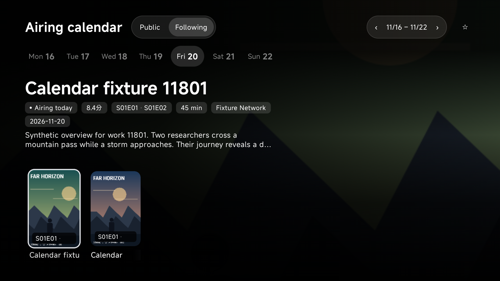
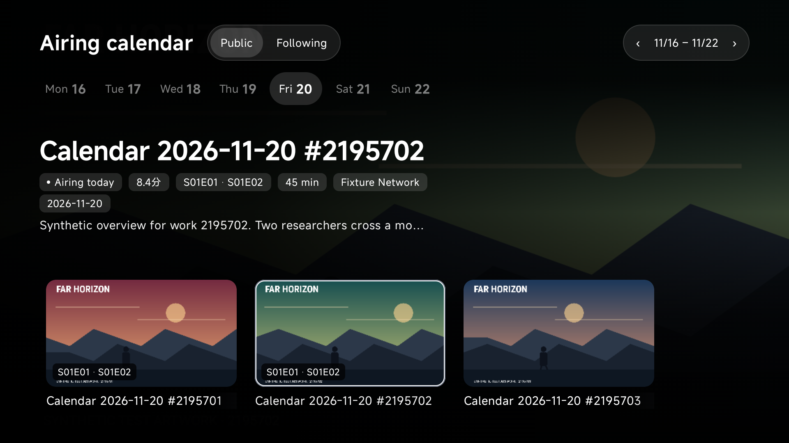

# 追更日历悬浮日期栏验证

[GHA 复测](https://github.com/wobuhui666/TV/actions/runs/44758177664)：43 项专项 JVM 测试通过；API 24／34 各 16 项 Android 用例与 18 张必需截图通过，测试无失败或跳过。日历范围未新增 lint 错误，完整 lint 仍有既有错误。

## 日期栏变化

七个日期左对齐，占 1080p TV 安全内容宽度约 56%，与下方介绍区左缘对齐；右侧直接露出剧照。日期栏宽 484dp、高 40dp，每个日期为 64dp，间距 6dp。星期 13sp 和日号 15sp 加粗显示在同一行，内边距为横向 6dp、纵向 8dp。

日期直接浮在剧照遮罩上，没有长条外框、圆点或横线。未选中日期透明背景、文字 50% 白；所选日期为白色 14% 的全圆角胶囊；遥控器焦点为纯白底、深色字。页面加载后先聚焦当天第一部作品，上键进入日期、再上键进入顶栏，下键返回内容。

## 验证输入与结果

- 测试提交：`89fe4b254187caec599d0cdae8081cefcdc212cc`，分支 `verify/issue-118-airing-calendar-20261118`。基于前次已验证的日历实现，仅修订日期布局、配色和对应界面检查；保留工作区既有依赖与本地工作分支。35 项相关输入 SHA-256 见 [source-inputs.json](source-inputs.json)。
- GHA Ubuntu、JDK 21、Python 3.10、SDK 37、Gradle 9.1.0，两名 worker；固定 Media3 与既有补丁。
- API 24／34、x86_64、tv_1080p、1920×1080、320 dpi、Emulator 36.3.10。排期和图片为离线测试素材；测试 APK 与截图校验值见 [verification.json](verification.json)。

| 检查 | API 24 | API 34 |
| --- | --- | --- |
| 专项 JVM | 43／43 | 43／43 |
| TV ARM64 Debug、Preview、Preview AndroidTest | 编译通过 | 编译通过 |
| 日历与媒体库追剧 Android 用例 | 12＋4 通过 | 12＋4 通过 |
| 必需实际 PNG | 18／18 | 18／18 |
| 日历范围新增 lint 错误 | 0 | 0 |

新增检查读取真实日期栏和未合并文本节点的布局边界：40dp 高度、55%～60% 内容宽度、左缘对齐，七个日期的星期和日号同行且未伸出单元格。实际 D-Pad 上／下键验证日期与首张海报间的焦点切换。焦点日期临时真实 PNG 验证白底及两个文字节点的深色字像素对比 ≥ 7:1；随后恢复海报焦点，保留原截图文件名。API 24 截图回退、原白色阈值与海报缩放检查均保留。

原有日期／周导航、三种首页入口、分页、空日期、失败重试、完整剧集信息、背景联动、Logo、横竖海报、关闭动画和媒体库追剧用例同时通过。完整 lint 为 **121 个错误、389 个警告、6 个提示**，日历范围新增错误为 0；完整报告在 GHA artifacts 中。

## 保留的失败与重试

[44755161322](https://github.com/wobuhui666/TV/actions/runs/44755161322) 的单测、构建与日历范围 lint 通过，日期包含关系检查失败。实际 PNG 胶囊高 80px（40dp）；原测试误用可访问性的扩展触控范围。改为读取未合并节点的视觉边界，保留严格包含关系与颜色要求，并加入实际边界诊断。

最终运行的 API 24 在首次尝试完成；API 34 首次尝试在模拟器安装阶段遇到 SDK ZIP 读取失败，尚未运行应用用例。仅重跑失败任务，保留 API 24 结果，两套测试使用同一提交。

## 实际 Android 画面

以下为最终 API 34 原生界面，**片名、剧照及排期为测试素材**。

| 横卡 | 竖卡 |
| --- | --- |
|  |  |

本轮未验证线上排期准确性、ARM 电视实机性能、手机端或 Release 签名；截图不能代表所有字体缩放和设备。未知播出小时不补写时间。前次整页重排、海报裁切修正及其失败记录见 [2026-11-19 报告](../2026-11-19-calendar-redesign/README.md)。
