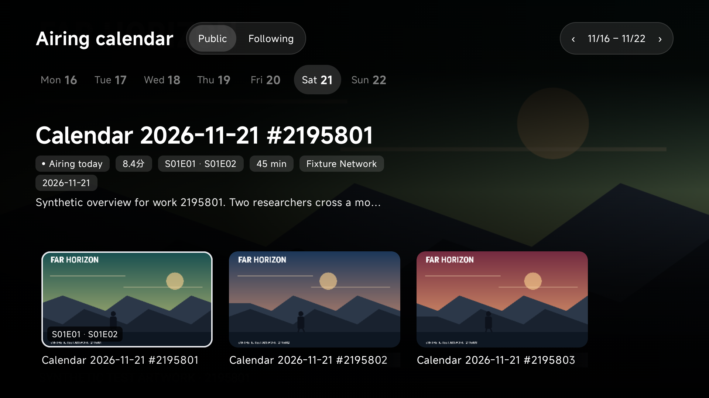
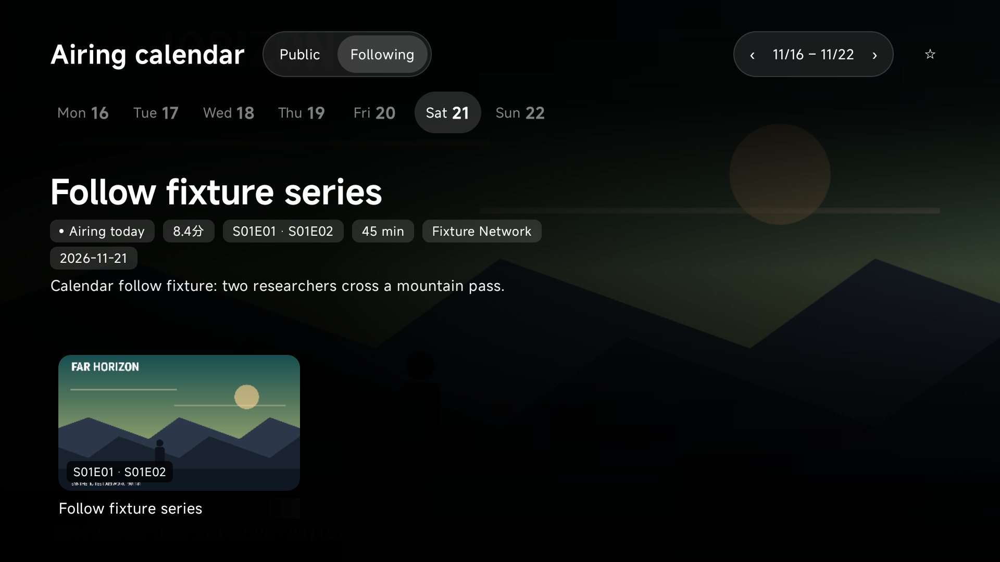
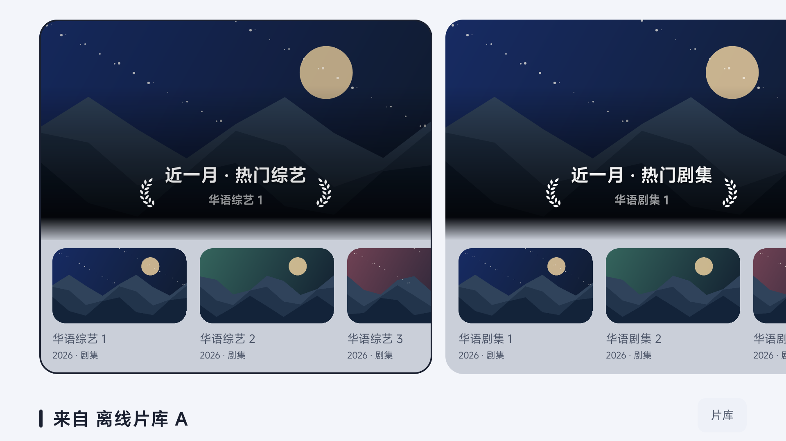

# 本地功能统一发布验证

本轮合入追更日历、媒体库追剧与首页栏目大卡、片源缺失字段和动态 URL 的选源兼容，以及相关公开验证资料。基于最新远端 `52b68c312442af9d45e5c895760ae7293ed955cf` 合并本地工作区快照，保留 Release 193 的横幅、源弹窗、播放进度与首页返回修复。331 个有效代码／文档文件已保存，142 个缓存和生成文件未纳入提交。

生产代码验证提交为 `200448937e88bd9b4a80877ec3b0819b6f057264`。最终首页回归提交为 `de8a5aafeb7e7e0ea656c5707bb0bbc7c9703be0`，相对生产验证提交只修订测试的初始焦点设置。发布前只补充验证记录与索引；各组实测提交和结果分别记录，不重复累计专项单测。

| 检查 | 实测提交与运行 | 结果 |
| --- | --- | --- |
| 完整构建、单测与 lint | `2004489` · [44886988840](https://github.com/wobuhui666/TV/actions/runs/44886988840) | app 1266、catvod 244、QuickJS 28、WASM 19，共 1557 项单测通过，失败／错误／跳过均为 0；TV／mobile 与测试 APK 构建通过；lint 新增 Error 0、Warning 3 |
| API24／34 日历与追剧 | `2004489` · [44886992267](https://github.com/wobuhui666/TV/actions/runs/44886992267) | 每种系统 43 项专项 JVM、16 项 Android 及 18 张必需截图通过；两种系统共 32 次 Android 执行，源码、包与安装哈希核验一致 |
| API34 首页与媒体库 | `de8a5aa` · [44888706278](https://github.com/wobuhui666/TV/actions/runs/44888706278) | 80 项首页／媒体库操作全部通过，另有 6 项目录筛选与 5 项表单回归通过；完整 1266 项 preview JVM 通过，未再次累计 |
| API34 详情交接 | `eea05ba` · [44865556975](https://github.com/wobuhui666/TV/actions/runs/44865556975) | 19 项相关 JVM 与 3 项 Android 全部通过；真实 Parcel 深复制、token 单次消费／上下文拒绝、controller 避免重复详情请求并保留 42 秒续播进度 |

环境为 GitHub Actions Ubuntu、JDK 21、Python 3.10、SDK／build-tools 37.0.0，以及固定 Media3 提交 `342f6590e02ac390e0bd6b4488b8a1bff55747c1`。设备回归使用隔离的 x86_64 preview 包。主要命令为 `:app:testLeanbackArm64_v8aDebugUnitTest`、`:app:testLeanbackArm64_v8aPreviewUnitTest`、TV／mobile Debug 构建、TV Preview／AndroidTest 构建及 `:app:lintLeanbackArm64_v8aDebug`；工作流提供 SDK minor 配置。日历专项 43 项及交接专项 19 项 JVM 均包含在全量单测中，不能再次累加。设备测试合计 126 次执行：日历 32、首页／媒体库 80、额外目录／表单 11、详情交接 3。

首轮 `c36108d` 的 1265 项 app 单测出现两项 `EpisodeTargetTest` 失败：新增匹配路径对未设置的 URL 调用 `equals`。修复恢复唯一匹配直接返回，并只让有效 URL 参与同文件归并；新增空 URL 歧义回归，原有中文集号／上下篇断言保留。后续 `eea05ba` 的 1557 项全量单测通过。

`eea05ba` 的首页回归执行 80 项，77 项通过、3 项失败。两项分类焦点因未完成滚动被停止，同位置选择后仍在屏外或被裁切；修复在布局完成、滚动停止后校正当前真实焦点，同时检查触摸模式、页面状态、CID、代次和 holder。另一项新增大卡测试在主题重建后仍引用旧 Activity，改为等待新的 resumed Activity 和实际列表绑定，原有可见性与导航断言未放宽。`2004489` 复测时两项生产裁切回归已通过，余下 1 项是测试把“选择行”误当成“聚焦主图”。测试先显式聚焦已绑定主图作为导航初始条件，再验证原有上下键与路由；生产行内焦点保持行为未改。旧失败与中止的运行保留，未计入通过结果。

交接实现、模型和专项用例在 `eea05ba` 至首页修复提交之间未改变，其结果按实际提交保留。源码相同性与计数摘要见 [verification.json](verification.json)。日历与首页截图使用离线排期、作品及图片，不能证明线上排期准确性、全部片源可播放、账号提交或实体电视性能；此次交接测试使用离线 host，未验证真实媒体解码。11 月 19 日的真实来源采样保留在[来源兼容报告](../2026-11-19-library-source-compatibility/README.md)，未作为本次新版重新采样。

[Release 194](https://github.com/wobuhui666/TV/releases/tag/build-44890522965-1) 已正式发布，[正式构建 44890522965](https://github.com/wobuhui666/TV/actions/runs/44890522965) 全部成功。Run、Release target 和 tag 均指向 `74cdb8a06b2cef442feba8ef656d2551d71c3df6`。发布记录更新只修改文档，不再次触发 APK 发布。

下载后的 ARM64／ARMv7 标准版与共存版均通过 ZIP、包名、单一 ABI、Android 7.0 最低版本及签名 v2 校验。四包签名证书均与 Release 193 标准包一致；版本统一为 `5.8.7+20261121.093831`／`218417111`，高于上一版 `218392640`。两份 OTA 清单和 GitHub 资产 SHA-256、大小与下载文件匹配；三语言横幅与发布提交逐像素一致；四包的 manifest 和 DEX 均包含追更日历入口及仓库实现。Release 非草稿、非预发布，已设为 Latest，六资产完整。详细结果见 [release-verification.json](release-verification.json)，本轮未在实体电视安装正式包。

正式 Gradle 命令为 `assembleLeanbackArm64_v8aRelease assembleLeanbackArmeabi_v7aRelease --no-daemon --build-cache --max-workers=2`；共存版附加 `-PtvApplicationId=com.wobuhui666.android.tv`。原 `/data/TV` 工作区已在保留本地备份后同步到发布分支，源码无未提交改动。

以下为 API34 的实际界面，排期、作品与图片均为离线测试素材。

