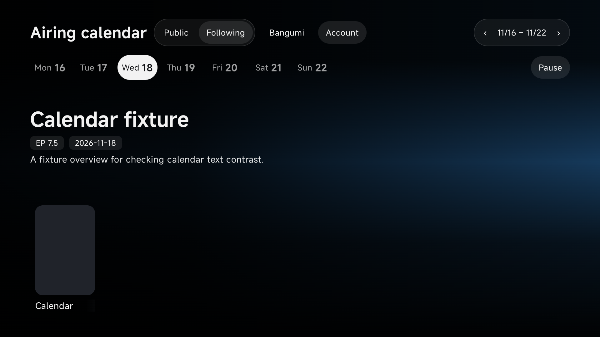
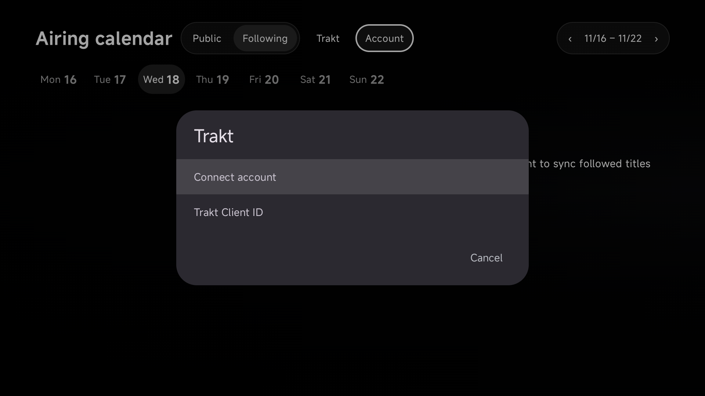
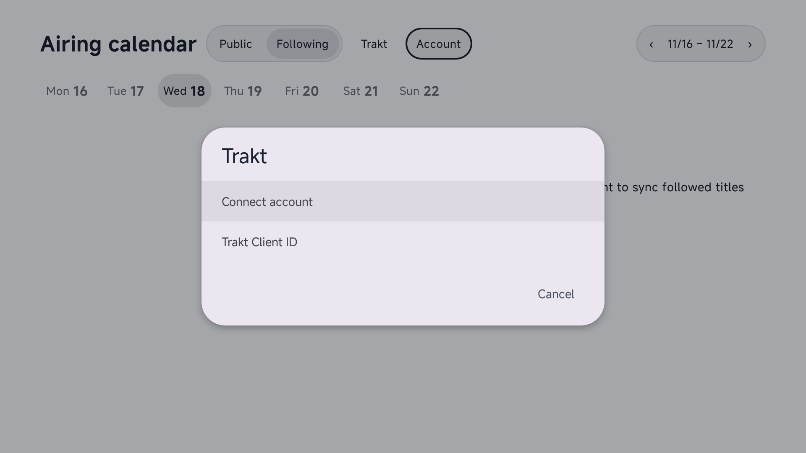

# 追更日历、账号同步与浅色模式验证

关联 [Issue #118](https://github.com/wobuhui666/TV/issues/118)。使用与账号配置见[追更日历](../../../native-discovery.md#追更日历)。

- 验证快照：`b223afe44b2b552db447f8a0da0c598ee3877321`（基准 `e81c1364f8` 加当时全部未提交修改，仅推送到 `verify/wall-filters-calendar-light-20261122`）。
- [GitHub Actions 验证](https://github.com/wobuhui666/TV/actions/runs/45207644467)：Ubuntu runner、JDK 21、Python 3.10、Android SDK 37.0；Media3 固定提交 `342f6590e02ac390e0bd6b4488b8a1bff55747c1` 与仓库固定补丁。本机 2 GB 内存无法完成 Gradle 编译，全部结果来自云端。
- 界面使用隔离包 `com.fongmi.android.tv.preview`，x86_64 模拟器 API 24、34，1920×1080 / density 320，离线夹具，不访问账号服务。

| 检查 | API 34 | API 24 |
| --- | --- | --- |
| 日历、账号与 TMDB 接口专项 JVM | 117 项通过 | 117 项通过 |
| TV ARM64 debug、preview 与测试 APK | 构建通过 | 构建通过 |
| Android lint 新增错误门槛 | 通过，错误 108→108 | 通过 |
| 真实日历页 `AiringCalendarAndroidTest` | 12／12 | 12／12 |
| 本地追剧 `LibraryFollowAndroidTest` | 4／4 | 4／4 |
| 数据源、账号与主题信号 `CalendarProvidersAndroidTest` | 7／7 | 7／7 |
| 截图检查 | 22／22 | 22／22 |

本快照的运行在 API 24、34 上都一次通过。**API 24 仍不稳定**：上一个快照 `faa561c5`（与本快照只差下文的两处 Bangumi 修正）在同一运行内试了三次——第一次模拟器启动后 `adb: device offline` 超时而未执行测试；第二次真实日历页 `shouldKeepEmptyDatesNavigable` 在空日期上按“上”后焦点没有回到页眉（其余 22 项通过）；第三次 23 项全部通过。本次通过的 API 24 运行里仍有两次焦点请求发了第二次才生效，上表不代表这些用例在 API 24 上稳定。

## 主题刷新信号测试宿主

新增仅预览包含有的 `CalendarThemePreviewActivity`：继承正式页面共用的 `BaseActivity`，承载正式的 `AiringCalendarView` 与 `CalendarAccountDialogs`。测试只调用 `RexTheme.setLight()` 并发出 `RefreshEvent.theme()`，不再手动刷新调色板或视图；页面通过 `BaseActivity.onThemeEvent` → `onThemeChanged()` 自行换色。此前的宿主是不订阅事件的普通 Activity，由测试代替页面刷新。`CalendarAccountDialogs` 的宿主类型相应由 `AiringCalendarActivity` 放宽为 `AppCompatActivity`，行为不变。

深色→浅色→深色往返中，每次检查页面背景亮度、标题／简介／卡片标题的字形明暗、选中日期的反色胶囊，以及遥控焦点和所选日期保持不变。

| 浅色 | 深色 |
| --- | --- |
|  |  |

## 账号页浅色像素与焦点

未连接 Trakt 的状态下，从“账号”按钮打开正式账号对话框，浅色、深色各一轮：

- 像素：对话框标题区域内，浅色下过半像素亮度高于 0.7 且存在亮度低于 0.2 的字形，深色相反。
- 焦点：对话框出现后遥控焦点在其内部；方向键下移到“取消”，确认后对话框关闭，焦点回到“账号”按钮，且没有发出账号操作。

| | 浅色 | 深色 |
| --- | --- | --- |
| API 34 |  |  |
| API 24 |  |  |

覆盖范围限于未连接状态的操作列表（连接账号、Trakt Client ID、取消）。已连接状态的同步／断开项、Client ID 与令牌输入框、Trakt 设备码对话框没有做像素或焦点检查。

## Bangumi 真实接口与账号只读验证

11 月 23 日以应用相同的 User-Agent 向 `api.bgm.tv` 发出 22 个 GET 请求（不跟随重定向），按应用的解析规则核对响应。账号部分使用一个真实账号的个人访问令牌，这 22 个请求全部只读；写入另见下文。核对脚本是解析规则的 Python 对照，不是运行应用内的 Kotlin 类。[脱敏摘要](bangumi-live-summary.json)只含状态码和数量；令牌与用户名没有写入仓库、报告或 GitHub。

| 请求 | 结果 |
| --- | --- |
| 账号 `/v0/me` | 真实令牌返回 200 和用户名；不带令牌、带无效令牌均为 401 |
| 账号「想看」「在看」列表 | 真实令牌返回 200，分页字段通过应用的完整性检查；该账号所有状态下都没有动画收藏，导入结果为空 |
| 公开账号的同一列表（未登录） | 「想看」「在看」首页 200，`limit=50` 被接受，80 行全部通过解析 |
| 单条收藏 | 已收藏条目 200（公开账号）；未收藏条目 404（公开账号、真实令牌各一次），与应用把 404 视为未收藏一致 |
| 公开排期 `/calendar` | HTTP 200，7 个星期分组，按应用规则保留 113 部动画 |
| 单集 `/v0/episodes` | 一部 1,230 集的长篇以 `limit=200` 取完 7 页，分页字段全部通过完整性检查；1,221 集有日期，9 集的 `airdate` 只有年份，按规则跳过 |

只读部分验证到「令牌被接受、空列表可导入」：账号原本没有任何动画收藏。应用内的令牌输入、Keystore 保存和连接流程没有连真实服务运行。

### 一次真实写入

经账号所有者同意，11 月 23 日按 `BangumiAccountApi.setFollowing` 的请求顺序对一部此前未收藏的本周新番各写入一次（脚本对照，条目不记录）：

| 步骤 | 结果 |
| --- | --- |
| 预读收藏状态 | 404，按未收藏处理 |
| 追剧：`POST {"type":3,"private":true}` | 202；读回为「在看」、私密，评分与进度为 0；不带令牌读取为 404，私密生效 |
| 导入「想看／在看」 | 列表含这 1 条并通过解析；条目有封面和非空的 `short_summary`，没有 `summary` 与 `nsfw` |
| 本周单集 | 25 行、一页取完，其中 1 集落在本周 |
| 搁置：`PATCH {"type":4}` | 204；读回为「搁置」，私密、评分、进度不变；再次导入时不在追更列表 |

**发现并修正一个会让所有写入失败的缺陷。** 应用原先以 `Content-Type: application/json; charset=utf-8` 发送请求体，Bangumi 对 `POST` 和 `PATCH` 都返回 415，收藏没有创建；改为 `application/json` 后同样的请求成功。也就是说修正前 Bangumi 的追剧和搁置在真实服务上不会成功，此前的合同测试和离线界面夹具都没有覆盖请求头。已改为按字节发送、不带 charset 参数，并补了单测；Trakt 的写入走同一段代码，未实测。

这条「搁置」收藏留在了账号里：Bangumi 没有删除收藏的接口。从「搁置」恢复为「在看」的 `PATCH {"type":3}` 没有发送。

### 参照 Kazumi 的对照与修正

按要求以 [Kazumi](https://github.com/Predidit/Kazumi) `635cd58d` 的 Bangumi 实现为参照。两者授权方式相同：用户在 `next.bgm.tv/demo/access-token` 生成个人访问令牌，以 `/v0/me` 校验后保存，不使用 OAuth 应用的 App ID 与 Secret。

| 项目 | Kazumi | 本应用 | 处理 |
| --- | --- | --- | --- |
| 收藏条目简介 | 读 `short_summary` | 只读 `summary`；真实列表 80 条中 0 条有该字段、80 条有 `short_summary` | 已修正：缺少 `summary` 时回退到 `short_summary` |
| 令牌被拒（401） | 提示令牌无效或已过期 | 显示通用的加载失败与重试 | 已修正：提示重新连接，保留本机同步列表，不再发送单集请求 |
| 成人条目 | 不过滤 | 靠条目的 `nsfw` 字段过滤；真实列表（公开 80 条、登录后 1 条）和官方 OpenAPI 的收藏条目都没有该字段，过滤不生效 | 未修改；登录后列表是否返回成人条目未能验证 |
| 写入收藏 | 一律 `POST` | 新增 `POST`、已有 `PATCH` | 两者都符合官方规范；`POST` 新增与 `PATCH` 搁置各实测一次 |
| 请求节奏 | 收藏分页间隔 200 ms、并发 3 | 单集请求并发 4、无间隔 | 未修改；关注较多时是否触发限流未能验证 |

两处修正各补一条单测（`BangumiAccountApiTest` 17 项、`AccountCalendarLoaderTest` 7 项），随本快照在 GHA 通过。重新连接提示在刷新关注列表时判断，刚同步后的五分钟内令牌失效仍显示加载失败；提示在界面上的呈现没有界面用例覆盖，也没有用失效的真实令牌在应用里复现。

另外，单集响应带有官方规范未列出的 `subject_id`，应用用它核对条目身份，本次 1,230 行都带有。官方规范没有删除收藏的接口，与应用以「搁置」代替取消一致。

## 未验证

- **Trakt 真实账号授权与写入尚未实测。** 未使用真实 Trakt Client ID 或令牌；设备码授权、令牌刷新和 watchlist 写入只有合同测试。
- **Bangumi 的真实验证都是脚本对照，不是应用实测。** 令牌、导入和上述两次写入在真实服务上成立，但没有在应用界面里用真实令牌完成连接、追剧或搁置；修正后的应用代码只经过单测。
- **Bangumi 未覆盖的情况：** 从「搁置」恢复、关注较多时的限流、成人条目、令牌失效后的界面呈现。
- 播放器内核、实体电视及真实片源播放不在本次 x86_64 模拟器范围。

## 过程记录

专项 JVM 覆盖 UTC 换日、原生服务身份、逐集合并、分页完整性、失败时保留账号快照、取消后的迟到响应、私有请求缓存隔离、限流、授权数据解析及收藏状态更新规则。执行任务：`:app:testLeanbackArm64_v8aDebugUnitTest --tests 'com.fongmi.android.tv.calendar.*' --tests com.fongmi.android.tv.api.TmdbLibraryApiTest`、`:app:assembleLeanbackArm64_v8aDebug`、`:app:assembleLeanbackArm64_v8aPreview`、`:app:assembleLeanbackArm64_v8aPreviewAndroidTest -PtvPreview`、`:app:lintLeanbackArm64_v8aDebug`。本快照的完整变体单测（1,354 项通过）、基准对比 lint（新增错误 0）与安装包来自[构建运行](https://github.com/wobuhui666/TV/actions/runs/45207621752)，安装包路径见[首页栏目完整筛选验证](../2026-11-22-home-wall-filters/README.md#安装包)。

| 运行 | 结果 |
| --- | --- |
| [44981756244](https://github.com/wobuhui666/TV/actions/runs/44981756244)（旧宿主） | API 34 通过；API 24 的数据源用例 6 项中 4 项焦点或文字断言超时 |
| [45028366076](https://github.com/wobuhui666/TV/actions/runs/45028366076) | 首次尝试 API 24 因 Maven Central HTTP 429 未编译；重跑后 API 24 数据源用例 7 项中 1 项焦点断言超时 |
| [45048254959](https://github.com/wobuhui666/TV/actions/runs/45048254959) | API 34 通过；API 24 数据源用例 7 项中 1 项未读到已更新的“暂停”文字 |
| [45054846949](https://github.com/wobuhui666/TV/actions/runs/45054846949) | 快照 `faa561c5`。API 34 通过；API 24 第一次模拟器离线，第二次真实日历页 1 项焦点断言失败，第三次全部通过 |
| [45207644467](https://github.com/wobuhui666/TV/actions/runs/45207644467) | 快照 `b223afe4`，增加 Bangumi 两处修正。API 24、34 均一次通过 |

API 24 上数据源用例的修正都在测试侧：焦点请求按正式页面恢复焦点的方式重发，并在轮询时刷新无障碍节点缓存。API 24 每次通过的运行里都有焦点请求要发第二次才生效：`faa561c5` 的第二次尝试 1 次、第三次尝试 2 次，`b223afe4` 的运行 2 次；API 34 没有出现。连同 `shouldKeepEmptyDatesNavigable` 的偶发失败，说明 API 24 模拟器上日历宿主的单次焦点请求或方向键导航偶尔会丢失。原因没有定位，是模拟器负载还是页面焦点逻辑的竞态尚不清楚，生产焦点代码未修改；测试的重发会掩盖这一现象，判断 API 24 焦点可靠性时应以此为准。
