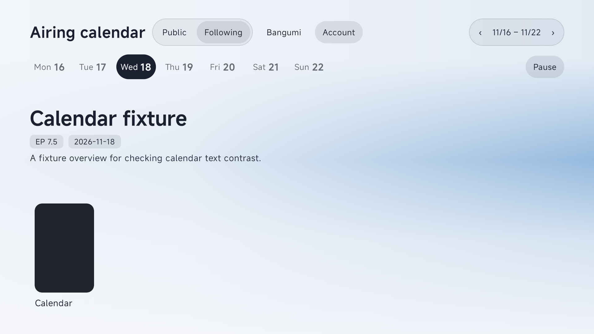
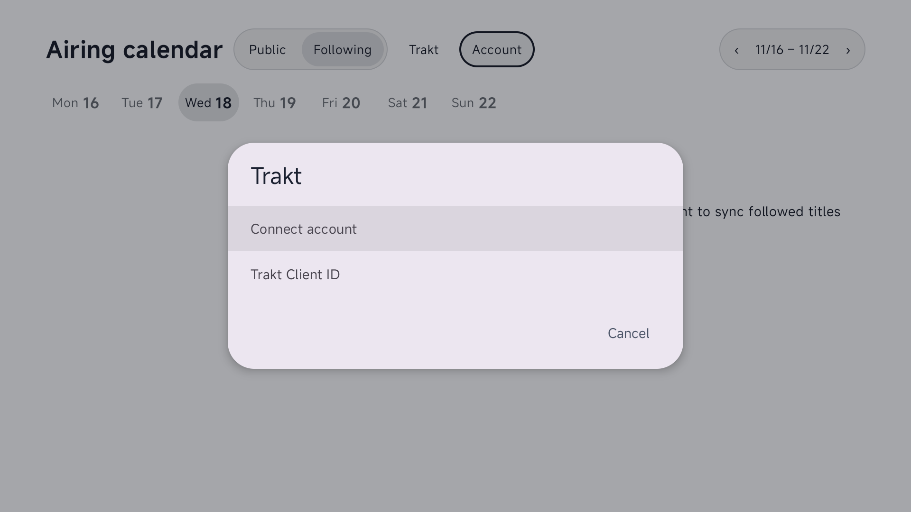
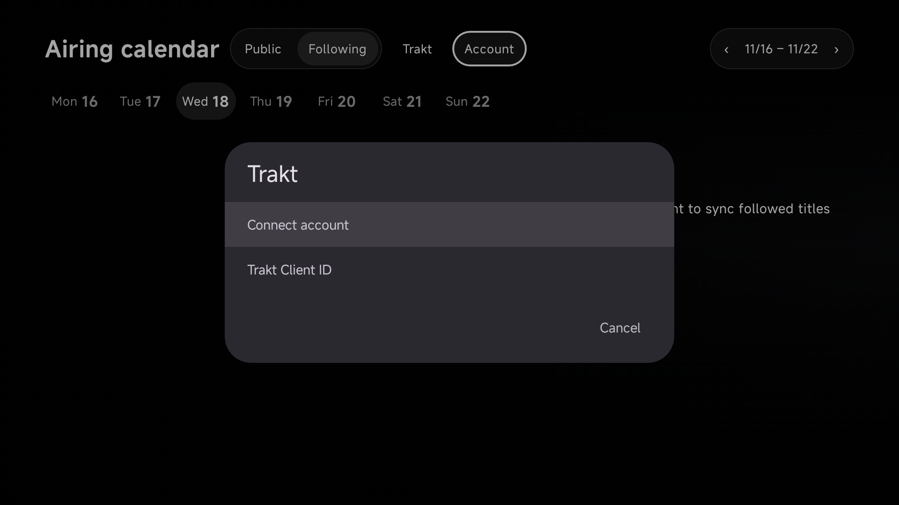

# 追更日历、账号同步与浅色模式验证

关联 [Issue #118](https://github.com/wobuhui666/TV/issues/118)。使用与账号配置见[追更日历](../../../native-discovery.md#追更日历)。

- 验证快照：`faa561c5a77cf808fc446eb567493e9f6da69bd4`（基准 `e81c1364f8` 加当时全部未提交修改，仅推送到 `verify/wall-filters-calendar-light-20261122`）。
- [GitHub Actions 验证](https://github.com/wobuhui666/TV/actions/runs/45054846949)：Ubuntu runner、JDK 21、Python 3.10、Android SDK 37.0；Media3 固定提交 `342f6590e02ac390e0bd6b4488b8a1bff55747c1` 与仓库固定补丁。本机 2 GB 内存无法完成 Gradle 编译，全部结果来自云端。
- 界面使用隔离包 `com.fongmi.android.tv.preview`，x86_64 模拟器 API 24、34，1920×1080 / density 320，离线夹具，不访问账号服务。

| 检查 | API 34 | API 24 |
| --- | --- | --- |
| 日历、账号与 TMDB 接口专项 JVM | 115 项通过 | 115 项通过 |
| TV ARM64 debug、preview 与测试 APK | 构建通过 | 构建通过 |
| Android lint 新增错误门槛 | 通过，错误 108→108 | 通过 |
| 真实日历页 `AiringCalendarAndroidTest` | 12／12 | 12／12（第三次尝试；第二次 11／12） |
| 本地追剧 `LibraryFollowAndroidTest` | 4／4 | 4／4 |
| 数据源、账号与主题信号 `CalendarProvidersAndroidTest` | 7／7 | 7／7 |
| 截图检查 | 22／22 | 22／22 |

API 34 一次通过。**API 24 不稳定**：同一快照、同一运行内三次尝试，第一次模拟器启动后 `adb: device offline` 超时而未执行测试；第二次真实日历页 `shouldKeepEmptyDatesNavigable` 在空日期上按“上”后焦点没有回到页眉（其余 22 项通过）；第三次 23 项全部通过。上表 API 24 一列取第三次尝试，不代表该用例在 API 24 上稳定。

## 主题刷新信号测试宿主

新增仅预览包含有的 `CalendarThemePreviewActivity`：继承正式页面共用的 `BaseActivity`，承载正式的 `AiringCalendarView` 与 `CalendarAccountDialogs`。测试只调用 `RexTheme.setLight()` 并发出 `RefreshEvent.theme()`，不再手动刷新调色板或视图；页面通过 `BaseActivity.onThemeEvent` → `onThemeChanged()` 自行换色。此前的宿主是不订阅事件的普通 Activity，由测试代替页面刷新。`CalendarAccountDialogs` 的宿主类型相应由 `AiringCalendarActivity` 放宽为 `AppCompatActivity`，行为不变。

深色→浅色→深色往返中，每次检查页面背景亮度、标题／简介／卡片标题的字形明暗、选中日期的反色胶囊，以及遥控焦点和所选日期保持不变。

| 浅色 | 深色 |
| --- | --- |
|  |  |

## 账号页浅色像素与焦点

未连接 Trakt 的状态下，从“账号”按钮打开正式账号对话框，浅色、深色各一轮：

- 像素：对话框标题区域内，浅色下过半像素亮度高于 0.7 且存在亮度低于 0.2 的字形，深色相反。
- 焦点：对话框出现后遥控焦点在其内部；方向键下移到“取消”，确认后对话框关闭，焦点回到“账号”按钮，且没有发出账号操作。

| | 浅色 | 深色 |
| --- | --- | --- |
| API 34 |  |  |
| API 24 |  |  |

覆盖范围限于未连接状态的操作列表（连接账号、Trakt Client ID、取消）。已连接状态的同步／断开项、Client ID 与令牌输入框、Trakt 设备码对话框没有做像素或焦点检查。

## Bangumi 真实接口对照（未登录）

11 月 23 日以应用相同的 User-Agent 向 `api.bgm.tv` 发出 17 个 GET 请求（不跟随重定向），按应用的解析规则核对响应，没有使用账号令牌。核对脚本是解析规则的 Python 对照，不是运行应用内的 Kotlin 类。[脱敏摘要](bangumi-live-summary.json)只含状态码和数量。

| 请求 | 结果 |
| --- | --- |
| 公开排期 `/calendar` | HTTP 200，7 个星期分组，按应用规则保留 112 部动画 |
| 单集 `/v0/episodes` | 一部 1,230 集的长篇以 `limit=200` 取完 7 页，分页字段全部通过应用的完整性检查；1,221 集有日期，9 集的 `airdate` 只有年份，按规则跳过 |
| 账号 `/v0/me` | 不带令牌、带无效令牌均为 401 |
| 收藏列表与单条收藏 | 一个公开账号「想看」「在看」的首页：HTTP 200，`limit=50` 被接受，80 行全部通过解析；已收藏条目 200，未收藏条目 404，与应用把 404 视为未收藏一致 |

发现三处实现或测试夹具与真实接口不一致，生产代码均未修改：

1. **成人条目过滤在真实列表上不生效。** 收藏列表里的条目没有 `nsfw` 字段（80 条中 0 条；官方 OpenAPI 的收藏条目结构同样没有，完整条目接口才有）。`BangumiAccountApi.parseCollections` 靠该字段排除成人条目，`BangumiAccountApiTest` 相应用例的夹具给条目加了这个字段。登录后列表是否返回成人条目，需要真实令牌确认。
2. **账号条目没有简介。** 收藏列表提供的是 `short_summary`（80 条都有），应用读取 `summary`（0 条）。按代码路径，Bangumi「我的追更」的焦点作品不显示简介；未在设备上复现。公开排期的 112 部同样没有 `summary` 文本。
3. **令牌失效时没有重新连接提示。** 带无效令牌时，原本公开的单集和收藏接口也返回 401。按代码路径，令牌失效后个人日历只显示通用的加载失败与重试；未在设备上复现。

另外，单集响应带有官方规范未列出的 `subject_id`，应用用它核对条目身份，本次 1,230 行都带有。写入接口只对照了官方规范：`POST`、`PATCH /v0/users/-/collections/{subject_id}`，没有删除收藏的接口，与应用以「搁置」代替取消一致。

## 未验证

- **真实账号授权与远端写入尚未实测。** 未使用真实 Trakt Client ID 或任何用户令牌；Trakt 设备码授权、令牌刷新、Bangumi 令牌登录，以及关注、取消关注、暂停等写入远端账号的操作，都只有 JVM 接口合同测试和离线界面夹具，不能视为真实账号实测。下面的 Bangumi 对照没有读取任何私有收藏，也没有发出 POST 或 PATCH。
- 播放器内核、实体电视及真实片源播放不在本次 x86_64 模拟器范围。

## 过程记录

专项 JVM 覆盖 UTC 换日、原生服务身份、逐集合并、分页完整性、失败时保留账号快照、取消后的迟到响应、私有请求缓存隔离、限流、授权数据解析及收藏状态更新规则。执行任务：`:app:testLeanbackArm64_v8aDebugUnitTest --tests 'com.fongmi.android.tv.calendar.*' --tests com.fongmi.android.tv.api.TmdbLibraryApiTest`、`:app:assembleLeanbackArm64_v8aDebug`、`:app:assembleLeanbackArm64_v8aPreview`、`:app:assembleLeanbackArm64_v8aPreviewAndroidTest -PtvPreview`、`:app:lintLeanbackArm64_v8aDebug`。完整变体单测、基准对比 lint 与安装包见[首页栏目完整筛选验证](../2026-11-22-home-wall-filters/README.md)，两者使用同一快照。

| 运行 | 结果 |
| --- | --- |
| [44981756244](https://github.com/wobuhui666/TV/actions/runs/44981756244)（旧宿主） | API 34 通过；API 24 的数据源用例 6 项中 4 项焦点或文字断言超时 |
| [45028366076](https://github.com/wobuhui666/TV/actions/runs/45028366076) | 首次尝试 API 24 因 Maven Central HTTP 429 未编译；重跑后 API 24 数据源用例 7 项中 1 项焦点断言超时 |
| [45048254959](https://github.com/wobuhui666/TV/actions/runs/45048254959) | API 34 通过；API 24 数据源用例 7 项中 1 项未读到已更新的“暂停”文字 |
| [45054846949](https://github.com/wobuhui666/TV/actions/runs/45054846949) | 最终快照。API 34 通过；API 24 第一次模拟器离线，第二次真实日历页 1 项焦点断言失败，第三次全部通过 |

API 24 上数据源用例的修正都在测试侧：焦点请求按正式页面恢复焦点的方式重发，并在轮询时刷新无障碍节点缓存。API 24 通过的第三次尝试中，仍有两次焦点请求（日期、账号按钮各一次）发了两次才生效，第二次尝试中有一次；API 34 没有出现。连同 `shouldKeepEmptyDatesNavigable` 的偶发失败，说明 API 24 模拟器上日历宿主的单次焦点请求或方向键导航偶尔会丢失。原因没有定位，是模拟器负载还是页面焦点逻辑的竞态尚不清楚，生产焦点代码未修改；测试的重发会掩盖这一现象，判断 API 24 焦点可靠性时应以此为准。
