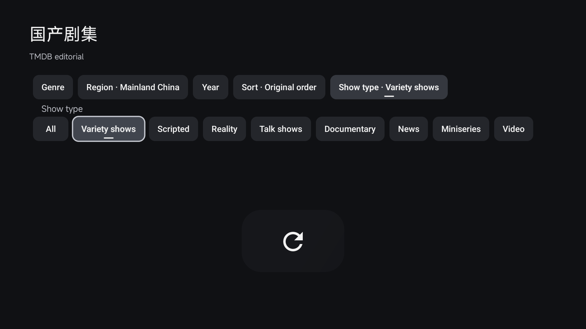
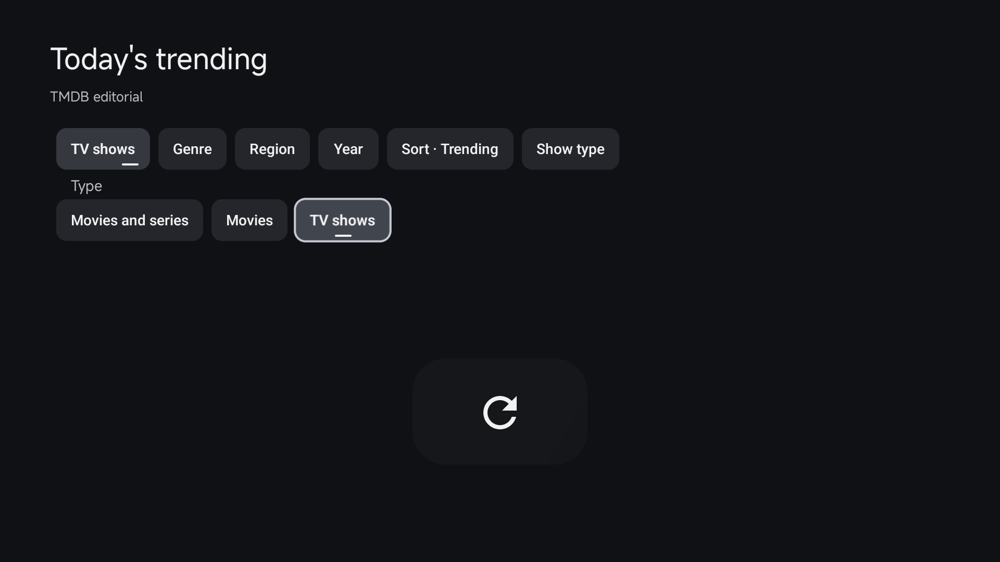
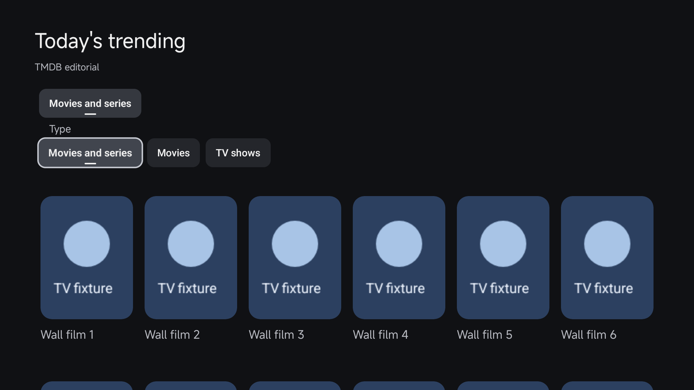
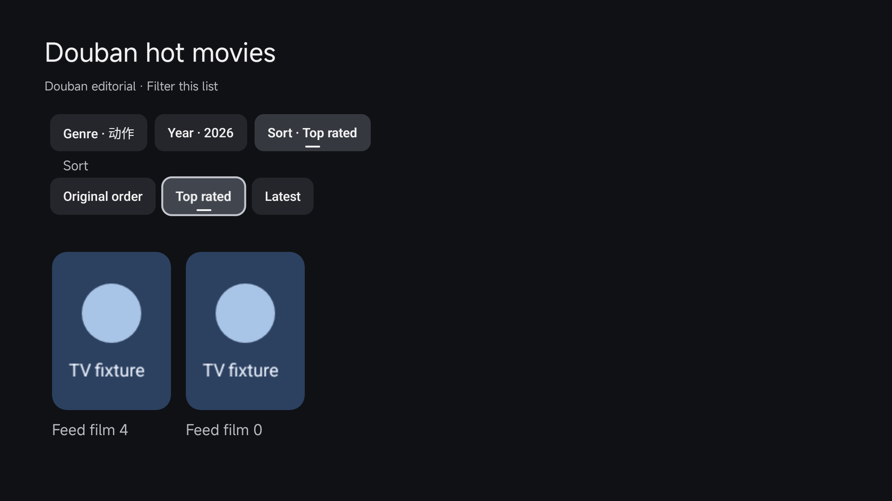

# 首页栏目完整筛选验证

国产电影、国产剧集和区域栏目进入列表后使用可分页的完整 TMDB 片库；首页继续使用原有 Rex 榜单、近期范围和预览数量。剧集支持综艺、影视剧、真人秀、脱口秀、纪录片、新闻、迷你剧及视频节目，类型列表来自 TMDB，另有 17 个地区、年份和排序。今日趋势选定电影或剧集后展开条件，加条件后使用片库查询，清空后恢复每日趋势。用法见 [TV 媒体库体验](../../../media-library.md)。

基准提交为 `e81c1364f8cbebc50afccd01c16fc035bf838f99`，测试对象包含本次未提交修改。源码 SHA、真实接口摘要和覆盖范围见 [verification.json](verification.json)。本机环境为 Linux、JDK 21、Gradle 9.1.0、AGP 9.0.1、SDK 37.0，约 1.9 GiB 内存；下表为本机结果，完整构建见 [GitHub Actions 完整验证](#github-actions-完整验证)。

| 检查 | 结果 |
| --- | --- |
| 专项 JUnit | 59 项通过，失败 0：查询 18、TMDB 原查询 19、Rex 栏目 10、首页策略 12 |
| Java 编译 | 本次生产文件及必要 Java 依赖、四个单测类、11 项 Android 海报墙用例的源码全部通过 |
| TMDB 真实请求 | 25 次成功：剧集 16 类、电影 19 类；综艺使用 `10764\|10767`，前两页共 40 部均含真人秀或脱口秀；七种 `with_type` 的样本详情均对应正确性质 |
| 完整列表 | 国产剧和综艺第二页各返回 20 部；国产综艺返回总数 1,587、80 页；2020 年国产电影返回总数 1,214、61 页 |
| 首页保留 | 原首页展示、首页请求和 feed 加载文件 SHA 未变；栏目断言确认首页仍取 Rex feed，进入列表后取 TMDB discover |

专项测试覆盖综艺的“或”关系、节目性质 0～6、取消地区限制、旧年份及开放日期范围、趋势恢复、原类型／平台／评分约束和首页预览上限。最初单独执行的 37 项查询与 2 项入口检查已包含在最终 59 项中，不重复累计。真实接口首次取样为 11 月 21 日，11 月 22 日补查详情及第二页；计数以取样时 TMDB 返回为准，达到接口上限的结果数不作为完整数据库计数。

源码使用 JDK `javac --release 21 -proc:none`、标准 Gradle 生成的当前 R.jar、真实 TV ARM64 Debug 依赖和本地现有 Java／Kotlin 编译输出验证；没有替换生产模型或手写 R。测试运行使用该变体的真实单测 runtime classpath 与 AGP `returnDefaultValues=true` Android jar。初次手动运行误用了编译用 Android 桩，导致 17 项 `Stub!` 失败；调整运行 classpath 后又补齐本地现有类目录，最终上述 59 项全部通过，生产源码未因这些运行配置错误而修改。

本机约 1.9 GiB 内存无法完成标准 Gradle 构建链：默认 4 GiB 进程退出，768 MiB 报 heap 不足，1536 MiB 耗尽 swap 且两小时未编完。完整检查改在 GitHub Actions 执行，本机未再运行 Gradle。

## GitHub Actions 完整验证

验证快照 `faa561c5a77cf808fc446eb567493e9f6da69bd4`（基准提交加当时全部未提交修改，仅推送到 `verify/wall-filters-calendar-light-20261122`）。Ubuntu runner、JDK 21、Python 3.10、Android SDK 37.0。

| 检查 | 结果 |
| --- | --- |
| `:app:testLeanbackArm64_v8aDebugUnitTest` | 170 个测试类 1,352 项通过，失败、错误、跳过均为 0；其中上述四个专项类 17＋20＋10＋12＝59 项。连同 catvod、quickjs、wasm 共 1,643 项通过 |
| `:app:assembleLeanbackArm64_v8aDebug`、`:app:assembleLeanbackArm64_v8aDebugAndroidTest` | 通过，androidTest 完整编译并打包 |
| `:app:lintLeanbackArm64_v8aDebug` | 对比基准 `e81c1364f8`：错误 108→108，新增错误 0；警告 388→393，新增 8 条（6 条为日历账号存储的 `UseKtx`）。不带基准的完整 lint 不通过，108 个错误在基准提交已存在 |
| 海报墙界面回归 | API 34 x86_64 模拟器、隔离包 `com.fongmi.android.tv.preview`：`PosterWallFiltersIntegrationTest` 11 项及 `TrackPresentationTest` 1 项通过 |

运行记录：[构建、单测与 lint](https://github.com/wobuhui666/TV/actions/runs/45054922909)，[界面回归](https://github.com/wobuhui666/TV/actions/runs/45054858821)。构建运行首次尝试因 Maven Central 返回 HTTP 429 中断，重跑失败作业后通过。

界面回归所在运行的总结论为失败：同一步骤随后执行的 `NativeBrowseIntegrationTest#searchReleasesOffscreenViewsAndKeepsLoadedPagesAndLateResults`（普通搜索页未及时打开）和 `HistoryActionsIntegrationTest#legacyHomeClearRunsInTheQueueAndKeepsTheCapturedConfiguration`（期望 JSON 缺少 `mediaRef` 字段）未通过。这两项及其被测代码不在本次修改内。[对照运行](https://github.com/wobuhui666/TV/actions/runs/45062921427)使用基准提交 `e81c1364f8` 加同一处工作流依赖修正（快照 `660ee280be`），两项以相同断言失败（9 项中 2 项），属于基准提交的既有问题，本次未处理。

此前两次界面运行未通过：第一次工作流缺少 Python 源检查所需的 `lxml`，未进入模拟器；第二次 11 项中 5 项失败，原因在测试本身——对已展开的筛选摘要再次点击会将其收起，豆瓣栏目夹具没有固定其假定的海报首页布局。修正测试和工作流后通过，生产代码未因此修改。

界面回归使用拦截器提供的合成 TMDB 与榜单数据，不含真实 Key；真实内容以上表 TMDB 请求为准。

| 国产剧集 · 综艺 | 今日趋势 · 剧集 |
| --- | --- |
|  |  |

| 趋势清空后恢复 | 豆瓣栏目本地筛选 |
| --- | --- |
|  |  |

## 安装包

ARM64 Debug 包来自后续快照 `b223afe44b2b552db447f8a0da0c598ee3877321` 的[构建运行](https://github.com/wobuhui666/TV/actions/runs/45207621752)，SHA-256 与产物内 `build-metadata.json` 一致；`Release/` 被 Git 忽略。该快照在上面的验证快照之上只增加了追更日历 Bangumi 的两处修正（见[日历报告](../2026-11-22-calendar-accounts-light/README.md#参照-kazumi-的对照与修正)），同一运行中 TV 变体 1,354 项单测通过、lint 新增错误 0。海报墙界面回归没有在该快照上重跑，两个快照之间没有海报墙相关改动。

| 文件 | 包名 | SHA-256 |
| --- | --- | --- |
| `Release/apk/TV-home-wall-filters-calendar-light-20261123-arm64-debug-sourceprobe.apk` | `com.fongmi.android.tv.sourceprobe` | `fc679c363153218c15a2c6ae250b5ffb093d03688e457f08a7d2558542108411` |
| `Release/apk/TV-home-wall-filters-calendar-light-20261123-arm64-debug-preview.apk` | `com.fongmi.android.tv.preview` | `422cb488762dbfe2a57ccdeafd2b6c4f188bbd2ab619b15bd078c3e4537bcfa4` |

同目录下文件名带 `20261122` 的两个包来自上面的验证快照，不含这两处修正。

未覆盖：安装包没有装到实体电视或 ARM64 设备上运行，界面结果仅来自 x86_64 模拟器；没有构建正式签名的 Release 包。

Key 保留在被 Git 忽略的 `local.properties`，文件权限 600；公开记录仅保存参数、计数及样本，不含 Key。后续 TMDB 改动使用真实内容验证的要求已写入根目录 AGENTS.md。原始日志、编译输出和凭据留在文档目录外。
