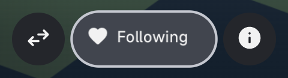
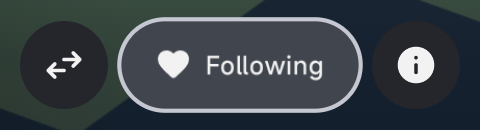
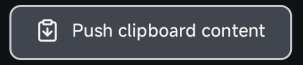
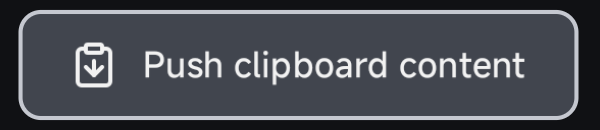

# 日历账号、栏目筛选、媒体库提速与按钮居中合并发布验证

本轮把尚未进入主线的四组修改合入 `ui/apple-tv-redesign` 并发布 Release 195：追更日历账号与浅色模式、首页栏目完整筛选（验证快照 `3cc09a73`，含 `feat/issue118-calendar-accounts-light` 的全部内容）、PR #135 媒体库选集与片源搜索复用、PR #136 MPV 解码路径日志，另加固定尺寸按钮内容居中修复。各功能自身的验证见[日历账号](../2026-11-22-calendar-accounts-light/README.md)、[栏目筛选](../2026-11-22-home-wall-filters/README.md)和[媒体库性能](../2026-11-22-media-library-performance/README.md)报告，这里只记录合并后的结果。

验证提交为 `08e1ca90e3bfdbd9622c2ac8393376031a92d82d`；发布提交 `4b20f86ac52a758a72f174b9f6b687abc399523d` 是它与基准 `e81c1364f8` 的合并提交，文件树与验证提交相同。全部结果来自 GitHub Actions（Ubuntu runner、JDK 21、Python 3.10、Android SDK 37.0），本机约 1.9 GiB 内存无法运行 Gradle。

| 检查 | 运行 | 结果 |
| --- | --- | --- |
| 构建、单测与 lint | [45446141626](https://github.com/wobuhui666/TV/actions/runs/45446141626) | app 1365、catvod 244、QuickJS 28、WASM 19，共 1656 项单测通过，失败／错误／跳过均为 0；TV 与测试 APK 构建通过；lint 对比基准 `e81c1364f8` 的新增错误门槛通过 |
| API 24／34 日历与追剧 | [45446147865](https://github.com/wobuhui666/TV/actions/runs/45446147865) | 每种系统 118 项专项 JVM、23 项 Android（日历 12、追剧 4、数据源与账号 7）通过 |
| API 34 首页与媒体库 | [45446153312](https://github.com/wobuhui666/TV/actions/runs/45446153312) | 第 1 次 87／88，`LibraryExperienceAndroidTest#qualityFiltersAreReachableFromResourceCards` 在筛选后按“下”焦点未到 4K 卡片；同一提交重跑后 88／88 |
| API 34 推送页与二维码 | [45447951803](https://github.com/wobuhui666/TV/actions/runs/45447951803) | 通过；基准提交的对照运行为 [45447957251](https://github.com/wobuhui666/TV/actions/runs/45447957251) |
| 正式包 | [45458071199](https://github.com/wobuhui666/TV/actions/runs/45458071199) | [Release 195](https://github.com/wobuhui666/TV/releases/tag/build-45458071199-1)，版本 `5.8.7+20261124.181837` |

## 按钮居中

TV Material 的 Button 让内容行按内容大小排布，Surface 把它放在左上角，所以固定宽度或高度的按钮内容不居中。`TvActionButton` 增加 `contentModifier`，固定尺寸的调用处用它让内容行撑满对应方向。数值取自 1920×1080（每 dp 2 像素）模拟器截图中的亮像素范围，按钮处于焦点放大状态。

| 按钮 | 修复前 | 修复后 |
| --- | --- | --- |
| 详情页“追剧／已追剧”（116×44dp） | 内容距左右内缘 20／40 像素，垂直偏上约 4 像素 | 30／30 像素，垂直居中 |
| 推送页“推送剪贴板内容”（高 52dp） | 内容垂直偏上 4 像素 | 垂直居中 |

| 修复前 | 修复后 |
| --- | --- |
|  |  |
|  |  |

详情页的换源、信息图标按钮和推送页的“复制地址”按钮使用同一选项。按布局推算，它们在 44dp 尺寸下修复前只偏上约 1dp，截图中看不出变化；“复制地址”的 52dp 尺寸偏上约 5dp，模拟器采用紧凑布局，没有截到。

## 正式包

| 文件 | SHA-256 |
| --- | --- |
| `leanback-arm64_v8a.apk` | `21aa9c66fa8ae07763fd2b8f18aa26dd36312c3476a55438f6725ad0fc2d3d2c` |
| `leanback-armeabi_v7a.apk` | `57f57afd504f8089d4916eb9090b7e9fc6697a05d7090bd7f36541d20a5d51f6` |
| `leanback-arm64_v8a-coexist.apk` | `3f5def4094ad87d06bc2ec017fcd55efcb2cabf2fbb0fdc6a3a7f89cbc8c2cd2` |
| `leanback-armeabi_v7a-coexist.apk` | `f894e17530cf3985aa3c1f1cac85f360d026220436c0a41cf80592d29104fa11` |

## 未覆盖

- 正式包没有装到实体电视或 ARM64 设备上运行；界面结果来自 x86_64 模拟器的隔离包 `com.fongmi.android.tv.preview`。
- 海报墙筛选的界面回归（`polish`）没有在合并后的提交上重跑；合并没有改动这部分代码，结果沿用栏目筛选报告。
- `qualityFiltersAreReachableFromResourceCards` 首次失败的原因没有定位。该用例在页面状态更新后立即发送按键，可能早于界面重组，这只是推测；按钮修复不涉及筛选项和片源卡片。
- 仓库没有配置 `TRAKT_CLIENT_ID`，正式包不带预置的 Trakt Client ID，需要在日历的账号入口填写。
