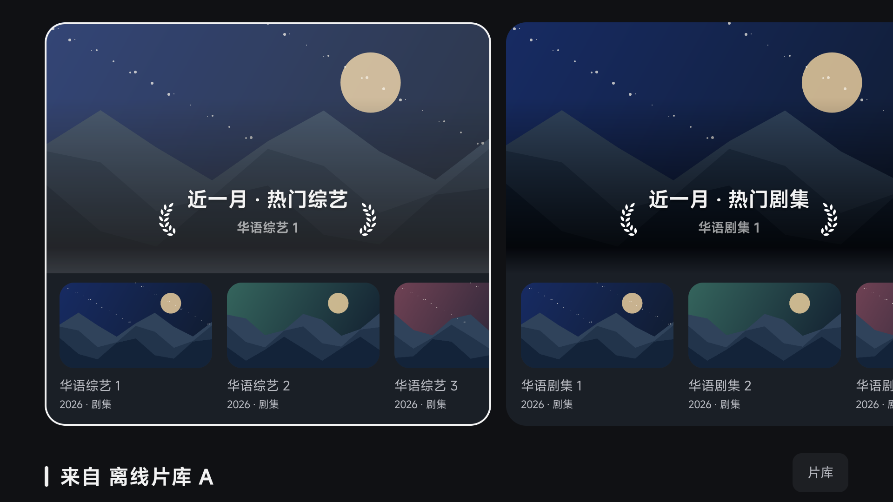

# X20 页面与真实续播性能

## 设备和比较方法

X20，Android 10（API 29），UMS512，ARM64。基线应用提交为 `3d9a1a188`，修复应用提交为 `8e604d598`。两个 release 型测试包使用同一个包名 `com.fongmi.android.tv.perf`、临时签名、Media3 提交 `342f6590e0` 和 shell profileable 配置。每次覆盖安装后都以 `cmd package compile -m speed -f` 编译。测试包从正式包的备份还原，连续覆盖保留相同设置、壁纸、历史和片源。两次测试构建的提交分别为 `7f3aa369d` 和 `fdf376009`。[基线构建](https://github.com/wobuhui666/TV/actions/runs/45889504971) · [修复构建](https://github.com/wobuhui666/TV/actions/runs/46008521071)

冷启动每轮强停五次，用 `am start -W` 的 `TotalTime`。首页从顶部连续按八次下键，片库、日历和搜索页从首页点击页签后采四秒，核对前台 Activity。慢帧取 atrace 主线程的 `Choreographer#doFrame`，卡顿率取同一操作窗口的 `dumpsys gfxinfo`。在线内容、网络等待、播放进度会随轮次变化，后台、GPU 和显示时序都可能影响卡顿率。

## 页面和输入

| 指标 | 基线 1 | 基线 2 | 基线 3 | 修复 1 | 修复 2 |
| --- | --- | --- | --- | --- | --- |
| 冷启动耗时，每轮五次的中位数（ms） | 1276 | 1320 | 1508 | 1219 | 1220 |
| 冷启动最慢主线程帧（ms） | 595 | 721 | 853 | 638 | 458 |
| 首页下移最慢主线程帧（ms） | 102 | 114 | 98 | 62 | 58 |
| 首页下移时构造的辅助文字控件数 | 101 | 101 | 101 | 26 | 26 |
| 搜索页最慢主线程帧（ms） | 275 | 283 | 273 | 121 | 96 |
| 进入片库最慢主线程帧（ms） | 219 | 246 | 235 | 106 | 83 |
| 进入日历最慢主线程帧（ms） | 199 | 126 | 196 | 161 | 92 |
| 首页下移卡顿帧（%） | 23.3 | 31.1 | 40.5 | 43.3 | 13.1 |
| 进入片库卡顿帧（%） | 21.5 | 16.2 | 23.8 | 20.4 | 29.3 |
| 进入日历卡顿帧（%） | 16.3 | 11.9 | 33.3 | 14.9 | 14.6 |

冷启动、搜索和片库的主线程壁纸解码切片从每轮一次降为零。首页、搜索和片库的长帧减少，片库的总体卡顿率仍有 20.4%–29.3%，本轮未证明其 GPU／显示队列等待已经消除。日历的波动也不足以推出稳定的整体提速比例。筛选后的指标记录在 [measurements.json](measurements.json)。

静态壁纸和视频壁纸预览共用 Glide 的位图缓存。快照写入完成后更新版本，切换壁纸或销毁视图时取消旧的图像请求。海报卡片保留原有的说明行高度，获焦后才创建其中的文字控件。搜索按键首次挂载时复用已绑定的主题，切换主题后仍会刷新。三个 MiSans 字体在 APK 内直接存储，实测 APK 增加约 1.54 MiB。

以下为 API 34 离线夹具截图，覆盖浅色和深色主题下的卡片、文字与焦点外观。性能数字来自 X20。

## 真实播放

| 起播窗口 | 基线 1 | 基线 2 | 修复 1 | 修复 2 | 修复后关自动弹幕 1 | 修复后关自动弹幕 2 |
| --- | --- | --- | --- | --- | --- | --- |
| 点击至媒体会话进入播放（s） | 15.5 | 17.1 | 13.0 | 13.3 | 21.0 | 10.5 |
| 点击至播放位置开始推进（s） | 18.5 | 20.1 | 15.8 | 16.4 | 24.1 | 13.7 |
| 主线程 CPU 时间（s，约 47–48 秒窗口） | 10.03 | 9.59 | 9.17 | 9.09 | 3.42 | 3.20 |
| 起播日志最长 Davey 停顿（ms） | 7834 | 7171 | 6972 | 7183 | 未出现 | 未出现 |

按用户指出的配置入口，在测试包 WEX 的“配置中心 → 综合设置 → 自动弹幕”选择“关闭自动弹幕”，保存后回读为模式 3。两轮均未再打印 Skipped frames 或 Davey，说明这次约 7 秒的 UI 停顿可以通过此设置避开。首次关闭后的起播仍等待约 21 秒，网络和片源响应时间尚有明显波动。两轮关闭测试使用同一条继续观看记录，进度随测试递增。

各轮稳态窗口图层约 25 fps，最近约 120 次呈现的最大间隔约 51–52 ms。关闭自动弹幕后，暂停的媒体时钟连续 3 秒保持不动，恢复和快进均推进，返回回到详情页，控制层操作 141 帧中有 5 帧卡顿，P99 为 40 ms。

另用合成 HLS 通过 ADB reverse 验证续播，暂停于 32756 ms，重新打开后为 32783 ms，随后推进到 33714 ms。该隧道反复缓冲，这组只验证进度保留，不用于推算起播性能。

起播时的基线 simpleperf 主线程采样中，约 62% 的 CPU 周期位于第三方片源插件调用的 `Pattern.compile`。调用链由插件自己的 Handler 回调进入，和应用的片源候选匹配是两条路径。应用已把候选预处理移到有并发上限的搜索线程，显式 HTTP(S) HLS 播放列表会随 `loadfile` 提交续播点，并在原生时钟未到达目标时回退到精确定位。自动弹幕开启时，第三方回调自身仍能阻塞 UI 线程，关闭设置后的对照见上表。

## 自动化回归

| 检查 | 结果 |
| --- | --- |
| TV JUnit | 1657 项，0 失败、0 跳过 |
| TV lint 与基线比较 | 0 新增 Error，两项新增 Warning 均指向未改动的 Manifest |
| ARM64 构建 | TV debug、androidTest、release 性能包及 mobile debug 成功 |
| API 34 首页、媒体库与附加界面 | 88 + 11 项通过 |
| 日历 | API 24、34 各 23 项通过 |
| API 34 播放交接、异步搜索和收藏卡片 | 3 + 5 + 7 项通过 |

构建使用 JDK 21、Python 3.10、Android SDK 37.0。执行了 `:app:testLeanbackArm64_v8aDebugUnitTest`、`:app:lintLeanbackArm64_v8aDebug`、`:app:assembleLeanbackArm64_v8aDebug`、`:app:assembleLeanbackArm64_v8aDebugAndroidTest`、`:app:assembleMobileArm64_v8aDebug` 和 `:app:assembleLeanbackArm64_v8aRelease`，使用仓库工作流的 SDK 兼容 init 脚本、Media3 composite 和独立包名。[构建与 lint](https://github.com/wobuhui666/TV/actions/runs/46008516205) · [首页和媒体库](https://github.com/wobuhui666/TV/actions/runs/46008516236) · [日历](https://github.com/wobuhui666/TV/actions/runs/46008516225) · [交接、搜索与卡片](https://github.com/wobuhui666/TV/actions/runs/46013056886)

额外卡片套件首次在基线和修复版均失败。夹具需显式设置 CLASSIC 浏览模式，并保存还原对应偏好，删除最后一张卡片时断言焦点回到导航，允许 Leanback 先行恢复。最后一项按键失败由模拟器首次全屏提示抢走窗口焦点导致，验证分支按现有设备脚本处理该提示后 7 项通过。一次较早构建因 Maven 返回 429 失败，后续构建通过。应用最终回归对应 `8e604d598`，`0f518c00d` 仅补正卡片测试夹具，额外验证分支只增运行脚本。

实机使用一个用户配置的 MPV 硬解 H.264 点播源。各轮的帧间隔样本来自窗口图层最近约 120 次呈现。直播、Exo、其他片源插件、其他芯片及长时间播放不在此次实机对比范围内。

## 收尾

七份原有 TV 备份的 SHA-256 全部通过核验。已卸载任务创建的独立性能测试包，移除本轮临时 APK、采样目录及端口转发，关闭临时 X20 隧道，设备恢复休眠。正式包仍在设备上。自动弹幕关闭在独立测试包内验证，正式包需要通过同一配置入口按需设置。私有配置、媒体地址和原始日志保存在仓库外。
