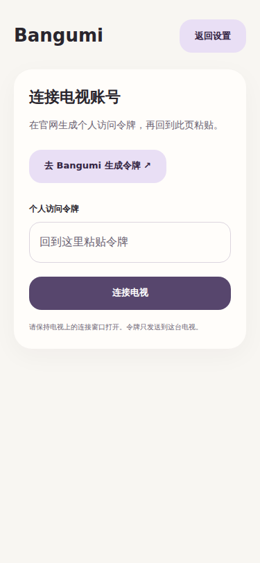

# Bangumi 手机扫码连接验证

基线提交：`10d60c808`，测试对象为其上未提交的账号连接改动。工作区另有播放器等修改，未计入本功能结论。

环境：Ubuntu、JDK 21、Android SDK 37.0、固定 Media3 composite；浏览器使用 Python 3.12、Playwright 1.64.1 与 Chromium 受控 HTTP 响应。

## 浏览器

运行：

```bash
WEB_VERIFY_OUTPUT=/tmp/tv-bangumi-browser \
  /data/tv-web-verify-venv/bin/python .github/scripts/verify-calendar-account-web.py -v
```

6 项通过：合法会话提交与完成、无效令牌重试、刷新恢复配对但不恢复令牌、未配对／过期拒绝、网络失败恢复、简体／繁体／英文与浅深色在 320／375／768 宽度无横向溢出。检查令牌只在 POST JSON 中提交、不进入 URL 或浏览器存储、提交后清空输入框。过程中发现同标签页重新扫码未更新和英文按钮窄屏溢出，已修复并复测。

| 手机浅色 | 手机深色 |
| --- | --- |
|  |  |

## Android

新增会话单测覆盖并发重复提交、失败重试、过期／取消／替换会话、保存失败与服务停止；接口单测覆盖同源和私网限制、体积限制、非法格式及真实 NanoHTTPD 请求。专项 Gradle 验证结果将在本轮执行完成后记录。

## 覆盖限制

浏览器使用受控接口，无真实账号令牌；未验证真实 Bangumi 登录、iOS Safari 或实体电视扫码。本次不接入 OAuth App ID／Secret，不部署回调服务。既有账号数据导入与操作范围见[使用说明](../../../native-discovery.md#追更日历)，手机接口见[大屏伴侣](../../../web-companion.md#bangumi-账号连接)。
