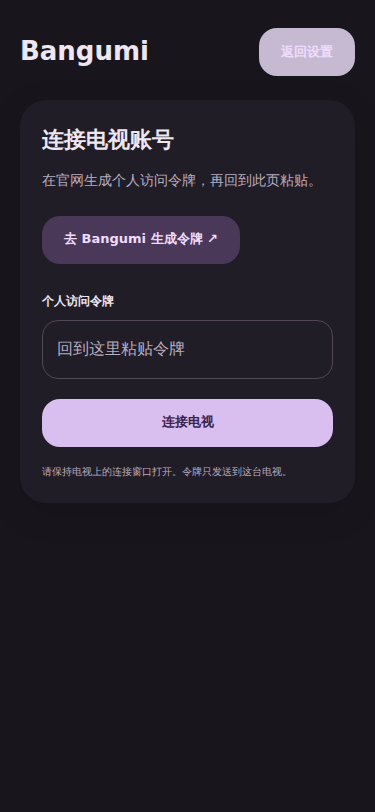
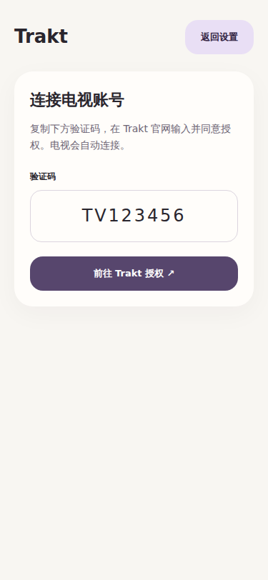
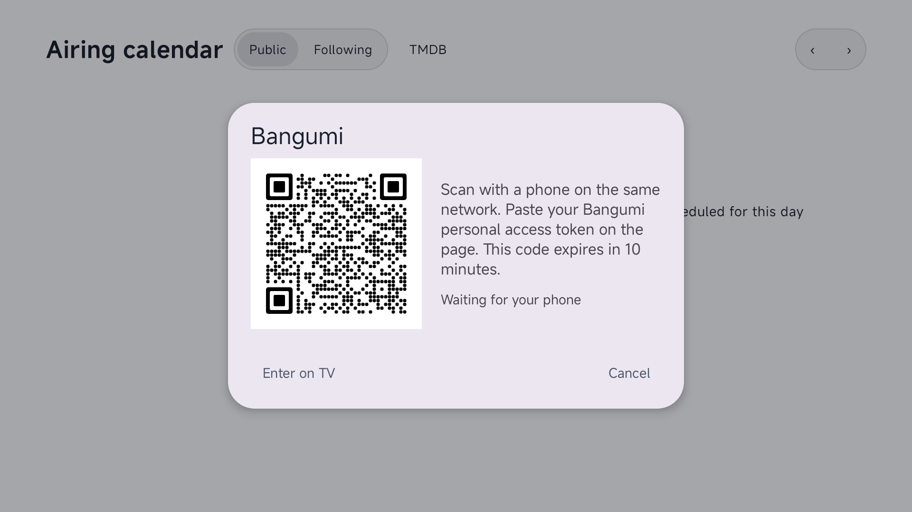
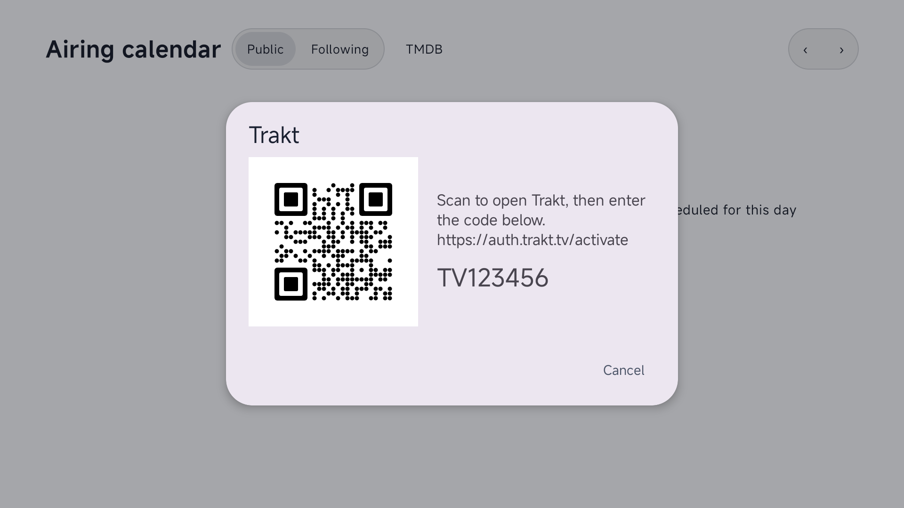
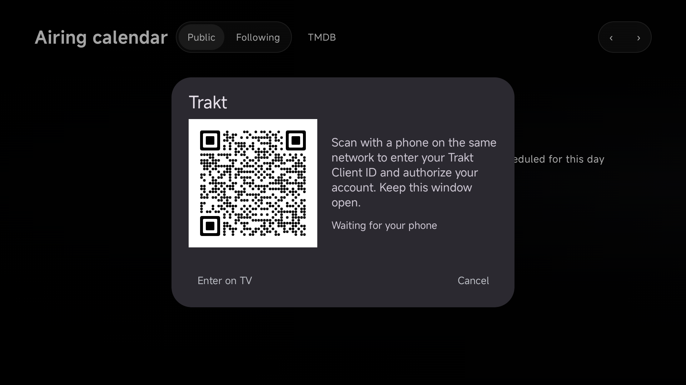
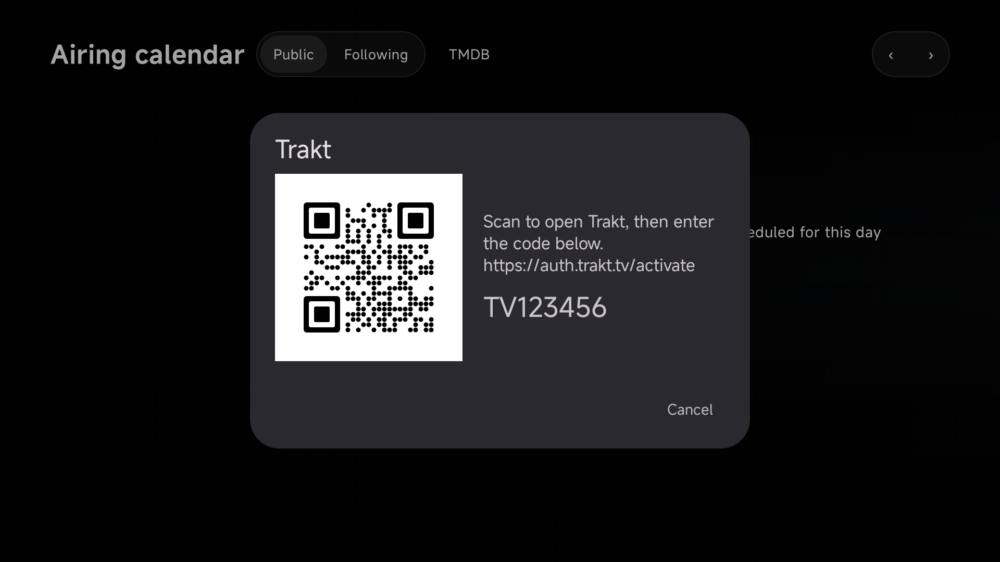

# Trakt 与 Bangumi 手机扫码连接验证

验证提交：`36dcf58d8a899a09d903e49feb2818a1cd95f29d`，分支 `feat/calendar-phone-20261128`，基线 `10d60c808`。独立分支包含 Trakt 与 Bangumi 手机连接、Trakt 发布配置补全、相关文档与验证用例。

最终 [GitHub Actions 46159738099](https://github.com/wobuhui666/TV/actions/runs/46159738099) 全部通过。环境为 Ubuntu runner、Temurin JDK 21、Python 3.10、Android SDK 37.0、固定 Media3 `342f6590e02ac390e0bd6b4488b8a1bff55747c1` 及仓库补丁；浏览器为 Playwright 1.64.1 / Chromium，设备为 API 34 x86_64 模拟器。

| 检查 | 结果 |
| --- | --- |
| 大屏伴侣既有浏览器回归 | 18 项通过 |
| Trakt / Bangumi 手机连接浏览器回归 | 10 项通过 |
| Debug 会话／HTTP／Trakt API／日志／诊断专项 JUnit | 5 类、40 项通过 |
| Preview 完整应用 JUnit | 174 类、1,389 项通过，无失败或跳过 |
| Preview 应用和 instrumentation APK | 构建通过 |
| API 34 Android | 24 项通过：二维码 8、遥控 8、真实日志 1、日历账号连接 7（Bangumi 3、Trakt 4） |

脱敏结果见 [validation-summary.json](validation-summary.json)。首次本地 Gradle 因内存不足未完成，随后按用户要求迁到 GHA；本地结果不计为 Android 构建或单测通过。

## 浏览器

运行：

```bash
python3 .github/scripts/verify-material-web.py --output artifacts/material-web
WEB_VERIFY_OUTPUT=artifacts/material-web/accounts \
  python3 .github/scripts/verify-calendar-account-web.py -v
```

6 项通过：合法会话提交与完成、无效令牌重试、刷新恢复配对但不恢复令牌、未配对／过期拒绝、网络失败恢复、简体／繁体／英文与浅深色在 320／375／768 宽度无横向溢出。检查令牌只在 POST JSON 中提交、不进入 URL 或浏览器存储、提交后清空输入框。过程中发现同标签页重新扫码未更新和英文按钮窄屏溢出，已修复并复测。

另外 4 项 Trakt 检查通过：手机提交 Client ID 后显示公开验证码与官网链接、拒绝非 Trakt 授权地址、无效 Client ID 重试与过期停止授权、简繁英 320 宽度输入／授权两阶段无溢出。API 不向网页返回私有设备码或访问／刷新令牌。

| 手机浅色 | 手机深色 |
| --- | --- |
|  |  |



## Android

新增会话单测覆盖重复提交、失败重试、过期／取消／替换会话、保存失败与服务停止；接口单测覆盖同源和私网限制、体积限制、非法格式及真实 NanoHTTPD 请求。

账号 instrumentation 用例从真实电视截图解码二维码，通过实际本机 HTTP 提交令牌，验证取消会话失效、手动输入可达、无效令牌保留原账号、有效令牌经 Keystore 加密保存与完成后重复提交不覆盖账号。Bangumi `/v0/me` 和空收藏分页由受控 OkHttp 响应提供，未访问真实账号。

新增 4 项 Trakt instrumentation 验证：直接官网二维码与验证码可读、授权成功保存访问／刷新令牌；手机更换 Client ID 时失败保留旧账号，授权成功后才替换；关闭弹窗停止轮询；授权码过期使手机会话失效且不保存账号。Trakt `/oauth/device/code` 和 `/oauth/device/token` 由受控响应提供，覆盖待授权 400 与无效 Client ID 401，未访问真实 Trakt 账号。

[首轮 GHA 46156258758](https://github.com/wobuhui666/TV/actions/runs/46156258758) 的单测及构建通过，但账号 UI 的 3 项中有 1 项失败：二维码与说明纵向排列导致底部按钮超出弹窗可见区域。改成并排布局，并显式检查浅深色两种弹窗的取消与手动输入按钮可见后，[Bangumi 第二轮](https://github.com/wobuhui666/TV/actions/runs/46157574933) 全部通过；本报告顶部为追加 Trakt 后再次通过的完整结果。

| 电视浅色 | 电视深色 |
| --- | --- |
|  |  |

| Trakt 官网授权 | Trakt 手机配置 |
| --- | --- |
|  |  |



工作流执行的 Gradle 命令（`sdk.init.gradle` 为工作流生成的 SDK 37.0 兼容脚本）：

```bash
./gradlew -I sdk.init.gradle :app:testLeanbackArm64_v8aDebugUnitTest \
  --tests 'com.fongmi.android.tv.server.LogSessionTest' \
  --tests 'com.fongmi.android.tv.server.process.DiagnosticsTest' \
  --tests 'com.fongmi.android.tv.calendar.CalendarAccountPairingTest' \
  --tests 'com.fongmi.android.tv.server.process.CalendarAccountTest' \
  --tests 'com.fongmi.android.tv.calendar.TraktAccountApiTest' \
  --no-daemon --build-cache --max-workers=2 --console=plain
./gradlew -I sdk.init.gradle :app:assembleLeanbackArm64_v8aPreview \
  :app:assembleLeanbackArm64_v8aPreviewAndroidTest \
  :app:testLeanbackArm64_v8aPreviewUnitTest \
  -PtvPreview --no-daemon --build-cache --max-workers=2 --console=plain
```

## 覆盖限制

浏览器使用受控接口；Android 使用生产账号弹窗的预览宿主、真实 HTTP 与 Keystore，官方 API 响应为受控设备码、令牌或空列表。未验证真实 Trakt／Bangumi 登录、真实刷新令牌、非空列表同步、个人日历刷新后的真实排期、iOS Safari、API 24 或实体电视扫码，未运行完整 lint。Trakt 使用现有设备码 OAuth，无 Client Secret；Bangumi 使用个人令牌，不接入 Bangumi OAuth，也不部署回调服务。两条发布工作流已对齐 `TRAKT_CLIENT_ID` 注入，但本次未构建带真实 Client ID 的发布包。既有账号数据导入与操作范围见[使用说明](../../../native-discovery.md#追更日历)，手机接口见[大屏伴侣](../../../web-companion.md#日历账号连接)。
