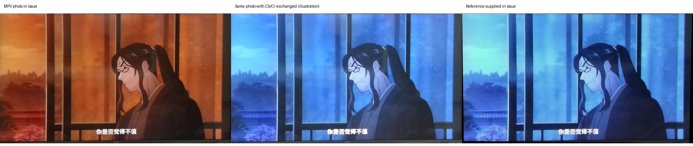
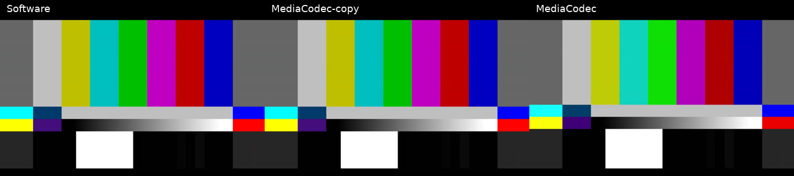

# Issue #134：海思 MPV 偏色与卡顿排查

2026-11-28，初查基线 `4044b4c6b`，修复分支 `fix/issue134-mpv-hisi` 从
`10d60c80866af4b16c7905d1d61aa477b4167607` 创建。原生构建源码提交
`2fa70ab0de4287db8a2f5ab78a0977b1c88f4828`。其他预加载／UI 改动未带入测试分支。

结论：找到与现场蓝／橙颜色变化相符的 **NV21 被当作 NV12** 的格式映射冲突，
并用固定版本的 FFmpeg 原函数复现。补丁已由 GHA 完整重编两个 ARM ABI，
打入本分支原生库，并同步 Media3 的共享 FFmpeg。
**V55i 现场验证仍待测试包反馈；硬解初始化失败与卡顿还没有完成根因验证。**

## 现场证据

- 设备：issue 作者报告华为智慧屏 V55i，EXO 同片正常。
- [日志附件](https://github.com/wobuhui666/TV/issues/134#issuecomment-7240008778)：
  `OMX.hisi.video.decoder.hevc` 启动失败，最终为
  `hwdec=mediacodec-copy format=nv12 size=3840x2160`；
  `vo=gpu context=android`，Vulkan／gpu-next 关闭；
  BT.709／BT.1886，未检测到 Dolby Vision。
- [第一张照片](https://github.com/wobuhui666/TV/issues/134#issuecomment-7240054674)
  与[后补的“原图”](https://github.com/wobuhui666/TV/issues/134#issuecomment-7240136294)
  展示同一场景与字幕，分别呈橙／蓝色。结合日志分析，不把照片作为另一次未知播放而丢弃。
- [新增卡顿反馈](https://github.com/wobuhui666/TV/issues/134#issuecomment-7240067913)
  与日志中的反复 AudioTrack 欠载和音画失步一致。

日志中的播放地址、来源参数和完整现场照片保留在仓库外；此处只收录公开链接、
裁切后的屏幕对照及必要的格式信息。

## 格式映射冲突

公开海思 SDK `HiSTBLinuxV100R005C00SPC050` 的固定提交
`fd20f78ab02934e71474dbb1d933c6ec911b01c9`：

1. [omx_drv_ctx.c:466](https://github.com/JasonFreeLab/HiSTBLinuxV100R005C00SPC050/blob/fd20f78ab02934e71474dbb1d933c6ec911b01c9/source/msp/api/omx/omx_vdec/omx_vdec_v2.0/normal/omx_drv_ctx.c#L466)
   默认 `cfg_color_format = HI_DRV_PIX_FMT_NV21`。
2. [omx_vdec.c:3205](https://github.com/JasonFreeLab/HiSTBLinuxV100R005C00SPC050/blob/fd20f78ab02934e71474dbb1d933c6ec911b01c9/source/msp/api/omx/omx_vdec/omx_vdec_v2.0/normal/omx_vdec.c#L3205)
   在非 native buffer 输出下，把 NV21 报为 `OMX_QCOM_COLOR_FormatYVU420SemiPlanar`。
3. [OMX_IVCommon.h:121](https://github.com/JasonFreeLab/HiSTBLinuxV100R005C00SPC050/blob/fd20f78ab02934e71474dbb1d933c6ec911b01c9/source/msp/api/omx/include/OMX_IVCommon.h#L121)
   该值是 `0x7FA30C00`，十进制 `2141391872`。

初查参考 FFmpeg 头文件提交
`03d9533176e98bb9fbf569c1f34968e73e948dd9` 的
[mediacodecdec_common.c:196](https://github.com/FongMi/FFmpeg/blob/03d9533176e98bb9fbf569c1f34968e73e948dd9/libavcodec/mediacodecdec_common.c#L196)
把同一值命名为 `COLOR_QCOM_FormatYUV420SemiPlanar`，统一映射到 `AV_PIX_FMT_NV12`。
后续半平面复制函数直接保留源字节，没有 VU→UV 交换。
因此当上述海思格式出现时，V 被当成 U、U 被当成 V，画面保持完整但颜色改变。

NV12 的色度顺序是 UV，NV21 是 VU。它们字节数和行跨度相同，
只看 `nv12`、3840×2160、BT.709 并不能发现错误。
EXO 的 Surface 输出不经过 FFmpeg 这条字节缓冲映射，可解释其表现不同。

公开 SDK 并不等于 V55i 的实际固件；现有日志没有原始 `color-format`，
因此这是一处已复现的代码兼容冲突和现场问题的强候选，尚非 V55i 上的闭环证明。
随后从 Media3 的 `native-dependencies.properties` 找到原二进制的确切 FFmpeg 提交
`04482c8d13ac27b2a9fe93f5d388929eef8af5f4`，该版本也存在同一映射。最终补丁、
原函数回归和完整重编均使用此提交；MPV 本体与扩展 JNI 桥保持原二进制。

## 照片对照



两张电视屏幕先作透视校正，再以 SIFT／RANSAC 对齐；408 个匹配中 363 个为内点。
在 462,091 个有效彩色像素上比较不同转换，统一使用一个亮度增益和偏移
补偿两次拍摄曝光差异。BT.709 的 U/V 交换平均通道误差约 15.5/255，
仅替换 BT.601／BT.709 矩阵约 63.5/255，RGB 红蓝交换约 19.2/255。
详情见 [photo-comparison.json](photo-comparison.json)。

这验证 U/V 交换与现场变化相符，不能单靠照片排除 RGB 通道错误、相机白平衡
或电视图像处理；照片也不是解码帧的像素级颜色标准。中间图是变换示意，
不是修复版 APK 的实拍。

## 初始化失败和卡顿

- 应用切 EXO→MPV 时先 `old.release()`，MPV 在有效 Surface 绑定后才 loadfile。
  现场日志没有支持“未绑定显示 Surface 就开始播放”的证据。
- `Both surface and native_window are NULL` 出现在直接硬解失败之后。
  MPV 的 copy 分支创建无 Surface 的 MediaCodec device；FFmpeg 的
  `hwcontext_mediacodec.c` 明确允许这种 dummy context，之后
  `mediacodec_surface.c` 会记录这行并继续走字节缓冲。
  该行本身不是显示 Surface 丢失的证明。
- copy 分支每帧把 MediaCodec 输出复制到 FFmpeg 帧，再由 GPU 使用。
  3840×2160 的 8 位 4:2:0 可见数据每帧约 11.9 MiB；
  若为 24 fps，仅可见帧数据就约 285 MiB/s，尚未计填充、读写双向流量和 GPU 传输。
  日志没有帧率和耗时，不能用这个估算认定欠载唯一原因。
- 海思直接硬解的 `start failed` 仍可能涉及驱动对 AImageReader 输出的支持、
  输出缓冲分配或资源条件。现有 X20 为 Unisoc，不能替代 V55i；
  日志的通用异常码没有给出厂商内部原因。

## 初查验证（完整重编前）

- 应用保留 H.264／HEVC 的 `Output MediaFormat changed to` 和
  `Output crop parameters`。原先 `all=warn` 加 Java 回调过滤丢弃了这些信息。
  现在仅对 `ffmpeg/video` 提升到 verbose，并用消息白名单收集配置事件，
  没有启用逐帧 debug／trace。
- [原生补丁](../../../../third_party/mpv/patches/ffmpeg-hisi-nv21.patch)
  仅针对无 Surface、解码器名以 `OMX.hisi.video.decoder.` 开头且
  `color-format=0x7fa30c00` 的情况返回 NV21。标准 NV12、其他厂商和直接 Surface
  输出保留原有映射；不增加每帧 CPU 交换／重拷贝。
- [回归脚本](../../../../third_party/mpv/verify_hisi_nv21.py)
  校验固定源文件 SHA-256，提取并编译原映射函数和半平面复制函数，
  以最小类型定义运行 AddressSanitizer／UndefinedBehaviorSanitizer 检查。
  补丁前 9/11 映射通过，两项海思 NV21 失败；补丁后 11/11 通过。
  源行填充、分片高度、非零缓冲偏移、左侧裁剪和 3 种目标行跨度均保持 VU 字节。
  [实际输出](native-mapping-regression.txt)。
- NDK r29、Android API 24：补丁后的 `mediacodecdec_common.o` 与
  `mediacodec_sw_buffer.o` 在 arm64-v8a 和 armeabi-v7a 均编译通过。
  这是对象编译，不是完整 FFmpeg 链接／打包。
- OpenJDK 21、JUnit 4.13.2：`MpvVideoPathTest` **7/7 通过**，
  覆盖格式事件准入和逐帧／无关消息排除。
- 尝试
  `:app:testLeanbackArm64_v8aDebugUnitTest --tests com.fongmi.android.tv.player.mpv.MpvVideoPathTest`：
  配好 SDK 后进入 Kotlin 编译，但编译 daemon 连接 EOF，回退编译未完成，
  已停止本次构建。**不记为 Gradle variant 通过**。
- 独立 ARM64 标准色条 probe APK 已在仓库外构建；X20 经 ADB 隧道传输／安装反复超时，
  没有安装成功或取得播放结果，不能报告设备色彩／性能验证通过。

原生源回归可重复运行：

```bash
python3 third_party/mpv/verify_hisi_nv21.py
```

## 首次完整重编与测试包

用户随后授权将修复编入 APK 并通过 GHA 发布专项共存测试版。

- [原生 GHA 46156228021](https://github.com/wobuhui666/TV/actions/runs/46156228021)：
  ARM64／ARMv7 均成功，保留原生产构建的 mbedTLS、dav1d、libxml2、ARIB 字幕和 AV3A 等特性。
- 新运行库 SHA-256：`4ac7c853a706851cdbd56363a9f3be481e4c00ebccf8ea7294959d67abb22eee`。
  每个源码压缩包、补丁、产物哈希见[构建清单](../../../../third_party/mpv/native-hisi-provenance.json)。
- 两 ABI 的七个 FFmpeg 库均保留原导出 ABI；全部带版本号的媒体符号可解析。
  扩展 JNI 的 23 个入口及 47 个媒体导入均通过检查。两个 codec 均包含实际编译的修正标记。
- 日志回归 10/10 通过；共享库同步、幂等、拒绝未知本地修改和符号链接的 4/4 测试通过。
- 原生补丁记录解码器名、原始格式和 Surface／copy 输出；Java 记录设备、App／内核版本、
  回退、音频缓冲容量及限频性能采样。常见凭据字段在独立日志入口亦进行脱敏。
- 测试 APK 使用独立包名 `com.wobuhui666.android.tv.mpv134`，桌面名“TV MPV 测试”。
  APK GHA 校验包名、签名、ABI 及实际打包的七个 FFmpeg 库哈希后才发布预发布附件。
  V55i 本身未连接本次构建环境，不能据此宣布颜色或性能已通过实机验证。

## 首次 GHA APK 发布与交付

[应用 GHA 46157742392](https://github.com/wobuhui666/TV/actions/runs/46157742392)
成功，构建提交 `02aaae3d1818f482723dcac7d541649991aa0ffd`：

- `:app:testLeanbackArm64_v8aDebugUnitTest --tests 'com.fongmi.android.tv.player.mpv.*'`：
  **6 个测试类、33 项通过，0 失败／错误／跳过**，见 [gha-tests.json](gha-tests.json)。
- `:app:assembleLeanbackArm64_v8aRelease :app:assembleLeanbackArmeabi_v7aRelease` 成功。
- 版本 `5.8.7-mpv134.2`，两个 APK 的独立包名、桌面名称、正式签名、ABI 和
  七个共享 FFmpeg 库哈希全部检查通过；MPV 与扩展 JNI 二进制未被替换。
- [预发布页面](https://github.com/wobuhui666/TV/releases/tag/mpv134-test-46157742392-1)，
  [ARM64 APK](https://github.com/wobuhui666/TV/releases/download/mpv134-test-46157742392-1/TV-MPV134-arm64-v8a-coexist.apk)，
  [ARMv7 APK](https://github.com/wobuhui666/TV/releases/download/mpv134-test-46157742392-1/TV-MPV134-armeabi-v7a-coexist.apk)。
  已用不带 GitHub 认证的 curl 完整下载两个 APK，复核 SHA-256、签名、包名与库哈希。
- [构建校验清单](build-verification.json)记录文件大小、SHA-256、签名证书和源码提交。
- 已按用户授权在 [#134 留言](https://github.com/wobuhui666/TV/issues/134#issuecomment-7241420201)，
  包含直接下载地址、同片 MPV／EXO 颜色对照和日志导出步骤。等待 V55i 现场反馈。

首次 APK 工作流因测试名称的 Manifest 合并冲突失败，改为资源覆盖后通过。
随后为兼容本机 SDK 37 的不同证书输出格式补强了校验脚本；它没有改变 APK 源码，
因此已取消自动触发的重复构建，保留上述通过验证的交付包。

## 追加复查与修复

继续复查同一条播放路径，确认并修复以下问题：

- `mediacodec_sw_buffer.c` 的 4:2:0 半平面复制把顶部裁剪的亮度行数直接用作
  色度行数，可能读错颜色或越界；另外，左侧裁剪后按完整 stride 连续复制会越过
  最后一个色度行。固定版本原函数的两个合法裁剪输入分别复现 ASAN
  `stack-buffer-overflow`，补丁后均通过。裁剪补丁提交为 `0a9989556`。
  这两处属于已有缺陷，不是 NV21 格式补丁引入；尚不确定 V55i 片源是否触发。
- `MpvPlayer` 原先把总时长填入已缓存位置，造成缓存条看似已缓存整片。
  现使用 `demuxer-cache-duration` 估算前向缓存，拖动／新播放／属性不可用时清除旧值，
  已知片长时限制上界。新增六项单测覆盖有限／无效缓存、直播、跳转和溢出。
- 正常退出先 `stop()` 清除状态，随后 `release()` 无法记录最后一份性能快照。
  现于 stop、清空列表及 END_FILE 重置前采样，并记录进入／退出缓存等待。
  不依赖播放时钟继续前进才能发现缓存停顿。
- Media3 库同步允许从清单里已验证的上一版补丁升级，避免本地增量构建把旧补丁
  当成未知修改；仍在写入前拒绝未知库。同步回归现为五项。

[原生 GHA 46163185605](https://github.com/wobuhui666/TV/actions/runs/46163185605)
在 `0a9989556c0cae05bfb727661830f9fecfbe4dcd` 上重编两个 ABI，均成功。
新运行库 SHA-256 为
`1ae1a5e55e3e96e3047cf37d3c464852ee8c0ceb2922e59d063a575b07a47022`。
主机复核：11/11 格式映射、3/3 原有复制场景及 2/2 新裁剪场景通过
ASAN／UBSAN；两 ABI 的原导出符号、23 个 JNI 入口和 47 个媒体导入检查通过；
六项缓存单测和五项共享库同步测试通过。当前输出见
[native-mapping-regression.txt](native-mapping-regression.txt)。

### 新版 APK 与交付

[应用 GHA 46164248943](https://github.com/wobuhui666/TV/actions/runs/46164248943)
在提交 `ed0b9460fe9155c5e646239db6d408fe291cdfc0` 上成功：

- `:app:testLeanbackArm64_v8aDebugUnitTest --tests 'com.fongmi.android.tv.player.mpv.*'`：
  **7 个测试类、39 项通过，0 失败／错误／跳过**，见 [回归清单](review-gha-tests.json)。
- `:app:assembleLeanbackArm64_v8aRelease :app:assembleLeanbackArmeabi_v7aRelease`
  成功；版本为 `5.8.7-mpv134.4`，保留独立测试包名和原签名，可覆盖上一版测试包。
- [新版 ARM64 APK](https://github.com/wobuhui666/TV/releases/download/mpv134-test-46164248943-1/TV-MPV134-arm64-v8a-coexist.apk)、
  [新版 ARMv7 APK](https://github.com/wobuhui666/TV/releases/download/mpv134-test-46164248943-1/TV-MPV134-armeabi-v7a-coexist.apk)
  均以无认证请求完整下载，HTTP 200；本地再次核验大小、SHA-256、包名、版本、
  桌面名称、签名、ABI、七个 FFmpeg 库及 MPV／JNI 二进制。
  见 [新版构建校验清单](review-build-verification.json)。
- 已更新 [#134 原测试留言](https://github.com/wobuhui666/TV/issues/134#issuecomment-7241420201)
  的版本、直链和修复说明。首次版本的构建清单仍保留在上节，供追溯。

### ARM 设备补充验证

X20（Unisoc `ums512`、Android 10／API 29）使用独立原生测试程序，载入本次运行库，
以 OpenGL／`vo=gpu` 播放合成 HEVC 色条。每种模式约 10 秒，采集 TextureView
实际画面、解码路径和性能属性；测试程序音量为零。

| 请求模式 | 实际解码 | 首帧采样 | 渲染／解码掉帧 | 音频欠载次数 |
| --- | --- | --- | --- | --- |
| 720p copy 硬解 | `mediacodec-copy`／NV12 | 732 ms | 0／0 | 1 |
| 720p 软解 | `no`／YUV420P | 600 ms | 0／0 | 0 |
| 720p 直接硬解 | `mediacodec` | 761 ms | 0／0 | 0 |
| 4K copy 硬解 | 初始化失败，回退软解 | 895 ms | 0／0 | 1 |
| 4K 软解 | `no`／YUV420P | 816 ms | 0／0 | 1 |

首帧由 500 ms 定时采样判定，仅供本轮参考。720p copy 与软解的完整 RGB 截图逐字节
一致。直接硬解的图像与软解有差异；重新安装前版运行库进行同场景对照，确认前后两版
直接硬解截图也逐字节一致，差异并非此次裁剪补丁引入。



[设备摘要](device-smoke-summary.json)记录运行库、测试 APK、源码与片段哈希，以及实际采样。
这是原生程序验证，未覆盖完整应用的缓存 UI 和停止日志；顶部／左侧裁剪仍只由主机回归覆盖。
X20 的 4K `OMX.sprd.hevc.decoder` 配置失败，故本轮没有取得 4K copy 硬解性能数据。
短色条、静音和掉帧计数不能证明真实片源长期流畅，也不能替代音频听感或 V55i 验证。
V55i 的偏色是否恢复、直接硬解启动失败和卡顿仍待现场反馈。

## 下一次 V55i 验证

2026-11-28 补查现成实现：FFmpeg master
[`67240ca40f83`](https://github.com/FFmpeg/FFmpeg/blob/67240ca40f83da4a0160cce250bebb6adae4955c/libavcodec/mediacodecdec_common.c#L208)
和 FongMi `release-9.0-fongmi`
[`bdf17191d55d`](https://github.com/FongMi/FFmpeg/blob/bdf17191d55d78984ea742fe858fbf9b9aaa5775/libavcodec/mediacodecdec_common.c#L361)
均仍把该值映射为 NV12，没有海思 NV21 分支。可获取的 Aryan447 AAR 最新版本仍为
项目已使用的 v0.0.3。未找到可直接替换且明确修复该问题的成品库；
现成的 `swapuv` 滤镜可以先做可逆色彩对照，不必先重建原生库。

记录同片 MPV copy 解码的原始格式：若是 `2141391872`，则与候选补丁条件直接一致。
用原包／补丁包的同帧色彩或标准色条作对照，并确认 EXO 与标准 NV12 输出没有回归。
两个 ABI 的完整重编、共享库同步及 JNI 校验已完成；剩余重点是 V55i 现场颜色和性能对照。

若先在现有包做短时色彩对照，可临时在 MPV 配置末尾添加：

```ini
vf-add=lavfi=[format=pix_fmts=yuv420p,swapuv]
```

退出播放后重新进入，比较同一场景颜色，再删除该行恢复。这只验证 U/V 顺序，
不是长期性能修复；格式转换会增加复制开销，也会使本来正确的片源偏色。
主机 FFmpeg 已验证 NV12→planar→swapuv→swapuv→NV12 往返逐字节一致，
仓库自带 libavfilter 含 swapuv；**此配置尚未在 Android 包上验证**。
