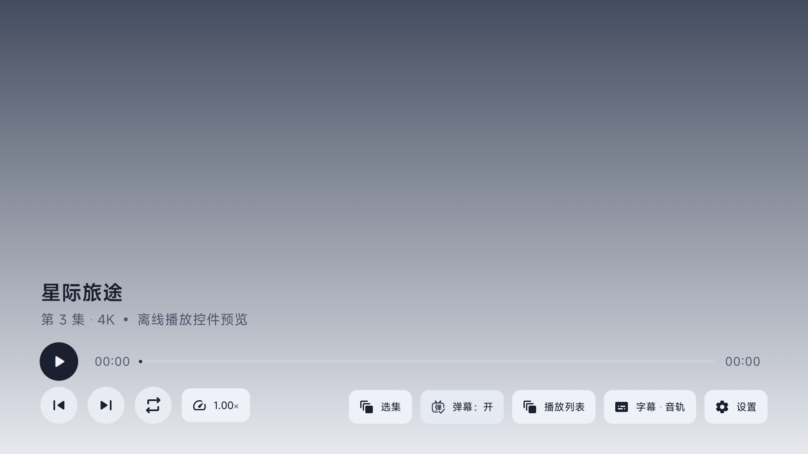

# TV 播放器倍速工具栏验证

对应 [Issue #138](https://github.com/wobuhui666/TV/issues/138)：点播、直播和投屏的底部工具栏显示当前倍速，按确认键或点击可循环调速，设置抽屉不再重复列出倍速。

验证提交：`920fa3c8c10dc0a5a74d10e08387434c1826e260`，分支 `feat/issue138-playback-speed`。
GitHub Actions：[运行 46121203643](https://github.com/wobuhui666/TV/actions/runs/46121203643)，工作流 `tv-ui-verify.yml`，输入 `playback_speed=true`。

环境：Ubuntu 26.04 runner、Temurin JDK 21、Python 3.10、Android SDK 37.0，固定 Media3 `342f6590e02ac390e0bd6b4488b8a1bff55747c1` 及仓库补丁。界面测试运行于 API 34 / x86_64 模拟器，1920×1080、320 dpi。

| 检查 | 结果 |
| --- | --- |
| Preview 应用及 instrumentation APK | 构建通过 |
| 完整 Preview 应用 JUnit | 172 个测试类、1,373 项通过，失败／错误／跳过均为 0 |
| `PlaybackSpeedToolbarTest` | 1 项用例通过，包含三种布局 × 深浅两种主题共 6 个组合 |

各测试类统计、运行信息和截图 SHA-256 见 [verification.json](verification.json)。

界面测试在离线预览 Activity 中使用正式 `JetStreamVodControlView`，切换点播、直播和投屏对应的播放按钮、选集、弹幕和直播进度布局开关，各检查深色与浅色主题。测试覆盖倍速与设置按钮同排、无重叠、触摸后速度文字更新、继续按遥控确认可再次调速、调速不打开设置抽屉、抽屉内没有重复倍速项，以及隐藏命令后移除按钮。

GHA 执行的 Gradle 命令（init 脚本由工作流生成）：

```bash
./gradlew -I "$RUNNER_TEMP/tv-sdk-compat.init.gradle" \
  :app:assembleLeanbackArm64_v8aPreview \
  :app:assembleLeanbackArm64_v8aPreviewAndroidTest \
  :app:testLeanbackArm64_v8aPreviewUnitTest \
  -PtvPreview --no-daemon --build-cache --max-workers=2 --console=plain
```

[首次专项运行](https://github.com/wobuhui666/TV/actions/runs/46120226397)的构建和 1,373 项应用单测通过；界面用例在关闭设置抽屉时失败。预览 Activity 的系统返回键直接结束页面，测试误以为它只会关闭抽屉。修订后使用正式抽屉支持的遥控器左键，并检查页面仍然存活。

下图为模拟器原始截图，均在调速前显示 `1.00×`；后续 `1.25×`、`1.50×` 的更新与遥控确认由通过的用例断言验证。已逐张检查六张图，倍速按钮与右侧操作没有重叠或截断。

| 布局开关 | 深色 | 浅色 |
| --- | --- | --- |
| 点播 |  |  |
| 直播 |  |  |
| 投屏 |  |  |

覆盖限制：界面测试的调速监听器使用受控数值，未启动实际点播、直播或投屏播放 Activity，未验证 Exo/MPV 音视频倍速、实体电视遥控器及重新打开影片后的倍速记忆。本轮未执行 lint 或签名 Release 构建；Preview APK 仅供验证。原始运行日志保留在 GHA artifact，报告只收录统计与离线界面截图。
