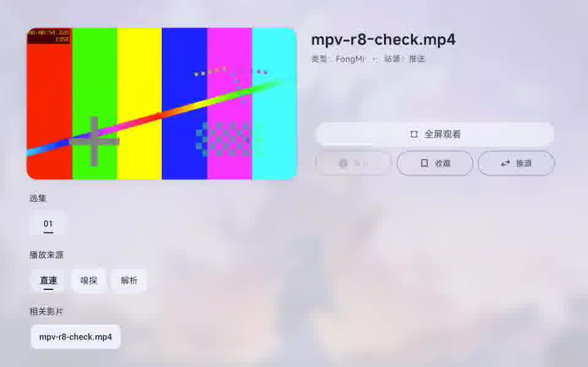

# R8 混淆对照构建

本实验检查开启 R8 后的 release 构建、实际字段改名及启动兼容性。应用基线为 `c2c5c1df7`，实验分支为 `verify/r8-x20-20261128`；不修改正式发布分支。

## 对照条件

同一次 GitHub Actions 运行依次构建未混淆和混淆两个 ARM64 release APK。两包使用相同源码、版本、临时签名、包名 `com.fongmi.android.tv.r8test`、固定 Media3 提交 `342f6590e02ac390e0bd6b4488b8a1bff55747c1` 及其仓库补丁。资源裁剪均关闭，仅 `minifyEnabled` 不同。R8 同时包含代码压缩、优化和改名，因此该实验不能单独量化改名的贡献。

两包均不可调试，但允许 shell 性能采样；可覆盖安装在同一测试包上。构建环境为 GitHub Ubuntu runner、JDK 21、Python 3.10、Android SDK 37.0。执行命令：

```bash
./gradlew -I "$RUNNER_TEMP/tv-r8.init.gradle" \
  -PtvApplicationId=com.fongmi.android.tv.r8test \
  :app:assembleLeanbackArm64_v8aRelease \
  --no-daemon --build-cache --max-workers=2 --console=plain
```

`R8_MINIFY=false` 和 `true` 分别选择基线与混淆配置。APK、R8 mapping、SHA-256、签名和原始 DEX 字段信息由工作流产物保存。

## 构建发现

[首轮 `073df99e4`](https://github.com/wobuhui666/TV/actions/runs/46124337904)：未混淆 APK 构建成功，R8 因 `org.lsposed.hiddenapibypass.HiddenApiBypass` 缺失而失败。

已检查仓库自带 `pine-core.aar` 的字节码。该引用仅在 SDK 34、代号为 Android 15 预览版且启用 hidden API bypass 时调用；`ToastFilter` 在 API 30 及以上关闭相应开关。实验为这一可选类添加精确的 `-dontwarn`，未忽略其他缺失类。

[第二轮 `d2023cbc5`](https://github.com/wobuhui666/TV/actions/runs/46125071761)：两包构建成功，APK 从 105,121,065 字节降到 95,749,170 字节。启动检查通过，但复查产物发现两项限制，因此不把这轮视为完整通过：

- 混淆包出现 Glide `ManifestParser` 的 `NoSuchMethodException`，虽然没有导致进程退出，仍会影响图片加载。补充旧式 Glide 模块公共无参构造方法的保留规则，并让启动检查拒绝反射／链接异常。
- Pine 的 `-keep class * { native <methods>; }` 保留了全部已有类名。播放页字段虽已改名，关联的 `ActivityVideoBinding`、`VideoViewModel` 和 `VodPlaybackController` 类名仍保留，WEX 仍可按类名继续扫描。

第三轮在 GHA 临时工作区将该规则收窄为 `-keepclasseswithmembers,includedescriptorclasses`。脚本核对原始 AAR SHA-256，并逐项确认仅 `proguard.txt` 改变，字节码、JNI 和资源保持一致。两份对照 APK 使用同样处理后的 AAR；仓库内 AAR 未改动。另保留 WEX 直接调用的 Logger／Printer 接口。对此前采样 JAR 的静态引用检查确认，第二轮在可核对的 132 个宿主方法和 5 个宿主字段中，丢失了 `Logger.t(String)` 与 `Printer.d(Object)` 两个方法；类名存在并不足以保证外部 JAR ABI 保持兼容。普通本地构建若不运行此实验脚本，仍保留 Pine 原始规则，不能声称得到同等类名混淆效果。

[第三轮 `837491b31`](https://github.com/wobuhui666/TV/actions/runs/46126477850)构建、成品校验和启动检查全部通过。[下载工作流产物](https://github.com/wobuhui666/TV/actions/runs/46126477850/artifacts/15256131793)，包含两份 APK、混淆映射及原始启动截图；保留期 14 天。脱敏摘要见 [verification.json](verification.json)。

| 指标 | 未混淆 | 开启 R8 |
| --- | --- | --- |
| APK 大小 | 105,121,681 字节（100.25 MiB） | 92,227,979 字节（87.96 MiB） |
| VideoActivity 实例字段数 | 50 | 49 |
| `mBinding` | 原名及 `ActivityVideoBinding` | `m0`，声明类型 `ab.c` |
| `mViewModel` | 原名及 `VideoViewModel` | `E0`，声明类型 `kb.w` |
| `mVod` | 原名及 `VodPlaybackController` | `B0`，声明类型 `nb.i` |
| 启动后主进程存活／HomeActivity 恢复 | 通过 | 通过 |
| 致命 Java／native 异常 | 0／0 | 0／0 |
| 检测到的反射／链接异常 | 0 | 0 |

APK 减少 12.30 MiB（12.27%）。两包 SHA-256、相同签名证书和源码提交已回读核验。此前采样 WEX JAR 可由未混淆宿主解析的 132 个方法引用、5 个字段引用，在最终混淆 APK 中均能静态解析；未执行 JAR 的动态反射或真实播放。

两个包都记录了空片源配置加载路径的已捕获 `NullPointerException`，没有导致进程退出；并非零异常日志。截图被 Android 首次全屏提示部分遮挡，基线截图背景尚黑，混淆包已显示首页和海报。因此启动检查只证明进程／Activity 状态及上述异常门槛，不能当作完整界面验收或启动耗时比较。

## 覆盖限制

GHA 启动检查使用 API 34 x86_64 模拟器的 ARM64 native bridge，安装实际 ARM64 release APK。检查冷启动、首页恢复、进程存活、崩溃及未清数据覆盖安装；截图和结果进入工作流产物。

初始 GHA 轮次尚未证明 X20 上 WEX 自动弹幕的停顿改善。完整播放、真实插件、其他 ABI、其他 Android 版本和持续使用不属于启动检查的覆盖范围。后续实机验证见下文。

## X20 后续实测

2026-11-28 在 X20 Android 10（API 29）、UMS512、ARM64 上使用独立包名实测。原始两包为 `837491b31`；覆盖安装保留测试包配置，安装后均以 `cmd package compile -m speed -f` 编译。WEX JAR 固定 SHA-256 为 `de8d0d39fdcb052a22aeadbb07ffb2a6b929dff0ca7c84173c9e440049a57aad`，自动弹幕回读为模式 1（自动弹幕＋纯白），同一记录为《十万狂花入梦来》第 15 集、续播点 1,490,321 ms。

两轮未混淆样本在约 47 秒窗口内的主线程 CPU 为 7.37／7.29 秒，最长 Davey 为 6,667／6,686 ms，Skipped frames 为 393／394，各出现一次 `AutoDanmu.request`。该片源返回的媒体域名已失效（独立 DNS 查询 NXDOMAIN），没有进入实际视频播放；这组只复现自动弹幕引起的主线程停顿。

原混淆 APK 进入 MPV 时 native abort：`ClassNotFoundException: is.xyz.mpv.MPVNode$None`，JNI `GetStaticFieldID` 收到空类。该崩溃发生在自动弹幕前，不能把“无 Davey”算作改善。已依据 `third_party/mpv/bridge/jni_utils.cpp`、`node.cpp` 保留 MPVNode 及嵌套类型、构造方法和字段，并在成品检查中验证节点类名及 value 字段。

[修正 JNI 后的构建 `e5bbdbe83`](https://github.com/wobuhui666/TV/actions/runs/46156873521)构建、JNI 名称检查及 API 34 启动检查通过。[下载最新两份 APK 和 mapping](https://github.com/wobuhui666/TV/actions/runs/46156873521/artifacts/15268014205)。X20 上同提交、同签名、同配置和 JAR 的结果如下；两轮混淆测完后换回该提交未混淆包复测，排除只因缓存或测试顺序改善。

| 指标 | 未混淆 1 | 未混淆 2 | 混淆 1 | 混淆 2 |
| --- | --- | --- | --- | --- |
| 观察窗口（秒） | 47.48 | 47.00 | 46.96 | 46.64 |
| 主线程 CPU（秒） | 7.36 | 7.31 | 1.34 | 1.33 |
| 最长渲染帧间隔（ms） | 6682.68 | 6648.14 | 619.47 | 674.32 |
| Skipped frames | 393 | 391 | 36 | 39 |
| WEX 自动弹幕请求次数 | 1 | 1 | 1 | 1 |
| 识别片名／集数 | 超时后为空 | 超时后为空 | 成功 | 成功 |
| 自动弹幕搜索及结果分发 | 未发生 | 未发生 | 发生 | 发生 |
| MPV 初始化 native abort | 无 | 无 | 无 | 无 |

最长帧间隔均值下降约 90.3%，主线程 CPU 均值下降约 81.8%。混淆包仍有约 0.6 秒停顿，并非完全无卡顿。`gfxinfo` 帧间隔包含主线程被 Handler 工作阻塞的等待；仅看 `Choreographer#doFrame` 方法自身耗时会漏掉本例的大部分停顿。

未混淆的 JAR 状态识别耗时超过两秒等待上限，`AutoDanmu.request` 的标题、集数为空；混淆后均取得 `source=media` 的正确标题／集数并发起搜索、分发结果地址。虽然 `/media` 提供元数据，JAR 仍先扫描 Activity 对象；此次 R8 对照支持“宿主暴露的名称和对象结构扩大反射／正则工作量”这一解释，不等于证明全部收益仅来自字段改名。

最终两包对 WEX 可静态解析的 132 个宿主方法、5 个字段均保持兼容。脱敏数据及精确 APK SHA-256 见 [x20-verification.json](x20-verification.json)。原始配置、媒体 URL 和日志保存在仓库外。

最后使用设备本地 640×360、25 fps、90 秒 H.264 测试视频确认混淆修正版 MPV 能进入播放，六次媒体会话采样均为 playing，位置从 6,484 ms 推进到 25,634 ms。该回归验证 MPV JNI 修复，不把本地视频当作真实源弹幕播放通过。




测试结束后已卸载独立 r8test 包，移除本轮设备临时 APK、媒体、快照和端口转发；原有七份 TV 备份 SHA-256 全部一致，休眠超时恢复为 300,000 ms，音量恢复为原值 0，设备回到休眠。正式应用未覆盖安装。
