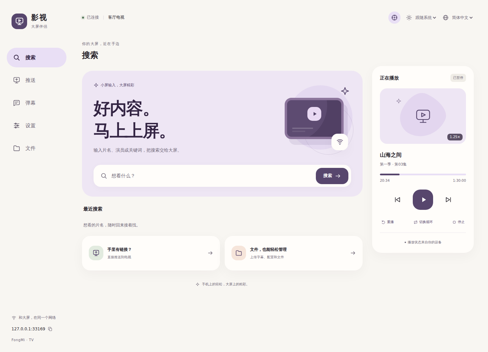

# 网页日志与图标对齐验证

基线：`3d9a1a1882116509552259c790bd24078c70fa3e`。本次在
`feat/web-logs-icons-20261128` 增加应用日志页面、采集接口和图标对齐修复。
上游参考：`FongMi/TV e296b5905ddb2ba34914f55c205b8cfb92279bc6`。

## 已完成的本地验证

环境：Ubuntu、Python 3.12、Playwright 1.64.1 / Chromium，受控 HTTP 示例。

- 网页回归 18 项通过：原有 13 项功能及新增 5 项日志回归。覆盖增量读取、文字／级别筛选、暂停显示继续接收、清空本页不重放、下载保留全部内容、停止与重启、断线重试、停止失败、会话结束、隐藏页面暂停轮询、文本注入和有界缓存。
- 简体／繁体／英文、浅色／深色、320／375／768／1440 宽度均无日志页横向溢出。
- `node --check app/src/main/assets/js/logs.js`、`node --check app/src/main/assets/js/script.js` 与 `git diff --check` 通过。
- 本地 Android Gradle 在配置阶段停止；用户指定编译与重型测试改用 GitHub Actions，本地不计通过。

## GitHub Actions

使用 `material-web-verify.yml`：浏览器回归、focused debug 日志／诊断单测、完整 preview 应用单测、preview APK 与 instrumentation APK 构建，以及 API 34 模拟器的日志／二维码／遥控测试。

新增 Android 测试通过真实 `Log.i` → 应用 logcat 子进程 → `/log` HTTP 路径检查采集、停止、重启及服务停止回收。结果将在工作流完成后填入，本段当前不宣称通过。

## 界面证据

截图使用相同受控设备名和播放数据。图标“之前”使用基线 CSS，“之后”使用本次 CSS；首页电视、Wi-Fi 与播放占位图标取消旋转，固定尺寸图标按钮显式清除内边距。

| 图标修复前 | 图标修复后 |
| --- | --- |
|  |  |

| 手机日志浅色 | 手机日志深色 |
| --- | --- |
|  |  |

## 覆盖限制

浏览器使用受控响应，不代表真实电视的网络与日志量。实际 ARM 电视、iOS Safari 的文件分享、厂商系统 logcat 限制与连续一小时采集尚未实测；会话期限、缓存上限和失败分支由 JVM／浏览器回归验证。原始私有日志未纳入报告。使用与接口见[大屏伴侣网页](../../../web-companion.md)。
