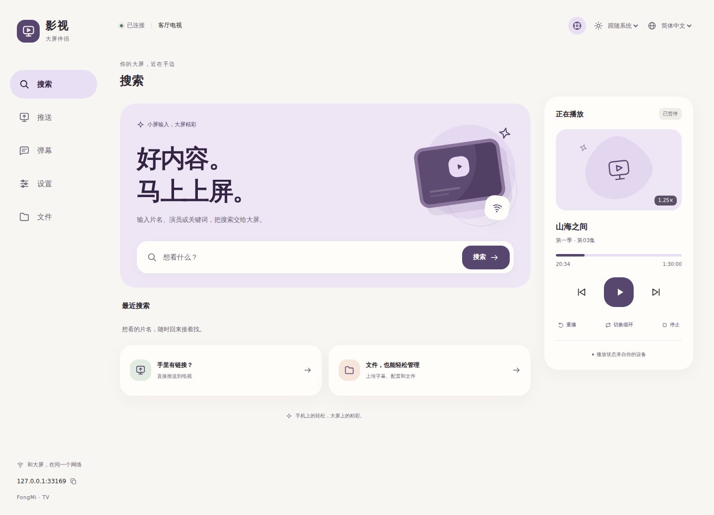
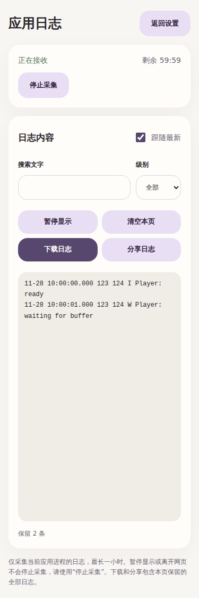
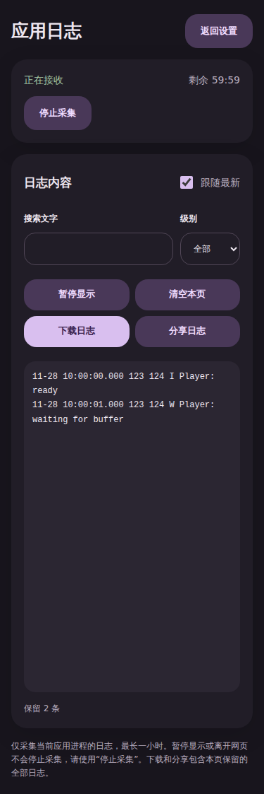

# 网页日志与图标对齐验证

基线：`3d9a1a1882116509552259c790bd24078c70fa3e`。本次在
`feat/web-logs-icons-20261128` 增加应用日志页面、采集接口和图标对齐修复。
上游参考：`FongMi/TV e296b5905ddb2ba34914f55c205b8cfb92279bc6`。

## 已完成的本地验证

环境：Ubuntu、Python 3.12、Playwright 1.64.1 / Chromium，受控 HTTP 示例。

- 网页回归 18 项通过：原有 13 项功能及新增 5 项日志回归。覆盖增量读取、文字／级别筛选、暂停显示继续接收、清空本页不重放、下载保留全部内容、停止与重启、断线重试、停止失败、会话结束、隐藏页面暂停轮询、文本注入和有界缓存。
- 简体／繁体／英文、浅色／深色、320／375／768／1440 宽度均无日志页横向溢出。
- `node --check app/src/main/assets/js/logs.js`、`node --check app/src/main/assets/js/script.js` 与 `git diff --check` 通过。
- 本地 Android Gradle 在配置阶段停止；用户指定编译与重型测试改用 GitHub Actions，本地不计通过。

## GitHub Actions

验证提交：`98923fcb895a8792f0bcbe69f1816bc36a75ab17`，
[运行 46113303458](https://github.com/wobuhui666/TV/actions/runs/46113303458)。

使用 `material-web-verify.yml`，Ubuntu runner、Temurin JDK 21、Python 3.10、SDK 37.0、固定 Media3 `342f6590e02ac390e0bd6b4488b8a1bff55747c1` 及其仓库补丁。

| 验证 | 结果 |
| --- | --- |
| Chromium 网页回归 | 18 项通过，见 [browser-summary.json](browser-summary.json) |
| Debug 日志／诊断专项 JUnit | 10 项通过 |
| 完整 Preview 应用 JUnit | 172 个测试类、1,373 项通过，无失败／跳过；见 [unit-summary.json](unit-summary.json) |
| Preview 应用及 instrumentation APK | 构建通过 |
| Android API 34 x86_64 模拟器 | 17 项通过：二维码 8、遥控 8、真实日志 1；见 [android-summary.json](android-summary.json) |

Android 日志测试经真实 `Log.i` → 当前应用 logcat 子进程 → `/log` HTTP 路径验证采集、停止、重启及服务停止回收。

GHA 执行的 Gradle 命令（`sdk.init.gradle` 为工作流生成的 SDK 37.0 兼容脚本）：

```bash
./gradlew -I sdk.init.gradle :app:testLeanbackArm64_v8aDebugUnitTest \
  --tests 'com.fongmi.android.tv.server.LogSessionTest' \
  --tests 'com.fongmi.android.tv.server.process.DiagnosticsTest' \
  --no-daemon --build-cache --max-workers=2 --console=plain
./gradlew -I sdk.init.gradle :app:assembleLeanbackArm64_v8aPreview \
  :app:assembleLeanbackArm64_v8aPreviewAndroidTest \
  :app:testLeanbackArm64_v8aPreviewUnitTest \
  -PtvPreview --no-daemon --build-cache --max-workers=2 --console=plain
```

前两轮 CI 暴露的测试客户端问题已修正：JDK `HttpURLConnection` 过滤 Origin，`java.net.http` 不在 Android 单测编译 API 中；最终采用项目已有的 OkHttp，保留真实 HTTP 的跨站请求校验。

## 界面证据

截图使用相同受控设备名和播放数据。图标“之前”使用基线 CSS，“之后”使用本次 CSS；首页电视、Wi-Fi 与播放占位图标取消旋转，固定尺寸图标按钮显式清除内边距。

| 图标修复前 | 图标修复后 |
| --- | --- |
|  |  |

| 手机日志浅色 | 手机日志深色 |
| --- | --- |
|  |  |

## 覆盖限制

浏览器使用受控响应；API 34 仅验证当前应用进程的实际 logcat 和 HTTP，不代表真实电视的网络与日志量。实际 ARM 电视、iOS Safari 的文件分享、厂商系统 logcat 限制与连续一小时采集尚未实测；会话期限、缓存上限和失败分支由 JVM／浏览器回归验证。原始私有日志未纳入报告。使用与接口见[大屏伴侣网页](../../../web-companion.md)。
