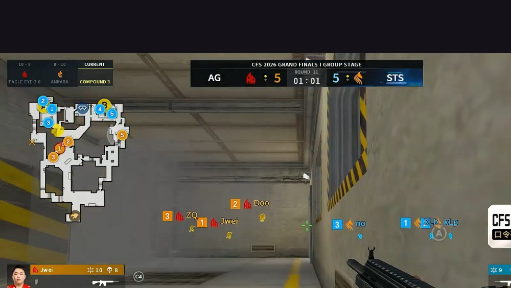

# WEX 自建源迁移与 X20 实测

2026-11-28，检查指定 WEX 配置中引用 `wobuhui666`、`zhhshss` 的 **16 个点播源和 3 个电视直播源**。游戏直播按斗鱼、虎牙、YY 分别抽样，共 21 条结果。迁移、9 处解析器地址替换及修复版配置更新已完成。同步上游规则后，抽样确认 **16 个源出现实际视频（mgnacg 缓冲明显），另 3 个仍未出画面**；源文件能下载不等于站点能播放。

## 迁移结果

- 源仓库及历史已复制到 [zhhshss/CatVodSpider](https://github.com/zhhshss/CatVodSpider/tree/wex-20261128) 和 [zhhshss/js](https://github.com/zhhshss/js/tree/wex-20261128)。原仓库保留。
- WEX 的 14 个独立 JAR 引用、哔哩的 API／规则引用、背景图和 Logo，共 **18 处地址**已改为 zhhshss，并固定提交。游戏与电视直播原本已在 zhhshss。
- 新旧 JAR、两份 JS、两张图片的 SHA-256 一致。X20 下载的 JAR 也已核对 SHA-256。坚果云条件 PUT 成功，最终 GET 与候选字节一致，仍有 104 个点播源、6 个直播配置，旧账号引用数为 0。
- 迁移前后完整配置、凭据和原始日志保存在仓库外的私有目录；公开记录仅保留哈希和字段变更。
- 后续按用户指定，将旧解析服务器替换为 `http://uk.frp.one:42822`：全局解析器 1 处、8 个源的 `playUrl`，共 9 处。逐字保留原路径、`pwd`、`url` 等查询参数、`json:` 前缀和请求头。条件 PUT 返回 204，回读一致，旧解析地址引用数为 0。其余 8 个源只验证引用替换，未逐个播放。

| 迁移时文件 | 迁移时固定提交（修复版见后文） |
| --- | --- |
| CatVodSpider JAR 与源码 | `74a91c878b9c9e902ef975cb546072b9dd2bff9e` |
| 哔哩规则与 drpy2 | `92ff75f478eb55381b02aba8f34b1c6497a65da1` |
| 背景图与 Logo | `888c1e0b85729c6c596d5c7166f56cd8c0702da3` |
| Python 游戏／电视直播 | `25ff7031e94b14c94ce7e8894394f04f3c1a0907` |

## 实测结果

以下结论只针对当次样本。逐源阶段、耗时、连续帧采样、文件哈希及迁移回读见 [verification.json](verification.json)。

| 来源 | X20 实测结果 |
| --- | --- |
| Girigiri | 已适配新版公开 API；首页 24 项、2 个分类，分类首页／下一页／尾页、搜索下一页及空结果均通过；X20 已播放 1080p 视频。 |
| 青空 Sorani | 已修复官方站误用镜像路径造成的 404；X20 返回 5 个分类、8 条搜索结果及 14 集列表。播放接口要求登录；后续密集分类复测还遇到 HTTP 403。支持在私有 `ext.accessToken` 配置有效访问令牌，未验证登录后的播放。 |
| Kazumi：7sefun、akianime、DM84、MXdm、xfdmnext | Android 10 编码调用已修复，搜索、详情和视频解码通过。 |
| Kazumi：baimao | 更新官方重定向域名与剧集 XPath，活跃《航海王》详情返回 6 条线路并实际播放；原站部分搜索条目没有资源。 |
| Kazumi：moonci | 识别 MacCMS 内嵌稀饭 Next 播放页，并按原片目／剧集／线路调用公开取址 API；初轮《暴力宇宙海贼》1080p 实播通过；同步上游 1.1 搜索接口后，《海贼王女》发布版复测 1080p、105 帧、推进 4.28 秒。 |
| Kazumi：AGE | 新增公开播放器取址；《葬送的芙莉莲 第二季》第 2 条线路在 R4 发布版实播 1080p、98 帧；同步 1.6 规则后的 R5 本地同字节 JAR 复测 103 帧、推进 4.23 秒。部分剧集仍限制原站 App 播放。 |
| Kazumi：ezdmw | 已修复 iframe 取址和 `.webp` 入口的 HLS 识别，清单返回成功；媒体分片请求超时／HTTP 502，另一线路返回空媒体地址，X20 仍未确认播放。 |
| Kazumi：dalvdm | 同步上游 1.2 规则并补齐 API 9：搜索 20 条、详情 7 条线路；最终发布版 X20 实播 1080p、103 帧、自然推进 4.22 秒。 |
| Kazumi：mgnacg | 同步上游 1.2 规则后恢复搜索、详情及出画面。发布版首线 1080p、77 帧，约 21.6 秒仅推进 3.18 秒，缓冲明显；第 2 条线路播放解析报 `bad base-64`，具体字段尚未定位。不能认定流畅或全线路可用。 |
| Kazumi：mutefun | 同步上游 1.6 新域名及页面规则，X20 搜索仍返回 HTTP 403，主机页面包含站点验证表单。 |
| 哔哩｜4K(JX) | 10 个分类、3 条搜索结果，详情与剧集可读。换用指定新解析服务器后，解析约 2.4 秒成功；《航海王：红发歌姬》显示 3840×2160 视频，21 个渲染帧，约 4.6 秒观察内自然推进 4.15 秒。短时播放通过。 |
| 游戏直播：斗鱼 | 改为原生播放器直连 FLV，保留头部与回看。相同房间对照：原 Python 转发约 27.1 秒推进 22.3 秒、16 个缓冲采样；直连约 28.9 秒推进 28.5 秒、855 个渲染帧、零缓冲采样，1080p 连续播放。 |
| 游戏直播：虎牙 | 120 个房间；详情、取址成功。1080p、62 个渲染帧，约 8.9 秒观察内推进 4.2 秒；短时播放成立，持续流畅性未验证。 |
| 游戏直播：YY | 60 个房间；详情、取址成功。1080×1920、127 个渲染帧，约 13.1 秒观察内推进 4.2 秒；短时播放成立，持续流畅性未验证。 |
| 央视频｜Python | 64 个频道；CCTV1 为 1080p，18.4 秒内增加 229 个渲染帧，最长观测帧间隙 608ms。抽样可播放，观测帧率约 12.4fps。 |
| 央视官网｜Python | 20 个频道；CCTV-1 综合从 576p 切至 720p，23 秒增加 561 帧，最长观测帧间隙 830ms。抽样连续播放。 |
| 广东广电｜Python | 52 个频道；“广东卫视4K”实际媒体为 1080p，21.7 秒增加 528 帧，最长观测帧间隙 572ms。抽样连续播放。 |

12 个 Kazumi 原先均受 `URLEncoder.encode(String, Charset)` 在 Android 10 不存在的影响。已改用字符串编码名重载；修复后继续逐站验证，站点登录、验证码、资源下架和播放器失效分别记录，不把公共编码修复等同于每个网站都能播放。

## 后续源修复

首轮 R4 修复版已于 `2026-11-28T07:56:24Z` 写入坚果云：更新 14 个 JAR 引用、baimao／moonci 规则及游戏 Python API，共 15 个源。使用 ETag 条件 PUT 返回 204，最终 GET 与候选字节完全一致，配置 SHA-256 为 `73583006b97b3f2de04432b7b2ff4d7e3daa343f01fac22ea6e501b4739e8182`。104 个点播源、6 个直播配置保留；9 处新解析地址、原路径与参数保留，旧解析地址及 wobuhui666 引用均为 0。

修复源码与 JAR 位于 [CatVodSpider 固定提交](https://github.com/zhhshss/CatVodSpider/commit/1b871364547dba1d0f2776a2901accd19ac1d013)，游戏源位于 [Python 固定提交](https://github.com/zhhshss/tv-python-sources/commit/6a4cac899912733ce536dcc05196f9ee94235654)。Linux JDK21 / SDK37.0 执行 `spiderJar` 完成 Release 编译、R8、lintVital、JAR 类引用及 MD5 检查；同时修正 PowerShell 检查脚本对 Linux 临时目录尾斜杠的处理。新 JAR SHA-256：`47ee3fbe04f1a33844e6863607b578a2b120600c35085a6fe31f4e07d7a93ce8`。

修复包含 Girigiri 新 API、Sorani 官方／镜像地址区分及可选访问令牌、Kazumi Android 10 编码与 moonci 嵌套播放、baimao 域名与章节规则、AGE／E站公开 iframe 播放器适配、斗鱼直连。首轮 R4 时，Sorani 仍需有效账号令牌，dalvdm、mgnacg、mutefun 受站点验证阻断，E站后续媒体不可用。dalvdm、mgnacg 后续经上游规则同步改善，见下文。

首轮 R4 发布 JAR 在 X20 上复测 AGE 和 E站；此前其余 8 个修复成功的 CatVod 源使用 R3 发布地址实播通过。R4 新增分支只匹配 AGE／E站域名，其余源未在 R4 重复播放。JSON 为每项记录实际测试的 JAR 哈希／提交；本地候选验证与发布地址验证分别标注。斗鱼最终发布版另外观察约 28.9 秒，渲染 853 帧、自然推进 28.4 秒。

哔哩初测的旧解析服务器约 15 秒连接失败，已由上述新地址复测替代。旧结果保留在 JSON 的 `supersededObservations`；最新地址的条件更新、路径／参数保留检查及回读记录见 `parserOriginUpdate`。

电视直播的 HLS 窗口会移动，`currentPosition` 多次回退甚至暂时为负。因此不能用观察末尾位置减起始位置判断直播是否停播；最终结论使用连续帧计数、`isPlaying` 和帧间隙。JSON 保留探针原始 `status`，最终结论以每项 `assessment` 及 `continuousFrameEvidence` 为准。

## Kazumi 上游复查与同步

2026-11-28 复查 [Predidit/KazumiRules](https://github.com/Predidit/KazumiRules/commit/64ea35976c383a3a760eb23d744fcada076317ee)：最新规则提交为 **2026-11-13**，当天没有新提交。原来导入的是 **2026-10-03** 快照，落后 28 次提交；首轮排查没有先核对上游，漏掉了其中的搜索修复。Kazumi 应用另于 **2026-11-26** 发布 [2.4.7](https://github.com/Predidit/Kazumi/releases/tag/2.4.7)，应用版本与规则版本分别核对。

| 规则 | 原快照 → 最新 | 实际变化 |
| --- | --- | --- |
| AGE | 1.5 → 1.6 | API 标记与广告选项；原 App 限制仍存在 |
| dalvdm | 1.1 → 1.2 | 改用公开 suggest 搜索、详情地址模板及相对章节 XPath |
| mgnacg | 1.0 → 1.2 | 改用公开 suggest 搜索、修正详情根路径及章节 XPath |
| mutefun | 1.2 → 1.6 | 新域名 `www.mutedm.com`、新搜索／章节及验证页面规则 |
| moonci | 1.0 → 1.1 | 改用公开 suggest 搜索和详情地址模板 |
| giriGiriLove | 2.4 → 2.7 | 同步参考规则；现用独立 Girigiri 源已经适配该公开 API |

适配器新增 API 9 的 `sourceTemplate` 支持，保留裸 ID 与旧 API 行为。真实 Java 解析器的 13 项主机检查、Release／R8／lintVital／JAR 检查通过；X20 复测五个实际变更规则，另从发布地址复验 dalvdm、moonci、mgnacg。mgnacg 的缓冲和失败线路保留在报告，不能以其搜索恢复推断播放完全恢复。LMM、TvTFun 虽已在上游恢复启用，本次没有扩大原有源数量。

最终 R5 源提交为 [25094a57004001e7a4206d8c3fdbf691436ca34b](https://github.com/zhhshss/CatVodSpider/commit/25094a57004001e7a4206d8c3fdbf691436ca34b)，JAR SHA-256 为 `0b55e3edc02f0d7e5e28d030847e0cccd84c21f7f1ec9495b06fb81d30a04262`。于 `2026-11-28T08:16:07Z` 条件更新坚果云并完成精确回读：14 个 JAR 引用和 5 个内嵌规则已更新；白猫本地规则、moonci 嵌套播放器、斗鱼脚本、104 个点播源／6 个直播配置及 9 处解析器替换均保留。最终配置 SHA-256 为 `b7e188a4cfe694f9eaba3a7eaea7056640cdeec4e32c1c35ece52fcdfce62ab0`。

未改动的源不重复播放；JSON 逐项记录实际测试版本，并保留前轮结果于 `preUpstreamRuleObservations`，完整上游差异、主机检查、X20 数值与部署证据见 `upstreamRuleUpdate`。

## 环境与覆盖限制

- 实体 X20，Android 10 / API29，ARM64；已安装的独立 `com.fongmi.android.tv.sourceprobe` 5.8.7。APK SHA-256 为 `ac27e95fa99398d93e4a34f0a79563f587ea02574726842ffffc36ad46635699`。该旧 APK 的精确构建提交未能确认，不能将结果标成当前工作区 HEAD 的验证。
- 使用应用真实 JarLoader、QuickJS、Chaquopy、ParseJob 和 ExoPlayerEngine，通过现有已签名 instrumentation 调用私有诊断 JAR。按配置 URL 加载迁移后的源；配置只注入测试进程内存。网络请求由 X20 发出，探针使用阿里 DoH 和 ECH。
- 现有测试入口的 `OK (1 test)` 只说明采集器完成；源成功与否按独立阶段结果判断。测试页面启动、多清晰度地址归一化、`jx=1` 和本地代理等早期探针问题已纠正后复测；排除校验失败和测试器异常，避免算成源故障。
- 逐源抽取首页／搜索和有效详情、剧集或频道；资源失败时有针对性地更换作品和线路，AGE／E站以第 2 条线路复测。Girigiri 另验分类、搜索分页与空结果，斗鱼包含 30 秒观察。未逐个播放所有房间、频道、线路和清晰度，也未验证登录、账号 Cookie、长时间稳定性、MPV 或声音输出。播放时静音。
- 没有修改正式应用或安装新版应用；本轮更新独立源源码、JAR、Python 和远端配置。当前 TV 工作区应用源码未构建，不声称通过 TV 应用 Gradle 单测、lint 或完整应用回归；源仓库的构建检查另列于上文。

## 画面证据

截图来自 X20 的真实视频 Surface，仅裁切黑边与系统导航区域。斗鱼截图是直连修复前的历史样本；最终发布版连续性以 JSON 的 `published-douyu` 及同房间对照帧计数为准。

| 斗鱼：修复前 Python 转发样本 | 虎牙：短时播放 |
| --- | --- |
|  |  |
