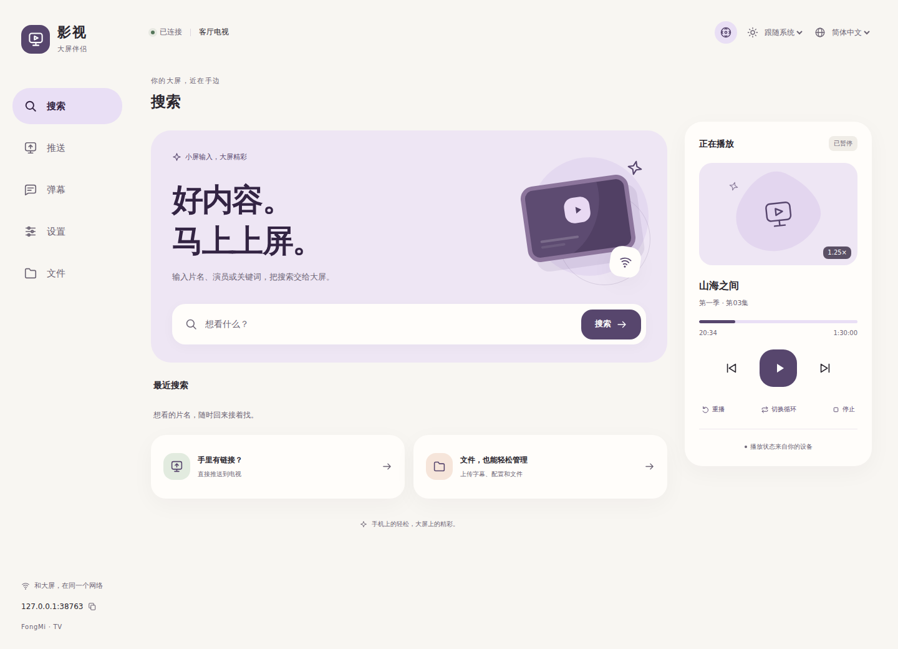
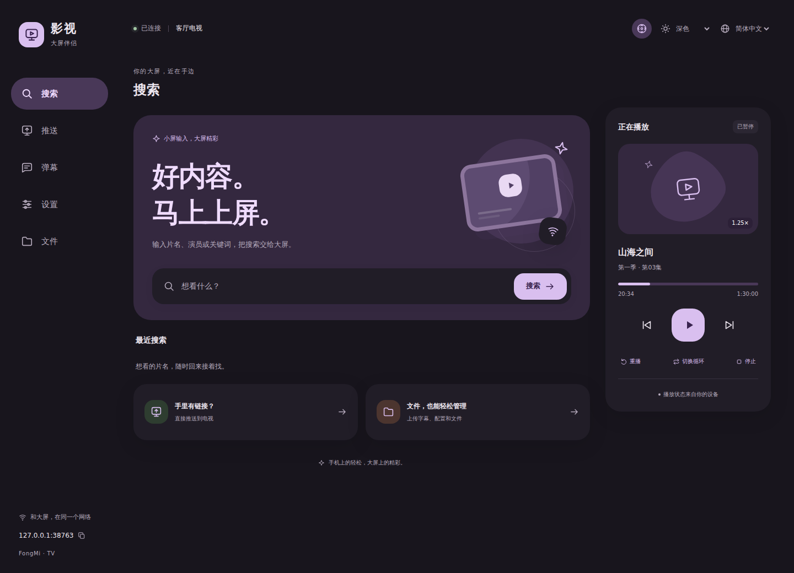
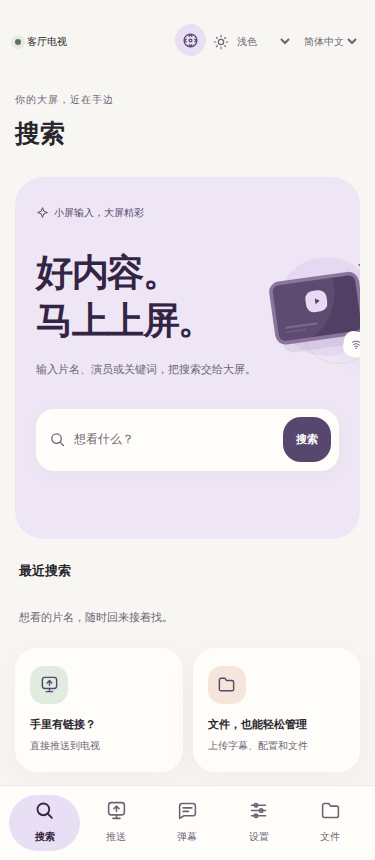
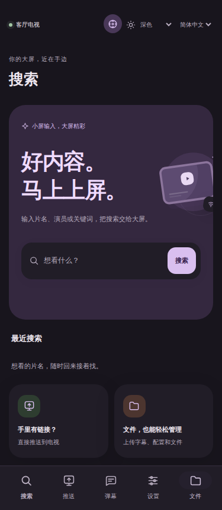
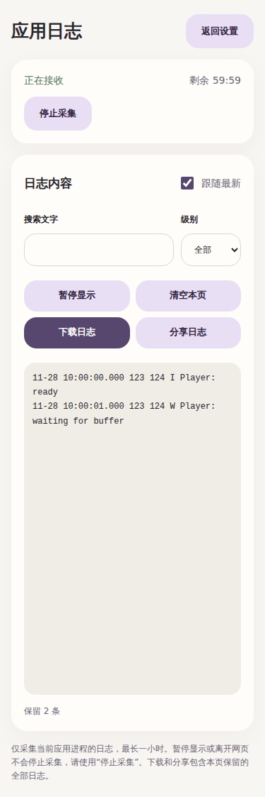
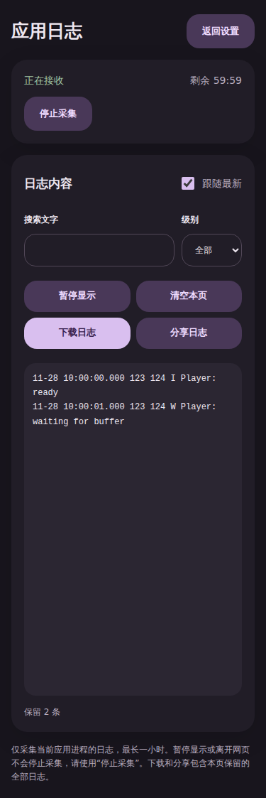

# 大屏伴侣网页

在应用中打开推送页，用手机扫描二维码，或在同一局域网的浏览器中输入页面显示的地址。网页由应用自身提供，资源随 APK 内置，使用时不需要加载远程脚本、字体或组件库。

## 外观与语言

界面按 Material 3 Expressive 的色彩角色、圆角与交互规范设计。浅色使用暖白与浅紫表面，深色保留对应的层次与对比度；外观可选择跟随系统、浅色或深色。桌面使用侧边导航，手机使用底部导航，页面支持缩放、键盘和减少动态效果设置。

默认语言为简体中文，可切换繁体中文或英文。外观和语言只保存在当前浏览器，切换语言保留正在输入的内容与已连接的设备名称。

以下截图使用受控浏览器示例，展示同一套内置网页；播放标题和设备名由实际设备返回。

| 桌面浅色 | 桌面深色 |
| --- | --- |
|  |  |

| 手机浅色 | 手机深色 |
| --- | --- |
|  |  |

## 功能

| 入口 | 行为 |
| --- | --- |
| 搜索 | 发送片名、演员或关键词，让当前设备打开搜索。Enter 可以提交。 |
| 推送 | 发送播放链接或分享内容，由设备沿用当前播放流程处理。多行输入可使用 Ctrl／Cmd＋Enter 提交。 |
| 正在播放 | 读取设备返回的标题、进度、倍速和状态，提供播放／暂停、上一集／下一集、重播、循环和停止。没有正在播放的内容时，播放控制不可用。 |
| 遥控器 | 页面右上角打开方向键、确认、返回、菜单和数字键；键盘方向键也可使用。仅向应用当前有焦点的窗口或对话框发送完整点按。 |
| 弹幕 | 发送一条弹幕，可选择位置、字号与颜色。 |
| 设置 | 向设备发送配置地址或设置内容，支持可选名称；也可打开应用日志。配置内容不加入浏览器的搜索／推送记录。 |
| 文件 | 浏览目录、按名称筛选、上传／下载、新建文件夹、重命名、移动和删除。字幕文件可加载到设备，视频文件可推送播放。 |

搜索和推送各保留最近 8 条成功发送记录，可以单独清空。上传显示当前请求的进度；操作失败会保留输入并允许重试。删除需要确认；重命名或移动遇到已有同名目标时拒绝覆盖，移动目录到自身内部也会拒绝。

既有二维码 `?tab=1` 到 `?tab=5` 分别定位搜索、推送、弹幕、设置、文件，旧地址继续可用。

## 应用日志

打开网页 **设置 → 应用日志** 即开始接收当前应用进程的 logcat。支持文字与级别筛选、跟随最新、暂停／恢复显示、清空本页、下载和分享。语言与外观沿用伴侣网页的选择；返回设置后，原来的五个导航入口和二维码参数保持兼容。

- 每次采集最长一小时；“停止采集”立即结束当前共享会话并清除设备端缓存。其他已连接的日志页会显示采集结束，可重新采集。
- 暂停显示时仍接收日志；网页进入后台时暂停轮询，回到前台继续。离开网页不会停止设备端采集。
- 设备最多保留 5,000 行／2 MiB，单行最多 16 KiB；浏览器最多保留 5,000 行／512 KiB。较早内容被覆盖时显示提示。清空本页不清理系统日志，也不重放已经接收的内容。
- 下载／分享包含本页保留的全部日志，不受当前筛选或暂停显示影响；浏览器不支持文件分享时改为下载。日志只留在内存，不写入浏览器本地存储。
- 此页显示原始应用日志，可能包含来源输出的地址等内容；与设备端“诊断”导出的脱敏 ZIP 是两个入口，不自动开启诊断包采集。Android 对当前应用可读取的日志范围仍有限制。

| 手机浅色 | 手机深色 |
| --- | --- |
|  |  |

## 二维码

应用生成的二维码使用当前主题的背景和高对比度码点。浅色页面使用深色码点；深色使用对应的浅色码点。完整静区保留在图片内，定位图形使用可扫描的圆角方形。手机版内置扫码同时接受正常和反色二维码。来源直接提供的二维码图片不改变颜色。

## 文件与遥控接口

原有 `/action`、`/media`、`/file` 和 `/upload` 接口继续使用，补充以下接口：

| 方法与路径 | 参数 | 行为 |
| --- | --- | --- |
| `POST /rename` | `path`、`name` | 更改文件或目录的名称，保留内容。 |
| `POST /move` | `path`、`target` | 移动到已有目标目录，保留原名称。 |
| `POST /remote/key` | `key`、可选 `action=press` | 发送 `up/down/left/right/ok/back/menu/0…9` 的完整点按。 |

文件路径相对于应用的共享存储根目录；`target` 是目标目录，空字符串代表根目录。文件操作拒绝越界路径、同名覆盖、移动根目录及目录自移，返回对应的 400／403／404／409 错误。遥控窗口不可用返回 409，应用忙碌返回 503；排队操作等待最多 2 秒，超时移除，避免稍后误点击。带浏览器 Origin 的请求需要同源。

## 日志接口

| 方法与路径 | 参数 | 行为 |
| --- | --- | --- |
| `POST /log` | `Content-Type: application/json`、请求体 `{}` | 开始或连接当前会话，返回 `code`。 |
| `GET /log` | 请求头 `X-Log-Code`、可选查询参数 `after` | 返回递增序号的 `lines`、下次游标 `next`、积压 `backlog`、缺失 `gap` 和剩余时间 `remainingMillis`。每批最多 200 行／64 KiB。 |
| `DELETE /log` | 请求头 `X-Log-Code` | 停止对应会话。 |

响应禁止缓存；带 Origin 的请求须同源，读取和停止均验证会话码。无效游标返回 400、会话码错误返回 403、采集结束返回 410。日志接口不改动既有 `/diagnostics/download` 的下载令牌与有效期。

## 验证与参考

浏览器回归覆盖简体／繁体／英文、主题保存、375／768／1440 宽度、表单协议、失败重试、键盘和对话框焦点、文件名及路径编码、上传、移动／重命名／删除确认和遥控。原生回归覆盖二维码真实像素与解码、浅深色切换、推送页截图及应用窗口的实际遥控键处理。文件接口测试通过真实 HTTP 服务验证碰撞、路径边界和并发操作。

参考 [FongMi/TV](https://github.com/FongMi/TV/tree/4512b4c9f82534ff66acfde06ccdd68f35b074f0) 的网页功能和接口，遥控窗口派发保留对应来源说明；项目沿用 GPL-3.0 许可证。网页资源按 [Material 3 Expressive](https://m3.material.io/blog/building-with-m3-expressive)、[色彩角色](https://m3.material.io/styles/color/roles) 与 [动态效果](https://m3.material.io/styles/motion/overview/how-it-works) 实现。

网页日志采集与有界轮询改编自 [FongMi/TV e296b5905](https://github.com/FongMi/TV/tree/e296b5905ddb2ba34914f55c205b8cfb92279bc6)，沿用 GPL-3.0。本地适配使用现有主题、简繁英偏好与独立日志入口，限定当前进程，并在 HTTP 服务停止时销毁采集进程。最新验证与图标前后对照见 [2026-11-28 网页日志验证](testing/reports/2026-11-28-web-logs/README.md)。
